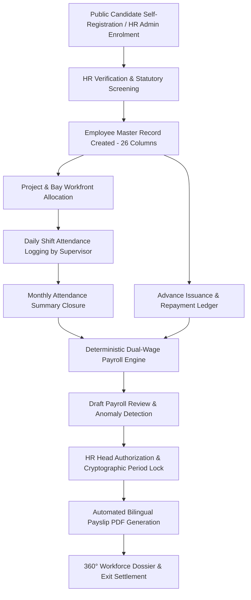
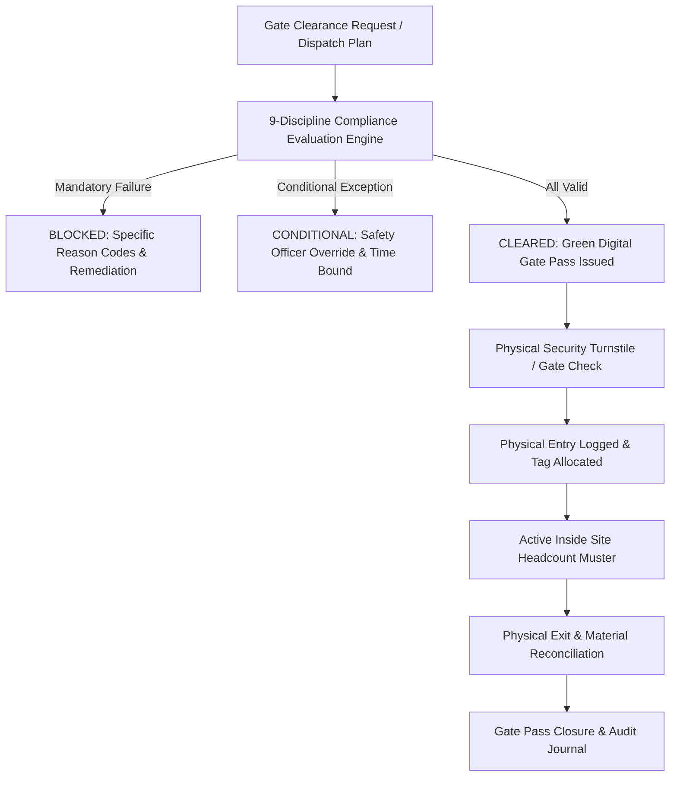
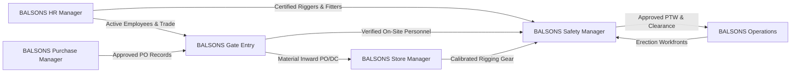

# BALSONS MULTI-PORTAL ENTERPRISE ECOSYSTEM
# DOCUMENT 01 — PORTAL-WISE PROJECT & FUNCTIONAL SPECIFICATIONS
## GREENFIELD MASTER ENGINEERING SPECIFICATION: BALSONS HR MANAGER & GATE ENTRY PORTALS

**Document Identifier:** `BAL-ENG-SPEC-01-GREENFIELD-V1.0`  
**Governing Standard:** BALSONS Standard Architecture Model (`SAM-2026`) & BFast Enterprise Design System (`BEDS V2.0`)  
**Enterprise Entity:** BALSONS Heavy Lift & Shift  
**Anchor Project:** Jupiter Tatravagonka Railwheel Factory (JTRWF), Khordha, Odisha  
**Engineering Mandate:** **100% GREENFIELD IMPLEMENTATION** — Designed, architected, and built from zero as an independent, fully owned BALSONS enterprise solution without dependency on legacy code, previous implementations, or third-party infrastructure.

---

## 1. GREENFIELD ARCHITECTURAL FOUNDATION & ENTERPRISE CONTEXT

### 1.1 Executive Mandate
This engineering specification defines the complete functional, operational, and business architecture for two core operational portals of the BALSONS enterprise suite:
1. **BALSONS HR & DUAL-WAGE PAYROLL MANAGER PORTAL**
2. **BALSONS JTRWF GATE ENTRY & SITE ACCESS PORTAL**

Both systems are engineered as brand-new, cloud-native enterprise web applications under direct BALSONS corporate tenancy. They operate autonomously with independent operational data stores while participating in real-time, bi-directional data exchange orchestrated by the **BALSONS Central Sync Hub**.

### 1.2 Operating Environment: JTRWF Khordha
The operational anchor is the heavy engineering and railwheel manufacturing plant of **Jupiter Tatravagonka Railwheel Factory (JTRWF)** at Khordha, Odisha. Key operational realities governing system requirements include:
* Erection of massive industrial machinery: 600 MT crawler cranes, 1000 MT hydraulic presses, heavy wheel-press assembly lines, and multi-axle hydraulic pullers.
* High-risk workforce: Highly skilled permanent engineers, site supervisors, daily-wage riggers, certified crane operators, and specialist subcontractors.
* Dual-wage workforce composition: Daily-wage contract technicians requiring day-by-day attendance calculations, alongside monthly salaried engineering staff with statutory benefits.
* High-frequency perimeter movements: Inward raw steel, wheel axles, calibrated rigging gear, returnable tools/tackles (RGP), non-returnable scrap dispatches (NRGP), and heavy transporters.
* Rigorous statutory compliance: Strict adherence to the Factories Act, Contract Labour (Regulation and Abolition) Act, Building & Other Construction Workers (BOCW) Act, EPF, ESIC, Minimum Wages Act, and Odisha State Labor Welfare policies.

---

## 2. PORTAL 1 — BALSONS HR & DUAL-WAGE PAYROLL MANAGER

### 2.1 Mission, Objectives & Scope
The **BALSONS HR Manager Portal** provides an end-to-end, zero-defect personnel management, attendance verification, advance recovery, and dual-wage payroll processing system.

### 2.2 Core Modules & Submodules Breakdown

#### Module 1: Employee Master & Candidate Onboarding Wizard
* **Dual Onboarding Pathways:**
  1. *Administrative Direct Enrolment:* Full onboarding executed by the HR Head or authorized administrator.
  2. *Candidate Self-Registration Wizard:* A 6-step responsive, bilingual (English & Hindi) onboarding wizard allowing prospective workers to submit demographic, trade, and statutory credentials via site kiosks or mobile devices.
* **The Authoritative 26-Column Master Data Schema:**
  Every employee record is bound to the following immutable 26-column specification:
  1. `EmpID`: Primary Key, formatted as `EMP-2026-XXXX`, generated via atomic mutex counter.
  2. `FullName`: Mandatory, capitalized, 3–100 characters.
  3. `FatherName`: Mandatory, capitalized, 3–100 characters.
  4. `DOB`: ISO Date `YYYY-MM-DD` (Validation: candidate must be $\ge 18$ years of age).
  5. `Gender`: Coded as `M` (Male), `F` (Female), `O` (Other).
  6. `BloodGroup`: Medical safety classification (`A+`, `A-`, `B+`, `B-`, `AB+`, `AB-`, `O+`, `O-`).
  7. `Mobile`: 10-digit Indian cellular number (`^[6-9]\d{9}$`).
  8. `EmergencyContact`: Contact name and primary phone number.
  9. `PermanentAddress`: Residential address with 6-digit PIN code.
  10. `SiteCampAddress`: Local Khordha/Bhubaneswar camp or quarters address.
  11. `Department`: Foreign key to `DEPARTMENT_MASTER` (Rigging, Erection, Safety, Mechanical, Admin, Stores).
  12. `Designation`: Job title (e.g. Master Rigger, Heavy Crane Operator, Safety Steward, Site Engineer).
  13. `Trade`: Technical specialization (e.g. Hydraulic Jacking, Heavy Slit Fitting, High-Tension Rigging).
  14. `WageType`: Classification: `DAILY_PAY` (Daily Wage) or `MONTHLY` (Salaried Staff).
  15. `DailyRateOrCTC`: Daily wage rate in INR or Monthly CTC in INR (restricted visibility).
  16. `JoiningDate`: ISO Date `YYYY-MM-DD`.
  17. `PF_Applicable`: Boolean (`TRUE` for Monthly, `FALSE` for daily-wage contractor exemptions).
  18. `ESIC_Applicable`: Boolean (`TRUE` for eligible Monthly staff, `FALSE` for daily-wage).
  19. `PAN_No`: 10-digit alphanumeric (`^[A-Z]{5}[0-9]{4}[A-Z]{1}$`), masked in non-admin views.
  20. `Aadhaar_No`: 12-digit UIDAI number (`^\d{12}$`), strictly masked as `XXXXXXXX1234`.
  21. `PoliceVerification_Ref`: Background verification reference code and issuing police station.
  22. `MedicalFitness_Ref`: Annual Form-32 medical examination and vertigo clearance reference.
  23. `BankAccNo`: Bank account number, masked in general views as `XXXXXXXX5678`.
  24. `BankIFSC`: 11-digit bank code (`^[A-Z]{4}0[A-Z0-9]{6}$`).
  25. `PhotoUrl`: Cloud storage URI for candidate portrait (CR80 ID card standard).
  26. `Status`: Lifecycle status (`ACTIVE`, `INACTIVE`, `EXITED`, `SUSPENDED`).

#### Module 2: Project, Site & Department Master Allocation
* **Department Master:** Centralizes organizational cost centres, department heads (HODs), and operational approval hierarchies.
* **Project Allocation:** Assigns personnel to specific erection bays (e.g., JTRWF Bay 1 Press Pit, Gantry Track 3, Heavy Yard B).
* **Supervisor Scoping:** Shift supervisors are strictly restricted to managing attendance for employees actively allocated to their assigned project bay.

#### Module 3: Dual-Wage Workforce Attendance Management
* **Dual Wage Classification Logic:**
  1. **DAILY_PAY Workforce:**
     - Earnings Basis: Calculated strictly on physical present days (`att.present`).
     - Weekly Off (WO) and Paid Leave (PL) are non-compensable unless specifically authorized by site management.
     - Statutory Deductions: Zero PF and ESIC deductions (governed under contractor statutory labor exemption certificates).
  2. **MONTHLY Salaried Workforce:**
     - Earnings Basis: Calculated on total *Payable Days* $= \text{Present} + \text{WO} + \text{PL}$.
     - Full statutory deductions apply: Provident Fund (12% of Basic, capped at ₹1,800/month or actual), ESIC (0.75% of Gross if Gross $\le$ ₹21,000), and Professional Tax (Odisha slab: ₹200).
* **Deterministic Zero-Attendance Rule:**
  - If an employee has zero recorded attendance (`att.present === 0`), gross earnings are deterministically ₹0.
  - The system strictly forbids auto-defaulting absent workers to 26 days.

#### Module 4: Overtime (OT) Governance Engine
* **OT Tracking:** Recorded per worker, shift, date, and task reference.
* **Calculation Formulas:**
  - Daily Wage OT:
    $$\text{HourlyRate} = \frac{\text{DailyRate}}{8}, \quad \text{OT Pay} = \text{HourlyRate} \times 2.0 \times \text{OT Hours}$$
  - Monthly Salaried OT (where eligible):
    $$\text{HourlyRate} = \frac{\text{BasicPay}}{208}, \quad \text{OT Pay} = \text{HourlyRate} \times 2.0 \times \text{OT Hours}$$
* **Safety Threshold:** Overtime exceeding 2 hours per shift requires digital authorization from the Safety Officer.

#### Module 5: Leave Management & Statutory Holidays
* **Categories:** Casual Leave (CL), Sick Leave (SL), Paid Privilege Leave (PL), and Compensatory Off (CO).
* **Validation:** Prevents double-booking (an employee cannot be recorded as both Present and on Leave on the same calendar day).
* **Ledger Tracking:** Live accrual, deductions, and leave balance reconciliation.

#### Module 6: Employee Advance & Loan Recovery Ledger
* **Advance Issuance Register:** Records Advance ID, disbursement date, principal loan amount, agreed monthly recovery instalment, and voucher reference.
* **Non-Negative Pay Guard:**
  - If an employee's gross earnings for a given month are less than the scheduled advance recovery, the deduction is automatically capped to $(\text{GrossEarnings} - \text{StatutoryDeductions})$, and the remaining balance is rolled forward.
  - Net pay cannot fall below ₹0.
* **Reconciliation Equation:**
  $$\text{ClosingBalance} = \text{OpeningBalance} + \text{NewAdvances} - \text{MonthlyRecoveries}$$

#### Module 7: Deterministic Payroll Processing Engine
* **Execution Workflow:**
  1. HR Head selects Pay Period (e.g. `2026-11`).
  2. Engine compiles verified attendance, effective wage structures, active loans, and ad-hoc allowances.
  3. Executes deterministic calculation in memory.
  4. Generates an in-memory **Exception and Anomaly Report** highlighting:
     - Workers with 0 attendance.
     - Workers with missing wage structures.
     - Advance recoveries exceeding net earnings.
     - Gross rate variances $> 15\%$ over prior pay runs.
  5. Upon executive review, HR Head authorizes the batch with a digital PIN.
  6. Atomic insertion into `PAYROLL_REGISTER` and `ADVANCE_RECOVERY`. The period is locked (`Status = 'LOCKED'`).

#### Module 8: Digital Payslips & Identity Passes (CR80 & A4)
* **Payslips:** Generates individual and batch PDF payslips featuring BALSONS enterprise branding, bilingual field headers, comprehensive earnings/deductions breakdown, net pay in numbers and words, and unique QR verification code.
* **CR80 Identification Cards:** Generates ISO/IEC 7810 ID-1 standard identity passes ($85.60 \times 53.98\text{ mm}$) featuring employee portrait, blood group, trade, emergency contact, barcode, and digital verification QR code linking to the live workforce dossier.

#### Module 9: Workforce 360° Digital Dossier
* **Unified Profile Modal:** Consolidates Employee Master, Medical Fitness, Vertigo Clearance, Safety Induction status, Gate Entry history, active PTW permits, Issued Tools, and Payroll history into an interactive 360° dossier.

#### Module 10: Exit Settlement & Gratuity Calculator
* **Exit Lifecycle:** Exit request $\rightarrow$ Clearance Checklist (Store tools return, Gate pass surrender, Advance recovery) $\rightarrow$ Gratuity and Leave Encashment calculation $\rightarrow$ Final Net Pay approval and employee status transition to `EXITED`.

---

### 2.3 Screen-Wise Functional & Validation Specifications

#### Screen HR-01: Employee Master & Directory (`#tab-employees`)
* **Components:** Filterable data table, KPI summary cards (Total Workforce, Active Daily, Active Monthly, Exited), search by Name/ID/Trade/Department, Export to CSV/PDF, Quick Action buttons (View Dossier, Edit Record, Deactivate).
* **Fields & Validations:**
  | Field Name | Type | Validation Rule | Error Message |
  | :--- | :--- | :--- | :--- |
  | `FullName` | Text | `^[A-Za-z\s]{3,100}$` | "Enter valid full name (letters only, min 3 chars)" |
  | `DOB` | Date | Age $\ge 18$ years | "Candidate must be at least 18 years old" |
  | `Mobile` | Text | `^[6-9]\d{9}$` | "Enter valid 10-digit Indian mobile number" |
  | `Aadhaar_No`| Text | `^\d{12}$` | "Aadhaar must be exactly 12 digits" |
  | `PAN_No` | Text | `^[A-Z]{5}[0-9]{4}[A-Z]{1}$` | "Enter valid 10-character PAN format" |
  | `BankIFSC` | Text | `^[A-Z]{4}0[A-Z0-9]{6}$` | "Enter valid 11-character IFSC code" |

#### Screen HR-02: Public Candidate Onboarding Wizard (`register.html`)
* **Step 1: Basic Demographics:** Name, Father's Name, DOB, Gender, Blood Group, Mobile.
* **Step 2: Residential Addresses:** Permanent address with PIN code, Site camp address.
* **Step 3: Trade & Deployment:** Department, Designation, Trade, Experience level.
* **Step 4: Statutory Credentials:** Aadhaar, PAN, Bank Details (Acc No, IFSC, Bank Name).
* **Step 5: Document Uploads:** Candidate Photo (camera capture or file), Aadhaar front/back, Bank passbook scan.
* **Step 6: Declaration & Digital Signature:** Terms acceptance, OTP verification (or supervisor endorsement), submission confirmation with temporary Reference ID (`REG-2026-XXXX`).

#### Screen HR-03: Attendance Register & Summary (`#tab-attendance`)
* **Components:** Monthly calendar matrix, Daily grid, Department dropdown, Project selector, Quick fill buttons (Present, WO, Absent), Lock Period button.
* **Validation:** Sum of $(\text{Present} + \text{WO} + \text{PL} + \text{Absent}) \le \text{Days in Month}$. Overtime hours cannot exceed 8 hours per shift without safety authorization.

#### Screen HR-04: Advance & Loan Management (`#tab-advances`)
* **Components:** Active Loan Ledger table, Issue New Advance modal, Monthly Recovery projection, Anomaly alert banner.
* **Validations:** New advance cannot exceed $3 \times \text{Monthly CTC}$ or $45 \times \text{Daily Wage}$ without Director approval. Monthly recovery cannot exceed 50% of monthly base earnings.

#### Screen HR-05: Payroll Execution Console (`#tab-payroll`)
* **Components:** Pay Period selector (`YYYY-MM`), Workforce filter, "Run Dry Calculation" button, Anomaly Detection grid, "Authorize & Lock Payroll" modal with PIN confirmation, Batch Payslip PDF generator.
* **Execution Guard:** Authorize button is disabled if critical anomalies (missing rates, duplicate entries) remain unresolved.

---

### 2.4 User Roles & Permission Matrix (HR Portal)

| Functional Capability | Super Admin (`admin`) | HR Head (`hr.head`) | Payroll Officer (`payroll.off`) | Work Supervisor (`sup.ramesh`) | Employee (`self`) |
| :--- | :---: | :---: | :---: | :---: | :---: |
| View Employee Directory | Full | Full | Masked PII | Masked (Assigned) | Self Profile Only |
| Create / Edit Employee | Yes | Yes | No | No | No |
| Approve Candidate Registration | Yes | Yes | No | No | No |
| Log Daily Attendance | Yes | Yes | Yes | Yes (Assigned) | No |
| Close & Lock Attendance Period | Yes | Yes | No | No | No |
| Issue Advance / Loan | Yes | Yes | Review Only | No | No |
| Calculate Payroll (Dry Run) | Yes | Yes | Yes | No | No |
| Lock & Authorize Payroll Run | Yes | Yes | No | No | No |
| View / Export Bank NEFT Sheet | Yes | Yes | Masked | No | No |
| Generate & Download Payslips | Yes | Yes | Yes | No | Own Payslip Only |
| Final Settlement Approval | Yes | Yes | Review Only | No | No |

---

## 3. PORTAL 2 — BALSONS JTRWF GATE ENTRY & SITE ACCESS PORTAL

### 3.1 Mission, Objectives & Scope
The **BALSONS Gate Entry & Site Access Portal** governs all physical and commercial traffic across the perimeter gates of the JTRWF Khordha plant. It executes automated safety pre-clearance evaluation, records physical pedestrian and vehicle entry/exit, manages serialized Material Returnable and Non-Returnable Gate Passes (RGP/NRGP), tracks heavy rigging equipment mobilization, and maintains real-time on-site emergency muster headcount.

### 3.2 Core Modules & Submodules Breakdown

#### Module 1: Personnel & Contractor Master Data
* **Contractor Directory:** Maintains primary contractor profiles, scope of work, project manager contacts, workmen compensation insurance validity, and commercial compliance status.
* **Personnel Register:** Unified registry of workers, drivers, technicians, client representatives, and temporary visitors. Captures trade category, photo, employer link, and emergency contact.

#### Module 2: Police & Background Verification Register
* **Verification Registry:** Tracks certificate reference, issuing police station/district, issue date, validity window (typically 1 year), and status.
* **Rule:** Any unverified personnel attempting access to sensitive work zones (e.g. Substation, Press Pit) triggers an automated **BLOCKED** state.

#### Module 3: Medical Fitness & Vertigo Height Clearance
* **General Fitness:** Annual Form-32 medical examination records, blood pressure, eyesight, and general fitness clearance.
* **Specialized Vertigo Clearance:** Mandatory for all personnel assigned to erection work at heights $> 1.8\text{ meters}$. Height work without verified vertigo clearance is automatically **BLOCKED** with zero override authority granted to security guards.

#### Module 4: Statutory Insurance, Training & Competency
* **Insurance Register:** Validates active workmen compensation and third-party liability insurance coverage for all contractor personnel.
* **Competency Certifications:** Rigging, scaffolding, heavy crane operation (Class HMV/Crane), electrical safety, and confined space entry certifications.

#### Module 5: PPE Compliance & Daily Toolbox Talk (TBT) Briefing
* **Mandatory PPE Matrix:** Verification of Helmet, Steel-Toe Safety Shoes, High-Visibility Vest, Leather Rigging Gloves, and Safety Eyewear.
* **TBT Linkage:** Verifies that personnel have attended the daily site safety induction and specific shift briefing before physical badge swipe.

#### Module 6: Work Package Safety Documentation Register
* **Required Documentation:** Risk Assessment (RA), Job Safety Analysis (JSA), Method Statement (MS), and Approved Heavy Lift Plans.
* **Validation:** Material dispatch or equipment mobilization cannot enter site front without an active approved Work Package reference code.

#### Module 7: Heavy Equipment, Cranes & Rigging Tackle Register
* **Machinery Master:** Hydraulic mobile cranes, crawler cranes, multi-axle trailers, aerial work platforms (boom lifts), and forklifts.
* **Inspection & Certification:** Form 11 statutory testing records, Third-Party Inspection (TPI) agency certificates, Safe Working Load (SWL) capacity, and periodic maintenance records.

#### Module 8: Chemical & Hazardous Substance SDS Register
* **Hazardous Materials:** Industrial gases (Oxygen, Acetylene, Argon), hydraulic oils, solvents, and structural paints.
* **Compliance:** Safety Data Sheet (SDS) availability, UN hazard class validation, approved storage bunker designation, and spill-kit availability.

#### Module 9: Heavy Vehicles, Drivers & Transporter Clearance
* **Vehicle Master:** Registration number, vehicle class, commercial fitness certificate, Pollution Under Control (PUC) certificate, and commercial insurance.
* **Driver Validation:** Commercial driving licence verification, site speed limit adherence acknowledgement, and breath-analyser record linkage.

#### Module 10: 9-Discipline Automated Gate Clearance Engine
The Clearance Engine evaluates 9 independent compliance disciplines server-side:
1. `IDENTITY_VALIDITY`: Valid photo ID, unexpired registration.
2. `POLICE_VERIFICATION`: Valid background check for category.
3. `MEDICAL_FITNESS`: General medical examination unexpired.
4. `VERTIGO_HEIGHT_CLEARANCE`: Valid if task involves height/lifting.
5. `INSURANCE_ACTIVE`: Workmen compensation policy valid.
6. `COMPETENCY_CERTIFIED`: Skill certifications match trade.
7. `PPE_COMPLIANCE`: Verified PPE checklist active.
8. `WORK_DOCUMENTATION`: Active RA/JSA/Method Statement reference.
9. `EQUIPMENT_FITNESS`: Vehicle/equipment Form 11 / PUC valid.

**Decision Engine Outputs:**
* **CLEARED (Green):** All 9 disciplines satisfied. Physical entry authorized.
* **CONDITIONAL (Amber):** Non-critical item pending (e.g. general visitor without height work), temporary escort required, authorized strictly by Safety Manager with time limit ($< 4\text{ hours}$).
* **BLOCKED (Red):** Critical statutory or safety failure (expired crane Form 11, missing vertigo clearance, no insurance). Entry strictly blocked.

#### Module 11: Physical Gate Entry & Exit Turnstile Logging
* **Separation of Pre-Clearance & Physical Entry:** Pre-clearance evaluates eligibility; physical logging records the actual moment an entity crosses the perimeter.
* **Logging Details:** Direction (`IN` / `OUT`), Gate Number (Gate 1 Heavy Vehicle, Gate 2 Personnel Turnstile), Security Guard ID, allocated plant bay, and vehicle odometer reading where applicable.

#### Module 12: Material Inward & Gate Pass Center (RGP / NRGP)
* **Material Inward:** Logs vendor delivery consignments against approved Purchase Orders (PO) or Delivery Challans (DC). Records carrier vehicle, weight slip reference, and material quarantine status.
* **Returnable Gate Pass (RGP):** Issued for tools, calibrated instruments, test rigs, and motors sent off-site for calibration/repair. Enforces strict return-due dates with automated overdue escalation.
* **Non-Returnable Gate Pass (NRGP):** Issued for scrap steel, discarded packing, completed client components, and consumable deliveries. Requires dual authorization (Owner / Commercial Head + Safety Manager) before physical exit dispatch.

#### Module 13: Emergency Roll-Call & Headcount Radar
* **Real-Time On-Site Headcount:** Instantaneous tally of all personnel currently inside the perimeter by contractor, bay, and zone.
* **Emergency Evacuation Muster:** Single-click export of the active headcount ledger to the Safety Officer’s mobile device for roll-call reconciliation at designated assembly points.

---

### 3.3 Screen-Wise Functional & Validation Specifications

#### Screen GE-01: Live Gate Dashboard & Clearance Radar (`#tab-dashboard`)
* **Components:** Real-time KPI cards (Personnel On Site, Heavy Equipment In Yard, Vehicles In Transit, Overdue Passes), Search clearance by QR or Registration No, Live Entry/Exit Stream table, Emergency Muster button.

#### Screen GE-02: Pre-Clearance Request & Evaluation (`#tab-clearance`)
* **Components:** Requestor submission form, 9-discipline compliance indicator lights, Automated clearance evaluation output box, Override Request modal.
* **Validations:** Request cannot be submitted without selecting Subject Type (`PERSONNEL`, `VEHICLE`, `EQUIPMENT`) and Target Bay.

#### Screen GE-03: Material Inward Register (`#tab-inward`)
* **Components:** Inward Consignment form, PO/DC verification field, Transporter details, Unloading Bay selector, Store Delivery Handover status.
* **Validation Rule:** Mandatory either `poNumber` or `dcNumber`. If both are blank, form submission is blocked.

#### Screen GE-04: Gate Pass Center (RGP / NRGP) (`#tab-gatepass`)
* **Components:** Pass creation form, Itemized table (Description, Quantity, Serial No, Return Due Date), Approver endorsement, Exit dispatch button, Return reconciliation modal.
* **Lifecycle Guard:** Physical exit dispatch button is disabled until `ApprovalStatus === 'APPROVED'`.

---

### 3.4 User Roles & Permission Matrix (Gate Entry Portal)

| Functional Capability | Owner / Admin (`admin`) | Safety Manager (`safety.manager`) | Safety Team / Gate Officer (`safety.team`) |
| :--- | :---: | :---: | :---: |
| User Admin & Role Management | Yes | No | No |
| Contractor & Vehicle Master CRUD | Yes | Yes | Create / View Only |
| Evaluate Gate Clearance | Yes | Yes | View / Trigger Engine |
| Authorize Clearance Override | Yes | Yes (Conditional) | No |
| Log Physical Entry / Exit | Yes | Yes | Yes (Primary Duty) |
| Create Gate Pass (RGP/NRGP) | Yes | Yes | Yes |
| Approve Gate Pass | Yes | Yes | No |
| Dispatch Physical Exit (Gate Pass) | Yes | No | Yes (Physical Check) |
| Log Material Inward Consignment | Yes | Yes | Yes |
| Access Emergency Evacuation Radar | Yes | Yes | Yes |
| Export Tamper-Evident Audit Logs | Yes | Yes | No |

---

## 4. CROSS-PORTAL INTEGRATION & DEPENDENCY ARCHITECTURE

### 4.1 Enterprise Interdependency Matrix
The BALSONS ecosystem functions as a synchronized operational web where actions in one portal directly govern transactions in another:

### 4.2 Data Ownership & Systems of Record
* **Employee Identity & Wage Rules:** Solely owned by **BALSONS HR Manager**. Gate Entry and Safety consume read-only snapshots.
* **Perimeter Access & Consignment Receipts:** Solely owned by **BALSONS Gate Entry**. Store and Safety query clearance status.
* **Permit to Work (PTW) & Job Safety Clearance:** Solely owned by **BALSONS Safety Manager**.
* **Rigging Tackles & Physical Tools:** Solely owned by **BALSONS Store Manager** (Offline-First `BALSONS_STORE_DB` + Central Sync).
* **Commercial Purchase Orders:** Solely owned by **BALSONS Purchase Manager**.
* **Heavy Erection Work Packages:** Solely owned by **BALSONS Operations Manager**.

---

## 5. GREENFIELD ACCEPTANCE CRITERIA & VERIFICATION TEST MATRICES

### 5.1 HR Manager Acceptance Criteria (HRP-001 through HRP-024)

| Test ID | Test Category | Execution Precondition | Expected System Contract |
| :--- | :--- | :--- | :--- |
| **HRP-001** | Platform Launch | HTTPS load on modern browser | Renders BEDS light-mode UI, no console errors, topbar sync pill initialized |
| **HRP-002** | Apps Script API | Valid HTTPS POST payload | Backend responds with valid JSON envelope, `success: true`, IST timestamp |
| **HRP-003** | Auth Enforcement | Unauthenticated API mutation call | Request rejected with HTTP 401 `UNAUTHORIZED` |
| **HRP-004** | Role Scoping | Supervisor requests HR salary sheet | Returns HTTP 403 `FORBIDDEN` or masks CTC/Daily Rate columns |
| **HRP-005** | Atomic ID Creation | 10 concurrent registrations | Generates 10 sequential unique IDs (`EMP-2026-0001`..`0010`) via LockService |
| **HRP-006** | Table 5 Extraction | Fetch employee record | All 26 fields correctly mapped without index shift or dropped statutory data |
| **HRP-007** | Deterministic Pay | Daily worker with 0 present days | Gross pay is exactly ₹0. Base earned is ₹0. No fallback to 26 days |
| **HRP-008** | Missing Wage Guard| Daily worker with null daily rate | Pay run halts for worker, logs `MISSING_WAGE_STRUCTURE` in exception report |
| **HRP-009** | Advance Cap | Gross earnings < Scheduled recovery| Advance deduction capped to Net Gross; balance rolls forward without negative pay |
| **HRP-010** | Monthly Salary | Monthly worker, CTC ₹40,000 | Basic ₹20,000, HRA ₹10,000, Site ₹10,000, PF ₹1,800, PT ₹200 correctly calculated |
| **HRP-011** | ESIC Threshold | Monthly worker, Gross ₹18,000 | ESIC calculated at $0.75\% = ₹135$. Gross > ₹21,000 yields ₹0 ESIC |
| **HRP-012** | Overtime Pay | Daily rigger, Rate ₹900, 10h OT | Hourly ₹112.50, OT Pay $= 112.50 \times 2.0 \times 10 = ₹2,250$ |
| **HRP-013** | Period Lock | Attempt edit on locked pay period | Mutation rejected with 400 `PAYROLL_PERIOD_LOCKED` |
| **HRP-014** | Payslip PDF | Individual payslip generation | Valid PDF stream generated with corporate header, earnings, and verification QR |
| **HRP-015** | PII Masking | Non-HR user views Aadhaar/Bank | Aadhaar displayed as `XXXXXXXX1234`, Bank Acc as `XXXXXXXX5678` |
| **HRP-016** | Self-Service View | Logged in as `self` employee | Can access own payslips and profile only; cannot view peer records |
| **HRP-017** | Document Drive | Candidate uploads statutory scan | Staged to restricted Google Drive vault; URL saved in `EMPLOYEE_DOCUMENTS` |
| **HRP-018** | Exit Settlement | Employee exit marked | Clearance checklist verified; gratuity/leave encashed; ID disabled |
| **HRP-019** | Tamper Journal | Perform employee modification | Audit row added with SHA-256 hash chaining to previous entry |
| **HRP-020** | Dual Sync Outbox | Offline attendance modification | Mutation queued in `localStorage` outbox; flushed to Google Sheet upon reconnection |
| **HRP-021** | Anomaly Detection| Pay run with duplicate attendance | Flagged in exception report prior to authorization |
| **HRP-022** | Concurrency Lock | 2 users approve payroll simultaneously| LockService serializes requests; 2nd user receives `ALREADY_PROCESSED` |
| **HRP-023** | Disaster Recovery | Restore spreadsheet from backup | Primary keys unique; row count matches backup audit manifest |
| **HRP-024** | Version Rollback | Revert frontend commit via Git | Application operates seamlessly with backward-compatible API schema |

---

### 5.2 Gate Entry Acceptance Criteria (JGE-001 through JGE-027)

| Test ID | Test Category | Execution Precondition | Expected System Contract |
| :--- | :--- | :--- | :--- |
| **JGE-001** | Platform Launch | HTTPS load on modern browser | Renders Gate dashboard, BEDS theme, live stream table, zero console errors |
| **JGE-002** | Backend Linkage | Apps Script API ping | Returns 200 OK with server version and IST timestamp |
| **JGE-003** | Auth Dev Key Purge| POST with invalid token | Rejects with 401 `INVALID_OR_REVOKED_TOKEN`; zero backdoor access |
| **JGE-004** | Role Guard | `safety.team` attempts user creation| Request rejected with 403 `FORBIDDEN_INSUFFICIENT_ROLE` |
| **JGE-005** | Identity Check | Register personnel without ID | Blocked: Mandatory Govt ID type and reference required |
| **JGE-006** | Police Verif Block| Unverified worker in high-risk zone| Engine sets status to `BLOCKED` with reason `MISSING_POLICE_VERIFICATION` |
| **JGE-007** | Vertigo Clearance | Rigger assigned to lifting without vertigo | Engine outputs `BLOCKED` for height work; entry restricted to ground duties |
| **JGE-008** | Insurance Expiry | Expired workmen compensation policy | All contractor workforce clearance requests blocked |
| **JGE-009** | Competency Match | Crane operator with light vehicle licence | Clearance engine blocks equipment mobilization |
| **JGE-010** | 9-Discipline Engine| All 9 requirements valid | Engine outputs `CLEARED`, generates digital clearance certificate |
| **JGE-011** | Emergency Override| Safety Manager executes override | Requires mandatory justification, sets 4-hour expiry, logs to audit journal |
| **JGE-012** | Non-Waivable Block| Attempt override on missing vertigo | Engine rejects override: statutory safety rules cannot be waived |
| **JGE-013** | Physical Entry Log| Security Guard swipes cleared ID | Creates entry in `GATE_ENTRY_EXIT_LOG`; updates on-site headcount $+1$ |
| **JGE-014** | Double Entry Guard| Swipe ID already inside site | System alerts `ALREADY_INSIDE`; blocks duplicate entry without recorded exit |
| **JGE-015** | Physical Exit Log | Personnel exits site | Records exit timestamp; decrements on-site headcount $-1$ |
| **JGE-016** | Material Inward | Inward truck arrives with PO | Validates PO in `MATERIAL_INWARD_REGISTER`; flags Store for physical receipt |
| **JGE-017** | RGP Creation | Returnable tool sent for calibration| Creates `RGP-2026-XXXX` with return-due date; status `PENDING_APPROVAL` |
| **JGE-018** | RGP Approval | Safety Manager approves RGP | Status updates to `APPROVED`; allows security exit dispatch |
| **JGE-019** | RGP Premature Exit| Security attempts exit on draft RGP| Blocked: `PASS_NOT_APPROVED`; exit cannot be recorded |
| **JGE-020** | RGP Return Log | Calibrated tool returns to gate | Security inspects tool condition; logs return; pass marked `RETURNED` |
| **JGE-021** | NRGP Exit Closure | Non-returnable scrap dispatch | Dispatched by security; automatically transitions to `CLOSED` |
| **JGE-022** | Overdue RGP Alert | RGP return date exceeded | Highlighted in amber on dashboard; sends notification to requestor |
| **JGE-023** | Crane Form 11 Exp | Heavy crane with expired Form 11 | Engine blocks gate entry; logs critical safety violation |
| **JGE-024** | Emergency Muster | Click "Emergency Evacuation Radar"| Instantaneous PDF/CSV roster of all on-site personnel generated |
| **JGE-025** | Topbar Link Check | Click topbar "Database" link | Opens verified production Gate spreadsheet (not clasp script ID) |
| **JGE-026** | Audit Hash Chain | Query `AUDIT_LOG` | Every transaction possesses cryptographically verified hash chain |
| **JGE-027** | Dual Sync Auto-Poll| Wait 30 seconds on gate dashboard | Countdown chip cycles; auto-triggers background parity sync without freeze |

---

## 6. NON-FUNCTIONAL REQUIREMENTS & GOVERNANCE STANDARDS

### 6.1 Performance & Latency Targets
* **Page Load & First Contentful Paint (FCP):** $< 1.2\text{ seconds}$ on 4G mobile broadband connections.
* **API Transaction Latency:** $< 600\text{ ms}$ for standard queries; $< 1,200\text{ ms}$ for transactional mutations under LockService concurrency control.
* **Dual Sync Overhead:** Background auto-sync must execute asynchronously without freezing the DOM or interrupting user input.

### 6.2 Availability, Offline Tolerance & Fault Recovery
* **Platform Availability:** $99.95\%$ platform SLA.
* **Offline-First Resilience:** In the event of temporary site network failure, all critical inspection and attendance forms must cache transactions in browser local storage (`beds_pending_mutations_queue`) and automatically flush upon network restoration.
* **Zero Data Loss Guarantee:** No transaction is confirmed to the user unless successfully written to the local encrypted queue or verified by a 200 OK server response.

### 6.3 Security, Privacy & Statutory Compliance
* **Transport Security:** Strict HTTPS (TLS 1.3) across all frontend and API endpoints.
* **Statutory Privacy:** PII data (Aadhaar, PAN, Bank Details) must be masked in memory before rendering in client views.
* **Tamper-Evident Accountability:** Every administrative action, password change, approval override, and clearance decision is journaled with SHA-256 hash chaining.
