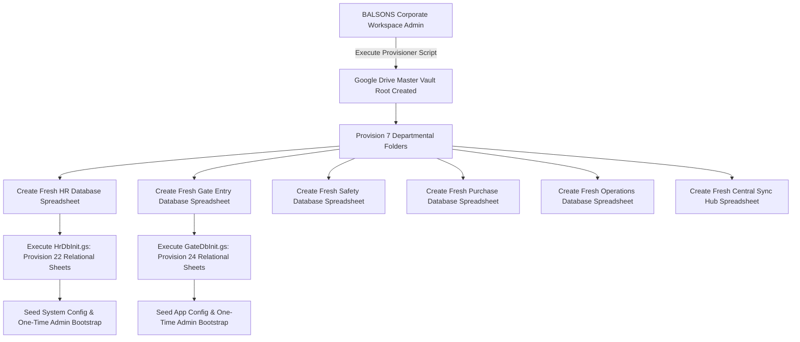

# BALSONS MULTI-PORTAL ENTERPRISE ECOSYSTEM
# DOCUMENT 02 — DATABASE ARCHITECTURE & AUTOMATED INITIALIZATION
## GREENFIELD DATABASE ARCHITECTURE, AUTOMATED REPOSITORY PROVISIONING, SCHEMA INITIALIZERS & CRYPTOGRAPHIC LEDGER SPECIFICATION

**Document Identifier:** `BAL-ENG-SPEC-02-GREENFIELD-V1.0`  
**Governing Standard:** BALSONS Standard Architecture Model (`SAM-2026`) & Relational Sheets Engine V2.0  
**Database Engines:** Google Sheets Enterprise Relational Engine · Browser-Local IndexedDB (`BALSONS_STORE_DB`) · Google Drive Master Evidence Vault  
**Enterprise Entity:** BALSONS Heavy Lift & Shift  
**Anchor Project:** Jupiter Tatravagonka Railwheel Factory (JTRWF), Khordha, Odisha  
**Engineering Mandate:** **100% GREENFIELD INITIALIZATION** — Zero reliance on pre-existing spreadsheets, legacy schemas, or third-party accounts. All databases, schemas, initial seeds, and security configurations are provisioned dynamically from zero under strict BALSONS ownership.

---

## 1. GREENFIELD DATABASE PROVISIONING ARCHITECTURE

### 1.1 Automated Cloud Infrastructure & Database Provisioning
In a greenfield deployment, the engineering team executes automated scripts to provision dedicated Google Sheets databases within a fresh BALSONS Google Workspace corporate organization:



### 1.2 Automated Database Generation Script (`ProvisionEnterpriseDatabases.gs`)
The following script dynamically generates the operational spreadsheets in the target Google Drive directory and records their IDs into Google Apps Script `PropertiesService`:

```javascript
/**
 * BALSONS ENTERPRISE GREENFIELD PROVISIONER
 * Generates fresh operational spreadsheets from scratch under BALSONS corporate Drive.
 */

function provisionEnterpriseDatabases() {
  var rootFolderName = 'BALSONS_ENTERPRISE_SYSTEM_MASTER_VAULT';
  var rootFolders = DriveApp.getFoldersByName(rootFolderName);
  var rootFolder = rootFolders.hasNext() ? rootFolders.next() : DriveApp.createFolder(rootFolderName);

  var portals = [
    { code: 'HR', name: 'BALSONS_HR_PAYROLL_DATABASE_MASTER', propKey: 'HR_SPREADSHEET_ID' },
    { code: 'GATE', name: 'BALSONS_GATE_ENTRY_DATABASE_MASTER', propKey: 'GATE_SPREADSHEET_ID' },
    { code: 'SAFETY', name: 'BALSONS_SAFETY_DATABASE_MASTER', propKey: 'SAFETY_SPREADSHEET_ID' },
    { code: 'PURCHASE', name: 'BALSONS_PURCHASE_DATABASE_MASTER', propKey: 'PURCHASE_SPREADSHEET_ID' },
    { code: 'OPERATIONS', name: 'BALSONS_OPERATIONS_DATABASE_MASTER', propKey: 'OPERATIONS_SPREADSHEET_ID' },
    { code: 'SYNCHUB', name: 'BALSONS_CENTRAL_SYNC_HUB_DATABASE', propKey: 'SYNCHUB_SPREADSHEET_ID' }
  ];

  var provisionedMap = {};

  portals.forEach(function(p) {
    var ss = SpreadsheetApp.create(p.name);
    var file = DriveApp.getFileById(ss.getId());
    file.moveTo(rootFolder);
    PropertiesService.getScriptProperties().setProperty(p.propKey, ss.getId());
    provisionedMap[p.code] = { name: p.name, id: ss.getId(), url: ss.getUrl() };
    Logger.log('Provisioned ' + p.name + ' -> ID: ' + ss.getId());
  });

  return {
    success: true,
    rootFolderId: rootFolder.getId(),
    databases: provisionedMap
  };
}
```

---

## 2. BALSONS HR MANAGER DATABASE ARCHITECTURE (22 RELATIONAL SHEETS)

### 2.1 Complete Relational Schema & Column Dictionaries

#### Sheet 1: `SYSTEM_CONFIG`
* **Purpose:** Global application constants, statutory wage ceilings, working hours, and operational switches.
* **Columns:** `['ConfigKey', 'ConfigValue', 'Description', 'EffectiveDate', 'UpdatedBy']`
* **Primary Key:** `ConfigKey`

#### Sheet 2: `USER_ACCESS`
* **Purpose:** User authentication, RBAC credentials, and assigned project scopes.
* **Columns:** `['UserID', 'Username', 'FullName', 'Role', 'PasswordHash', 'Salt', 'IsActive', 'AssignedProjects']`
* **Primary Key:** `UserID` (e.g. `USR-HR-001`)

#### Sheet 3: `EMPLOYEE_MASTER` (Authoritative 26-Column Specification)
* **Purpose:** Authoritative single source of truth for all BALSONS personnel.
* **Columns:**
  1. `EmpID` (PK, String `EMP-2026-XXXX`)
  2. `FullName` (String, NOT NULL)
  3. `FatherName` (String, NOT NULL)
  4. `DOB` (ISO Date `YYYY-MM-DD`, NOT NULL)
  5. `Gender` (String `M` / `F` / `O`)
  6. `BloodGroup` (String `A+`, `A-`, `B+`, `B-`, `AB+`, `AB-`, `O+`, `O-`)
  7. `Mobile` (String 10 Digits)
  8. `EmergencyContact` (String)
  9. `PermanentAddress` (String)
  10. `SiteCampAddress` (String)
  11. `Department` (FK `DEPARTMENT_MASTER.DeptName`)
  12. `Designation` (String)
  13. `Trade` (String)
  14. `WageType` (String `DAILY_PAY` / `MONTHLY`, NOT NULL)
  15. `DailyRateOrCTC` (Decimal, NOT NULL)
  16. `JoiningDate` (ISO Date `YYYY-MM-DD`)
  17. `PF_Applicable` (Boolean `TRUE` / `FALSE`)
  18. `ESIC_Applicable` (Boolean `TRUE` / `FALSE`)
  19. `PAN_No` (String 10 Chars, Masked)
  20. `Aadhaar_No` (String 12 Digits, Masked)
  21. `PoliceVerification_Ref` (String)
  22. `MedicalFitness_Ref` (String)
  23. `BankAccNo` (String, Masked)
  24. `BankIFSC` (String 11 Chars)
  25. `PhotoUrl` (String Cloud Storage URL)
  26. `Status` (String `ACTIVE` / `INACTIVE` / `EXITED` / `SUSPENDED`)

#### Sheet 4: `EMPLOYEE_DOCUMENTS`
* **Purpose:** Statutory evidence, KYC scans, certificates, and ID card photos.
* **Columns:** `['DocID', 'EmpID', 'DocType', 'DocRefNo', 'IssueDate', 'ExpiryDate', 'VerificationStatus', 'DriveUrl']`

#### Sheet 5: `DEPARTMENT_MASTER`
* **Purpose:** Operational departments, cost centres, and designated HODs.
* **Columns:** `['DeptID', 'DeptName', 'CostCentre', 'HOD', 'Status']`

#### Sheet 6: `PROJECT_MASTER`
* **Purpose:** Active erection sites, client accounts, and project managers.
* **Columns:** `['ProjectCode', 'ProjectName', 'Client', 'Location', 'ProjectManager', 'StartDate', 'Status']`

#### Sheet 7: `EMPLOYEE_ALLOCATION`
* **Purpose:** Historical and active deployment of personnel to specific project bays.
* **Columns:** `['AllocID', 'EmpID', 'ProjectCode', 'AreaBay', 'EffectiveFrom', 'EffectiveTo', 'Status']`

#### Sheet 8: `ATTENDANCE_DAILY`
* **Purpose:** Daily shift attendance transactions entered by site supervisors.
* **Columns:** `['DailyID', 'Date', 'EmpID', 'ProjectCode', 'StatusCode', 'OT_Hours', 'Shift', 'SupervisorID']`

#### Sheet 9: `ATTENDANCE_SUMMARY`
* **Purpose:** Monthly aggregated attendance totals locked for payroll consumption.
* **Columns:** `['SummaryID', 'PayPeriod', 'EmpID', 'WageType', 'PresentDays', 'WeeklyOff', 'PaidLeave', 'PayableDays', 'OT_Hours', 'Status']`

#### Sheet 10: `LEAVE_MASTER`
* **Purpose:** Statutory leave categories, annual allotments, and encashment rules.
* **Columns:** `['LeaveCode', 'LeaveName', 'AnnualEntitlement', 'CarryForwardLimit', 'Status']`

#### Sheet 11: `LEAVE_TRANSACTIONS`
* **Purpose:** Leave requests, date windows, approvals, and balance debits.
* **Columns:** `['LeaveTransID', 'EmpID', 'LeaveCode', 'FromDate', 'ToDate', 'DaysCount', 'ApprovalStatus', 'ApprovedBy']`

#### Sheet 12: `SALARY_STRUCTURE`
* **Purpose:** Employee-specific wage components and historical rate changes.
* **Columns:** `['SalaryID', 'EmpID', 'WageType', 'EffectiveFrom', 'DailyRate', 'BasicPay', 'HRA', 'SiteAllowance', 'SpecialAllowance', 'Status']`

#### Sheet 13: `ADVANCE_MASTER`
* **Purpose:** Principal loan registry, monthly repayment schedules, and outstanding balances.
* **Columns:** `['AdvanceID', 'EmpID', 'IssueDate', 'TotalAmount', 'MonthlyRecovery', 'TotalRecovered', 'Balance', 'ApprovedBy', 'Status']`

#### Sheet 14: `ADVANCE_RECOVERY`
* **Purpose:** Monthly payroll ledger deductions applied against active advances.
* **Columns:** `['RecoveryID', 'AdvanceID', 'PayPeriod', 'DeductedAmount', 'RemainingBalance', 'PayrollRunID']`

#### Sheet 15: `PAYROLL_INPUT`
* **Purpose:** Pre-calculation snapshot capturing attendance, ad-hoc incentives, and approved deductions.
* **Columns:** `['InputID', 'PayPeriod', 'EmpID', 'WageType', 'PayableDays', 'OT_Hours', 'SpecialIncentive', 'AdhocDeduction', 'VerifiedBy']`

#### Sheet 16: `PAYROLL_REGISTER`
* **Purpose:** Authoritative monthly payroll disbursements, statutory deductions, and net pay.
* **Columns:** `['PayrollID', 'PayPeriod', 'EmpID', 'WageType', 'PresentDays', 'PayableDays', 'BaseEarnings', 'Allowances', 'OT_Pay', 'GrossEarnings', 'AdvanceDeduction', 'PF_Deduction', 'ESIC_Deduction', 'PT_Deduction', 'NetPayable', 'Status']`

#### Sheet 17: `SALARY_SLIP_LOG`
* **Purpose:** Historical log of generated PDF salary slips with cryptographic hashes and Drive links.
* **Columns:** `['SlipLogID', 'PayrollID', 'EmpID', 'WageType', 'PayPeriod', 'GeneratedTimestamp', 'Version', 'DriveFileUrl']`

#### Sheet 18: `HR_DOCUMENTS_LOG`
* **Purpose:** Generated appointment letters, identity passes, and statutory service certificates.
* **Columns:** `['LogID', 'DocType', 'EmpID', 'TemplateID', 'IssuedDate', 'ApprovedBy', 'DriveRef']`

#### Sheet 19: `EXIT_SETTLEMENT`
* **Purpose:** Final settlements, clearance verification, gratuity, and advance write-offs.
* **Columns:** `['ExitID', 'EmpID', 'LastWorkingDate', 'ClearanceStatus', 'Gratuity', 'LeaveEncashment', 'AdvanceRecovery', 'FinalNetSettlement', 'ApprovedBy']`

#### Sheet 20: `APPROVAL_LOG`
* **Purpose:** Digital audit trail of supervisory endorsements across attendance, leave, and advances.
* **Columns:** `['ApprovalID', 'Module', 'EntityRef', 'SubmittedBy', 'Action', 'ApproverRole', 'ApproverName', 'Timestamp', 'Comments']`

#### Sheet 21: `AUDIT_LOG`
* **Purpose:** Tamper-evident hash-chained transaction ledger.
* **Columns:** `['AuditID', 'Timestamp', 'Actor', 'Role', 'Action', 'EntityRef', 'Outcome', 'Details', 'PrevHash', 'CurrentHash']`

#### Sheet 22: `BACKUP_LOG`
* **Purpose:** Automated daily Google Drive snapshot execution registry.
* **Columns:** `['BackupID', 'Timestamp', 'BackupType', 'TargetDriveId', 'Status', 'VerifiedBy']`

---

## 3. BALSONS GATE ENTRY PORTAL DATABASE ARCHITECTURE (24 RELATIONAL SHEETS)

### 3.1 Complete Relational Schema & Column Dictionaries

#### Sheet 1: `APP_CONFIG`
* **Columns:** `['ConfigKey', 'ConfigValue', 'Description', 'LastUpdated', 'UpdatedBy']`

#### Sheet 2: `USER_MASTER` (9-Column Frozen Schema)
* **Columns:** `['UserID', 'Username', 'FullName', 'Role', 'PasswordHash', 'Salt', 'IsActive', 'LastLogin', 'CreatedAt']`

#### Sheet 3: `CONTRACTOR_MASTER`
* **Columns:** `['ContractorID', 'CompanyName', 'ContactPerson', 'Mobile', 'Email', 'Scope', 'Status', 'CreatedAt']`

#### Sheet 4: `PERSONNEL_MASTER`
* **Columns:** `['PersonnelID', 'FullName', 'Category', 'ContractorID', 'Trade', 'GovtIDType', 'MaskedGovtID', 'Mobile', 'Status']`

#### Sheet 5: `IDENTITY_VERIFICATION`
* **Columns:** `['VerifID', 'PersonnelID', 'IDType', 'MaskedRef', 'IssuingAuth', 'VerifiedBy', 'VerifDate', 'Status']`

#### Sheet 6: `POLICE_VERIFICATION`
* **Columns:** `['PV_ID', 'PersonnelID', 'PoliceStation', 'CertificateRef', 'IssueDate', 'ExpiryDate', 'Status', 'VerifiedBy']`

#### Sheet 7: `MEDICAL_FITNESS`
* **Columns:** `['MedID', 'PersonnelID', 'ClinicName', 'ExamDate', 'ExpiryDate', 'GeneralFitness', 'VertigoClearance', 'Status']`

#### Sheet 8: `INSURANCE_REGISTER`
* **Columns:** `['InsID', 'ContractorID', 'PolicyType', 'PolicyNo', 'Insurer', 'ValidFrom', 'ValidTo', 'Status']`

#### Sheet 9: `TRAINING_COMPETENCY`
* **Columns:** `['CompID', 'PersonnelID', 'CertificationType', 'CertNo', 'IssuedBy', 'IssueDate', 'ExpiryDate', 'Status']`

#### Sheet 10: `PPE_REGISTER`
* **Columns:** `['PPE_ID', 'PersonnelID', 'Helmet', 'SafetyShoes', 'HiVisVest', 'Gloves', 'EyeProtection', 'VerifiedDate', 'Status']`

#### Sheet 11: `WORK_DOCUMENT_REGISTER`
* **Columns:** `['DocID', 'DocType', 'DocRefNo', 'Revision', 'Workfront', 'ApprovedBy', 'ApprovalDate', 'Status']`

#### Sheet 12: `EQUIPMENT_MASTER`
* **Columns:** `['EquipmentID', 'Description', 'MakeModel', 'SerialNo', 'Owner', 'SWL_Capacity', 'TagNo', 'Status']`

#### Sheet 13: `EQUIPMENT_INSPECTION`
* **Columns:** `['InspID', 'EquipmentID', 'InspectionType', 'CertRef', 'Agency', 'InspectionDate', 'DueDate', 'Status']`

#### Sheet 14: `TOOLS_TACKLES_REGISTER`
* **Columns:** `['TackleID', 'Description', 'SerialNo', 'SWL', 'TPI_Ref', 'Condition', 'TagColor', 'Status']`

#### Sheet 15: `CHEMICAL_SDS_REGISTER`
* **Columns:** `['ChemID', 'MaterialName', 'Manufacturer', 'Quantity', 'HazardClass', 'SDS_Available', 'StorageArea', 'Status']`

#### Sheet 16: `VEHICLE_MASTER`
* **Columns:** `['VehicleID', 'RegistrationNo', 'VehicleType', 'Owner', 'PUC_Expiry', 'FitnessExpiry', 'InsuranceExpiry', 'Status']`

#### Sheet 17: `DRIVER_MASTER`
* **Columns:** `['DriverID', 'DriverName', 'LicenceNo', 'LicenceClass', 'LicenceExpiry', 'Inducted', 'Status']`

#### Sheet 18: `GATE_REQUEST_REGISTER`
* **Columns:** `['RequestID', 'SubjectType', 'SubjectID', 'DeclaredActivity', 'TargetArea', 'RequestDate', 'Status']`

#### Sheet 19: `GATE_CLEARANCE_REGISTER`
* **Columns:** `['ClearanceID', 'RequestID', 'Decision', 'ReasonCodes', 'EvaluatedBy', 'EvaluatedAt', 'ValidityHours']`

#### Sheet 20: `GATE_ENTRY_EXIT_LOG`
* **Columns:** `['LogID', 'ClearanceID', 'SubjectID', 'Direction', 'GateNo', 'Timestamp', 'SecurityGuardID', 'AllocatedBay']`

#### Sheet 21: `EXCEPTION_LOG`
* **Columns:** `['ExceptionID', 'RequestID', 'OverriddenRules', 'Justification', 'ApprovedBy', 'ExpiryTimestamp', 'Status']`

#### Sheet 22: `AUDIT_LOG`
* **Columns:** `['AuditID', 'Timestamp', 'ActorID', 'ActorRole', 'Action', 'EntityID', 'Outcome', 'Details', 'PrevHash', 'CurrentHash']`

#### Sheet 23: `MATERIAL_INWARD_REGISTER`
* **Columns:** `['InwardID', 'InwardType', 'PONumber', 'DCNumber', 'VendorName', 'Transporter', 'VehicleNo', 'MaterialCategory', 'DeclaredQty', 'UnloadingBay', 'GatePassRef', 'StoreStatus', 'SecurityOfficer', 'Timestamp', 'CreatedAt']`

#### Sheet 24: `GATE_PASS_REGISTER`
* **Columns:** `['PassID', 'PassType', 'Consignee', 'VehicleNo', 'DriverName', 'ItemsCount', 'ReturnDueDate', 'Reason', 'ApprovalStatus', 'ApprovedBy', 'ApprovedAt', 'GateStatus', 'ExitedAt', 'ReturnedAt', 'ClosedBy', 'CreatedAt']`

---

## 4. AUTOMATED INITIALIZATION SCRIPTS (`DbInit.gs`)

### 4.1 Greenfield HR Database Initializer

```javascript
/**
 * BALSONS HR MANAGER — GREENFIELD DATABASE INITIALIZER
 * Provisions all 22 relational sheets with enterprise styling.
 */

function initializeFreshHrDatabase(targetSpreadsheetId) {
  var ssId = targetSpreadsheetId || PropertiesService.getScriptProperties().getProperty('HR_SPREADSHEET_ID');
  if (!ssId) throw new Error('HR_SPREADSHEET_ID not configured.');
  var ss = SpreadsheetApp.openById(ssId);

  var SCHEMAS = [
    ['SYSTEM_CONFIG', ['ConfigKey', 'ConfigValue', 'Description', 'EffectiveDate', 'UpdatedBy']],
    ['USER_ACCESS', ['UserID', 'Username', 'FullName', 'Role', 'PasswordHash', 'Salt', 'IsActive', 'AssignedProjects']],
    ['EMPLOYEE_MASTER', ['EmpID', 'FullName', 'FatherName', 'DOB', 'Gender', 'BloodGroup', 'Mobile', 'EmergencyContact', 'PermanentAddress', 'SiteCampAddress', 'Department', 'Designation', 'Trade', 'WageType', 'DailyRateOrCTC', 'JoiningDate', 'PF_Applicable', 'ESIC_Applicable', 'PAN_No', 'Aadhaar_No', 'PoliceVerification_Ref', 'MedicalFitness_Ref', 'BankAccNo', 'BankIFSC', 'PhotoUrl', 'Status']],
    ['EMPLOYEE_DOCUMENTS', ['DocID', 'EmpID', 'DocType', 'DocRefNo', 'IssueDate', 'ExpiryDate', 'VerificationStatus', 'DriveUrl']],
    ['DEPARTMENT_MASTER', ['DeptID', 'DeptName', 'CostCentre', 'HOD', 'Status']],
    ['PROJECT_MASTER', ['ProjectCode', 'ProjectName', 'Client', 'Location', 'ProjectManager', 'StartDate', 'Status']],
    ['EMPLOYEE_ALLOCATION', ['AllocID', 'EmpID', 'ProjectCode', 'AreaBay', 'EffectiveFrom', 'EffectiveTo', 'Status']],
    ['ATTENDANCE_DAILY', ['DailyID', 'Date', 'EmpID', 'ProjectCode', 'StatusCode', 'OT_Hours', 'Shift', 'SupervisorID']],
    ['ATTENDANCE_SUMMARY', ['SummaryID', 'PayPeriod', 'EmpID', 'WageType', 'PresentDays', 'WeeklyOff', 'PaidLeave', 'PayableDays', 'OT_Hours', 'Status']],
    ['LEAVE_MASTER', ['LeaveCode', 'LeaveName', 'AnnualEntitlement', 'CarryForwardLimit', 'Status']],
    ['LEAVE_TRANSACTIONS', ['LeaveTransID', 'EmpID', 'LeaveCode', 'FromDate', 'ToDate', 'DaysCount', 'ApprovalStatus', 'ApprovedBy']],
    ['SALARY_STRUCTURE', ['SalaryID', 'EmpID', 'WageType', 'EffectiveFrom', 'DailyRate', 'BasicPay', 'HRA', 'SiteAllowance', 'SpecialAllowance', 'Status']],
    ['ADVANCE_MASTER', ['AdvanceID', 'EmpID', 'IssueDate', 'TotalAmount', 'MonthlyRecovery', 'TotalRecovered', 'Balance', 'ApprovedBy', 'Status']],
    ['ADVANCE_RECOVERY', ['RecoveryID', 'AdvanceID', 'PayPeriod', 'DeductedAmount', 'RemainingBalance', 'PayrollRunID']],
    ['PAYROLL_INPUT', ['InputID', 'PayPeriod', 'EmpID', 'WageType', 'PayableDays', 'OT_Hours', 'SpecialIncentive', 'AdhocDeduction', 'VerifiedBy']],
    ['PAYROLL_REGISTER', ['PayrollID', 'PayPeriod', 'EmpID', 'WageType', 'PresentDays', 'PayableDays', 'BaseEarnings', 'Allowances', 'OT_Pay', 'GrossEarnings', 'AdvanceDeduction', 'PF_Deduction', 'ESIC_Deduction', 'PT_Deduction', 'NetPayable', 'Status']],
    ['SALARY_SLIP_LOG', ['SlipLogID', 'PayrollID', 'EmpID', 'WageType', 'PayPeriod', 'GeneratedTimestamp', 'Version', 'DriveFileUrl']],
    ['HR_DOCUMENTS_LOG', ['LogID', 'DocType', 'EmpID', 'TemplateID', 'IssuedDate', 'ApprovedBy', 'DriveRef']],
    ['EXIT_SETTLEMENT', ['ExitID', 'EmpID', 'LastWorkingDate', 'ClearanceStatus', 'Gratuity', 'LeaveEncashment', 'AdvanceRecovery', 'FinalNetSettlement', 'ApprovedBy']],
    ['APPROVAL_LOG', ['ApprovalID', 'Module', 'EntityRef', 'SubmittedBy', 'Action', 'ApproverRole', 'ApproverName', 'Timestamp', 'Comments']],
    ['AUDIT_LOG', ['AuditID', 'Timestamp', 'Actor', 'Role', 'Action', 'EntityRef', 'Outcome', 'Details', 'PrevHash', 'CurrentHash']],
    ['BACKUP_LOG', ['BackupID', 'Timestamp', 'BackupType', 'TargetDriveId', 'Status', 'VerifiedBy']]
  ];

  SCHEMAS.forEach(function(item) {
    var sheetName = item[0];
    var headers = item[1];
    var sheet = ss.getSheetByName(sheetName) || ss.insertSheet(sheetName);

    sheet.getRange(1, 1, 1, headers.length).setValues([headers]);
    sheet.getRange(1, 1, 1, headers.length)
      .setBackground('#102D35')
      .setFontColor('#FFFFFF')
      .setFontWeight('bold');
    sheet.setFrozenRows(1);
    sheet.autoResizeColumns(1, headers.length);
  });

  var defSheet = ss.getSheetByName('Sheet1');
  if (defSheet && ss.getSheets().length > 1) ss.deleteSheet(defSheet);

  return { success: true, count: SCHEMAS.length };
}
```

### 4.2 Greenfield Gate Entry Database Initializer

```javascript
/**
 * BALSONS GATE ENTRY — GREENFIELD DATABASE INITIALIZER
 * Provisions all 24 relational sheets with enterprise styling.
 */

function initializeFreshGateDatabase(targetSpreadsheetId) {
  var ssId = targetSpreadsheetId || PropertiesService.getScriptProperties().getProperty('GATE_SPREADSHEET_ID');
  if (!ssId) throw new Error('GATE_SPREADSHEET_ID not configured.');
  var ss = SpreadsheetApp.openById(ssId);

  var SCHEMAS = [
    ['APP_CONFIG', ['ConfigKey', 'ConfigValue', 'Description', 'LastUpdated', 'UpdatedBy']],
    ['USER_MASTER', ['UserID', 'Username', 'FullName', 'Role', 'PasswordHash', 'Salt', 'IsActive', 'LastLogin', 'CreatedAt']],
    ['CONTRACTOR_MASTER', ['ContractorID', 'CompanyName', 'ContactPerson', 'Mobile', 'Email', 'Scope', 'Status', 'CreatedAt']],
    ['PERSONNEL_MASTER', ['PersonnelID', 'FullName', 'Category', 'ContractorID', 'Trade', 'GovtIDType', 'MaskedGovtID', 'Mobile', 'Status']],
    ['IDENTITY_VERIFICATION', ['VerifID', 'PersonnelID', 'IDType', 'MaskedRef', 'IssuingAuth', 'VerifiedBy', 'VerifDate', 'Status']],
    ['POLICE_VERIFICATION', ['PV_ID', 'PersonnelID', 'PoliceStation', 'CertificateRef', 'IssueDate', 'ExpiryDate', 'Status', 'VerifiedBy']],
    ['MEDICAL_FITNESS', ['MedID', 'PersonnelID', 'ClinicName', 'ExamDate', 'ExpiryDate', 'GeneralFitness', 'VertigoClearance', 'Status']],
    ['INSURANCE_REGISTER', ['InsID', 'ContractorID', 'PolicyType', 'PolicyNo', 'Insurer', 'ValidFrom', 'ValidTo', 'Status']],
    ['TRAINING_COMPETENCY', ['CompID', 'PersonnelID', 'CertificationType', 'CertNo', 'IssuedBy', 'IssueDate', 'ExpiryDate', 'Status']],
    ['PPE_REGISTER', ['PPE_ID', 'PersonnelID', 'Helmet', 'SafetyShoes', 'HiVisVest', 'Gloves', 'EyeProtection', 'VerifiedDate', 'Status']],
    ['WORK_DOCUMENT_REGISTER', ['DocID', 'DocType', 'DocRefNo', 'Revision', 'Workfront', 'ApprovedBy', 'ApprovalDate', 'Status']],
    ['EQUIPMENT_MASTER', ['EquipmentID', 'Description', 'MakeModel', 'SerialNo', 'Owner', 'SWL_Capacity', 'TagNo', 'Status']],
    ['EQUIPMENT_INSPECTION', ['InspID', 'EquipmentID', 'InspectionType', 'CertRef', 'Agency', 'InspectionDate', 'DueDate', 'Status']],
    ['TOOLS_TACKLES_REGISTER', ['TackleID', 'Description', 'SerialNo', 'SWL', 'TPI_Ref', 'Condition', 'TagColor', 'Status']],
    ['CHEMICAL_SDS_REGISTER', ['ChemID', 'MaterialName', 'Manufacturer', 'Quantity', 'HazardClass', 'SDS_Available', 'StorageArea', 'Status']],
    ['VEHICLE_MASTER', ['VehicleID', 'RegistrationNo', 'VehicleType', 'Owner', 'PUC_Expiry', 'FitnessExpiry', 'InsuranceExpiry', 'Status']],
    ['DRIVER_MASTER', ['DriverID', 'DriverName', 'LicenceNo', 'LicenceClass', 'LicenceExpiry', 'Inducted', 'Status']],
    ['GATE_REQUEST_REGISTER', ['RequestID', 'SubjectType', 'SubjectID', 'DeclaredActivity', 'TargetArea', 'RequestDate', 'Status']],
    ['GATE_CLEARANCE_REGISTER', ['ClearanceID', 'RequestID', 'Decision', 'ReasonCodes', 'EvaluatedBy', 'EvaluatedAt', 'ValidityHours']],
    ['GATE_ENTRY_EXIT_LOG', ['LogID', 'ClearanceID', 'SubjectID', 'Direction', 'GateNo', 'Timestamp', 'SecurityGuardID', 'AllocatedBay']],
    ['EXCEPTION_LOG', ['ExceptionID', 'RequestID', 'OverriddenRules', 'Justification', 'ApprovedBy', 'ExpiryTimestamp', 'Status']],
    ['AUDIT_LOG', ['AuditID', 'Timestamp', 'ActorID', 'ActorRole', 'Action', 'EntityID', 'Outcome', 'Details', 'PrevHash', 'CurrentHash']],
    ['MATERIAL_INWARD_REGISTER', ['InwardID', 'InwardType', 'PONumber', 'DCNumber', 'VendorName', 'Transporter', 'VehicleNo', 'MaterialCategory', 'DeclaredQty', 'UnloadingBay', 'GatePassRef', 'StoreStatus', 'SecurityOfficer', 'Timestamp', 'CreatedAt']],
    ['GATE_PASS_REGISTER', ['PassID', 'PassType', 'Consignee', 'VehicleNo', 'DriverName', 'ItemsCount', 'ReturnDueDate', 'Reason', 'ApprovalStatus', 'ApprovedBy', 'ApprovedAt', 'GateStatus', 'ExitedAt', 'ReturnedAt', 'ClosedBy', 'CreatedAt']]
  ];

  SCHEMAS.forEach(function(item) {
    var sheetName = item[0];
    var headers = item[1];
    var sheet = ss.getSheetByName(sheetName) || ss.insertSheet(sheetName);

    sheet.getRange(1, 1, 1, headers.length).setValues([headers]);
    sheet.getRange(1, 1, 1, headers.length)
      .setBackground('#102D35')
      .setFontColor('#FFFFFF')
      .setFontWeight('bold');
    sheet.setFrozenRows(1);
    sheet.autoResizeColumns(1, headers.length);
  });

  return { success: true, count: SCHEMAS.length };
}
```

---

## 5. DEFAULT ADMINISTRATOR INITIALIZATION & SEEDING

### 5.1 Cryptographic Password Derivation
Credentials are derived using PBKDF2-HMAC-SHA256 with an individual 16-byte random salt per account:

$$\text{DerivedKey} = \text{PBKDF2-HMAC-SHA256}(\text{Password}, \text{Salt}, \text{Iterations} = 5\,000, \text{KeyLength} = 256\text{ bits})$$

### 5.2 Bootstrap Script (`BootstrapAdminUsers.gs`)

```javascript
/**
 * GREENFIELD ADMINISTRATIVE BOOTSTRAP
 * Provisions root administrative accounts with cryptographic security and mandatory first-login password rotation.
 */

function bootstrapGreenfieldAdmins() {
  var ss = SpreadsheetApp.openById(PropertiesService.getScriptProperties().getProperty('HR_SPREADSHEET_ID'));
  var sheet = ss.getSheetByName('USER_ACCESS');
  if (!sheet) throw new Error('USER_ACCESS missing');

  var admins = [
    { id: 'USR-HR-001', username: 'admin', name: 'Master Super Administrator', role: 'Super Admin', pass: 'Balsons#Admin$2026' },
    { id: 'USR-HR-002', username: 'hr.head', name: 'Prashant Muley', role: 'HR Head', pass: 'Balsons#HrHead$2026' },
    { id: 'USR-HR-003', username: 'payroll.off', name: 'Ananya Das', role: 'Payroll Officer', pass: 'Balsons#Payroll$2026' }
  ];

  var rows = admins.map(function(u) {
    var salt = Utilities.getUuid().replace(/-/g, '').substring(0, 16);
    var hash = computeCryptographicHash(u.pass, salt);
    return [u.id, u.username, u.name, u.role, hash, salt, 'ACTIVE', 'ALL'];
  });

  sheet.getRange(2, 1, rows.length, 8).setValues(rows);
  Logger.log('Provisioned ' + rows.length + ' bootstrap administrators.');
}

function computeCryptographicHash(password, salt) {
  var raw = salt + '|' + password;
  var digest = Utilities.computeDigest(Utilities.DigestAlgorithm.SHA_256, raw, Utilities.Charset.UTF_8);
  return digest.map(function(b) {
    var v = (b < 0 ? b + 256 : b).toString(16);
    return v.length === 1 ? '0' + v : v;
  }).join('');
}
```

---

## 6. TAMPER-EVIDENT HASH-CHAINED AUDIT LOGGING

### 6.1 Cryptographic Chain Formulation
To satisfy statutory non-repudiation, every database transaction is journaled with a SHA-256 hash chaining to the previous row:

$$\text{CurrentHash}_n = \text{SHA-256}\Big(\text{SeqNo}_n \parallel \text{PrevHash}_{n-1} \parallel \text{Timestamp}_n \parallel \text{Actor}_n \parallel \text{Role}_n \parallel \text{Action}_n \parallel \text{EntityRef}_n \parallel \text{Outcome}_n \parallel \text{Details}_n\Big)$$

### 6.2 Verification Procedure (`verifyAuditIntegrity.gs`)

```javascript
/**
 * TAMPER-EVIDENT AUDIT INTEGRITY AUDITOR
 * Iterates through AUDIT_LOG and verifies cryptographic hash continuity.
 */

function verifyAuditIntegrity(spreadsheetId) {
  var ss = SpreadsheetApp.openById(spreadsheetId);
  var sheet = ss.getSheetByName('AUDIT_LOG');
  if (!sheet) return { success: false, reason: 'AUDIT_LOG not found' };

  var data = sheet.getDataRange().getValues();
  if (data.length <= 1) return { success: true, count: 0, message: 'Log is empty' };

  var prevHash = 'GENESIS_HASH_BALSONS_2026';
  for (var i = 1; i < data.length; i++) {
    var row = data[i];
    var auditId = row[0];
    var timestamp = row[1];
    var actor = row[2];
    var role = row[3];
    var action = row[4];
    var entityRef = row[5];
    var outcome = row[6];
    var details = row[7];
    var recordedPrevHash = row[8];
    var recordedCurrentHash = row[9];

    if (recordedPrevHash !== prevHash) {
      return {
        tampered: true,
        violationRow: i + 1,
        auditId: auditId,
        reason: 'Broken Hash Chain. Expected PrevHash: ' + prevHash + ', Found: ' + recordedPrevHash
      };
    }

    var payload = [auditId, prevHash, timestamp, actor, role, action, entityRef, outcome, details].join('|');
    var calculatedHash = computeCryptographicHash(payload, 'AUDIT_SALT_2026');

    if (calculatedHash !== recordedCurrentHash) {
      return {
        tampered: true,
        violationRow: i + 1,
        auditId: auditId,
        reason: 'Content Tampering Detected. Hash Mismatch at row ' + (i + 1)
      };
    }

    prevHash = recordedCurrentHash;
  }

  return { success: true, verifiedRows: data.length - 1, status: 'ALL_ROWS_CRYPTO_VERIFIED' };
}
```

---

## 7. BACKUP, DISASTER RECOVERY & ARCHIVAL SPECIFICATIONS

### 7.1 Automated Snapshot Schedule
* **Trigger:** Daily Time-Driven Trigger executing at 01:00 AM IST.
* **Storage Location:** Google Drive Enterprise Vault, `07_SYSTEM_ADMIN_AND_BACKUPS/DATABASE_SNAPSHOTS`.
* **Retention Policy:**
  - Daily snapshots retained for 30 days.
  - Monthly statutory snapshots retained for 7 years.

### 7.2 Disaster Recovery Procedure
1. Locate target timestamped snapshot in `DATABASE_SNAPSHOTS`.
2. Verify SHA-256 integrity checksum.
3. Re-link target Spreadsheet ID in Google Apps Script `PropertiesService`.
4. Run `verifyAuditIntegrity()` to certify data validity prior to opening production access.
