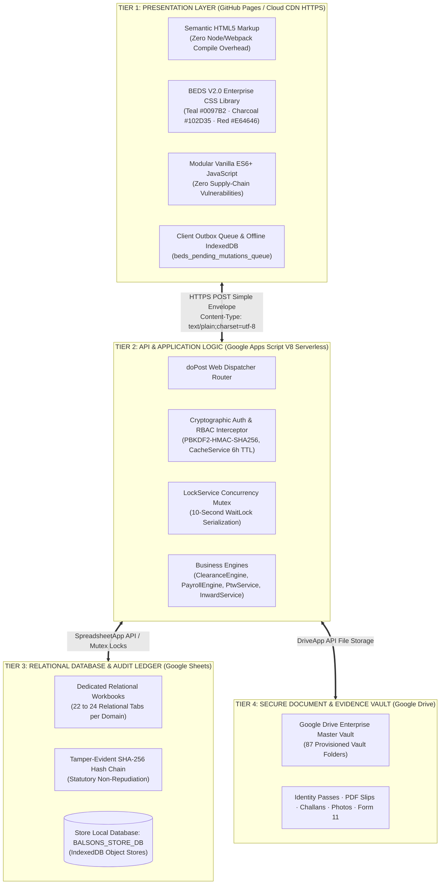
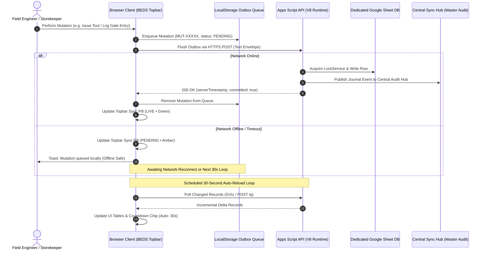

# BALSONS MULTI-PORTAL ENTERPRISE ECOSYSTEM
# DOCUMENT 03 — COMPLETE TECHNICAL ARCHITECTURE & ENTERPRISE INTEGRATION
## GREENFIELD TECHNICAL ARCHITECTURE, CENTRAL SYNC HUB (DUAL SYNC) & ENTERPRISE INTEGRATION SPECIFICATION

**Document Identifier:** `BAL-ENG-SPEC-03-GREENFIELD-V1.0`  
**Governing Standard:** BALSONS Standard Architecture Model (`SAM-2026`) & Central Sync Hub Engine V2.0  
**Ecosystem Scope:** All 6 Operational Portals (Safety, Store, HR, Gate Entry, Purchase, Operations) + Central Enterprise Launcher  
**Enterprise Entity:** BALSONS Heavy Lift & Shift  
**Anchor Project:** Jupiter Tatravagonka Railwheel Factory (JTRWF), Khordha, Odisha  
**Engineering Mandate:** **100% GREENFIELD ARCHITECTURE & INTEGRATION** — Completely fresh, independent technical implementation without legacy code dependencies, third-party infrastructure baggage, or deprecated endpoints.

---

## 1. GREENFIELD TECHNICAL STACK & 4-TIER SERVERLESS ARCHITECTURE

### 1.1 The Locked 4-Tier Serverless Model (`SAM-2026`)
The BALSONS Enterprise Ecosystem is engineered on a resilient, high-speed, serverless architecture specifically chosen to eliminate build fragility, eliminate server OS management, and deliver instant sub-second response times across industrial workfronts:



### 1.2 Technology Stack Justification

| Layer | Technology Choice | Engineering Advantage |
| :--- | :--- | :--- |
| **Hosting & CDN** | GitHub Pages / Cloud CDN | Zero server operating overhead, automated SSL/TLS, global high-availability CDN. |
| **Styling & UI** | BEDS V2.0 CSS Tokens | Native CSS variables, zero bundle bloat, responsive high-contrast industrial ergonomics. |
| **Client Scripting** | Vanilla ES6+ JavaScript | Zero build/compile fragility, instant execution on low-spec site tablets/phones. |
| **Backend API** | Google Apps Script (V8 Runtime) | Serverless execution, auto-scaling, native Google Workspace domain security. |
| **Database Engine** | Google Sheets Relational Engine | Relational multi-tab data structures, formula rollups, direct management auditability. |
| **Local Persistence** | Browser IndexedDB | High-frequency offline tool checkout without server latency dependencies. |
| **Evidence Storage** | Google Drive Enterprise Storage | Secure restricted folder trees (87 provisioned vaults), granular permissions, auto-backup. |
| **Concurrency Lock** | Apps Script `LockService` | Atomic mutex serialization preventing race conditions during payroll or gate movements. |
| **Session Cache** | Apps Script `CacheService` | In-memory ephemeral bearer tokens with strict 6-hour TTL and instant eviction. |

---

## 2. GREENFIELD SOURCE-CODE REPOSITORY LAYOUT

```
balsons-enterprise/
├── assets/                                      # Shared BEDS Core Foundation
│   ├── css/beds.css                             # Unified BEDS design tokens & styling
│   ├── js/
│   │   ├── beds-workspace.js                    # Enterprise Topbar, Sync Hub & Dual Sync Engine
│   │   ├── beds-superadmin.js                   # Master Super Admin console & governance
│   │   ├── beds-portal-login.js                 # Unified split-screen login modal & backdrop
│   │   ├── balsons-sam-auth.js                  # Shared SAM-2026 client auth helper
│   │   └── qrcode.min.js                        # Zero-dependency QR generation engine
│   └── images/                                  # High-definition domain covers & brand marks
│       ├── balsons-logo.png                     # Standard BALSONS identity mark
│       ├── login-gate.jpg                       # Gate Entry split-screen cover
│       ├── login-hr.jpg                         # HR Manager split-screen cover
│       ├── login-safety.jpg                     # Safety Manager split-screen cover
│       ├── login-store.jpg                      # Store Manager split-screen cover
│       ├── login-operations.jpg                 # Operations split-screen cover
│       └── login-purchase.jpg                   # Purchase split-screen cover
│
├── index.html                                   # Central Enterprise Launcher & Directory
│
├── BALSONS HR MANAGER/                          # HR & Dual-Wage Payroll Portal
│   ├── apps-script/                             # Fresh Backend Container
│   │   ├── appsscript.json                      # Timezone: Asia/Kolkata
│   │   ├── Code.gs                              # API router with strict auth check
│   │   ├── DbInit.gs                            # 22-sheet relational initializer
│   │   ├── EmployeeService.gs                   # 26-column master data & onboarding
│   │   └── PayrollEngine.gs                     # Deterministic dual-wage payroll engine
│   └── frontend/
│       ├── index.html                           # Single-page HR management app
│       ├── register.html                        # 6-step candidate self-onboarding wizard
│       └── assets/js/app.js                     # HR client, attendance, and payroll logic
│
├── BALSONS GATE ENTRY MANAGER/                  # Gate Entry & Turnstile Access Portal
│   ├── apps-script/                             # Fresh Backend Container
│   │   ├── appsscript.json                      # Timezone: Asia/Kolkata
│   │   ├── Code.gs                              # API router with session validation
│   │   ├── AuthService.gs                       # Cryptographic auth & lockout
│   │   ├── DbInit.gs                            # 24-sheet relational initializer
│   │   ├── MasterDataService.gs                 # Personnel, contractor & vehicle master
│   │   ├── ClearanceEngine.gs                   # 9-discipline compliance decision engine
│   │   └── GateTransactionService.gs            # Material inward & RGP/NRGP passes
│   └── frontend/
│       ├── index.html                           # Gate entry dashboard & turnstile monitor
│       └── assets/js/app.js                     # Gate client, scan loop, and modal logic
│
├── BALSONS SAFETY MANAGER/                      # Safety, HSE & PTW Governance
│   ├── apps-script/Code.gs                      # Safety dispatcher & PTW engine
│   └── frontend/index.html                      # Safety dashboard & permit interface
│
├── BALSONS STORE MANAGER/                       # Store & Rigging Tool Master
│   └── frontend/index.html                      # Offline-first IndexedDB tool manager
│
├── BALSONS PURCHASE MANAGER/                    # Commercial PO & Procurement
│   └── index.html                               # Procurement workbench & PO generator
│
├── BALSONS OPERATIONS MANAGER/                  # Heavy Erection & Lift Planning
│   └── index.html                               # Erection schedule & workfronts
│
└── BALSONS REPOTS PORTAL/                       # Central Sync Hub & Master Reporting
    └── index.html                               # Consolidated cross-portal reporting
```

---

## 3. GREENFIELD AUTHENTICATION & SECURITY ARCHITECTURE

### 3.1 Zero-Trust Principles
The greenfield architecture eliminates all development backdoors, hardcoded strings, and client-side password length checks from day one:
* Zero hardcoded credentials committed to source repositories.
* Zero client-side role validation: All access rights are validated server-side on every request.
* Zero opaque requests: `mode: 'no-cors'` is strictly forbidden. All API endpoints return validated JSON payloads.

### 3.2 Cryptographic Key Derivation Standard
Passwords are salted and derived using PBKDF2-HMAC-SHA256:

$$\text{DerivedKey} = \text{PBKDF2-HMAC-SHA256}(\text{Password}, \text{Salt}, \text{Iterations} = 5\,000, \text{KeyLength} = 256\text{ bits})$$

* **Salt Generation:** 16-byte cryptographically secure random hexadecimal string generated via `Utilities.computeDigest`.
* **Storage Location:** Column 6 of `USER_ACCESS` / `USER_MASTER`.

### 3.3 Ephemeral Session Management via `CacheService`
* **Token Structure:** High-entropy bearer token:
  $$\text{SessionToken} = \text{"BT-" } + \text{Utilities.getUuid}() + \text{"-" } + \text{Date.now}()$$
* **Storage Contract:**
  - Key: `SESSION_` $+$ `SessionToken`
  - Value: Serialized JSON `{ userId, username, fullName, role, permissions, assignedProjects }`
  - Time-To-Live (TTL): Exactly 21,600 seconds (6 hours).
* **Fail-Closed Principle:** A cache miss immediately returns HTTP 401 `SESSION_EXPIRED`.
* **Active Status Revalidation:** On every protected request, `validateSession()` verifies against `USER_MASTER` that `IsActive === 'ACTIVE'`. If inactive, the cache entry is immediately evicted and returns HTTP 403 `ACCOUNT_DISABLED`.

### 3.4 Universal Simple-Request Transport Protocol
To bypass CORS preflight restrictions (`OPTIONS` request) on Google Apps Script endpoints without using insecure opaque `no-cors` mode:
* **Protocol:** HTTPS POST.
* **Header:** `Content-Type: text/plain;charset=utf-8` (Browser "Simple Request").
* **Request Envelope:**
  ```json
  {
    "requestId": "REQ-1700000000-001",
    "authToken": "BT-a1b2c3d4-e5f6-7890",
    "action": "gate.evaluateClearance",
    "payload": { "subjectId": "EMP-2026-0001", "declaredActivity": "RIGGING" },
    "clientTimestamp": "2026-11-24T16:00:00.000Z"
  }
  ```
* **Response Envelope:**
  ```json
  {
    "success": true,
    "requestId": "REQ-1700000000-001",
    "action": "gate.evaluateClearance",
    "serverTimestamp": "2026-11-24T16:00:00.450Z",
    "data": { "clearanceStatus": "CLEARED", "validityHours": 24 }
  }
  ```

---

## 4. BALSONS CENTRAL SYNC HUB ARCHITECTURE (CONTROLLED DUAL SYNC)

### 4.1 Dual Sync Operating Principles
The **BALSONS Central Sync Hub** orchestrates data consistency across all seven ecosystem components while preserving autonomous database authority:



### 4.2 Outbox Mutation Queue & Offline Recovery
* **Storage Key:** `beds_pending_mutations_queue` in browser `localStorage`.
* **Record Structure:**
  ```json
  {
    "id": "MUT-1700000000-482",
    "portal": "gate",
    "action": "pass.logExit",
    "payload": { "passId": "RGP-2026-0042", "vehicleNo": "OD-02-AX-8910" },
    "timestamp": "2026-11-24T16:02:15.120Z",
    "status": "PENDING",
    "retryCount": 0
  }
  ```
* **Flush Triggers:**
  1. Triggered immediately upon new mutation creation.
  2. Triggered on `window.addEventListener('online', ...)`.
  3. Triggered on `visibilitychange` when browser tab becomes active.
  4. Triggered every 30 seconds during the auto-sync countdown loop.

### 4.3 Scheduled Auto-Reload Bi-Directional Parity Engine
* **Execution Interval:** Exactly 30 seconds.
* **UI Indicator:** Topbar sync chip (`#bedsAutoSyncChip`) decrements each second (`Auto: 30s` $\rightarrow$ `Auto: 29s` $\dots$ `Auto: 0s`).
* **Execution Sequence:**
  1. Flushes outbound local mutations from outbox.
  2. Queries Google Sheets for remote updates via Google Visualization API (`/gviz/tq?tqx=out:csv`).
  3. Re-renders active portal data tables without full-page browser refresh.
  4. Resets countdown timer to 30 seconds.

### 4.4 Conflict Detection & Resolution Strategy

| Conflict Scenario | Collision Type | Resolution Strategy | Authoritative Arbiter |
| :--- | :--- | :--- | :--- |
| **Simultaneous Employee Profile Edit** | Attribute conflict | **Last-Write-Wins (LWW)** using server timestamp. | HR Manager DB |
| **Concurrent Gate Exit Log** | Movement conflict | **First-Committed-Wins**. Duplicate exit blocked by LockService. | Gate Entry DB |
| **Offline Tool Checkout vs Online Checkout** | Inventory conflict | **Server-Rejection with Local Rollback**. If tool status $\ne$ `AVAILABLE`, local transaction rolls back. | Store Manager DB |
| **Simultaneous Payroll Run** | Batch conflict | **Mutex Serialization**. Second run aborted with `PERIOD_ALREADY_LOCKED`. | HR Head Authority |

---

## 5. CROSS-PORTAL DATA EXCHANGE CONTRACTS

### 5.1 HR Manager $\rightarrow$ Gate Entry & Safety Manager
* **Payload:** Active Personnel Snapshot.
* **Fields:** `['EmpID', 'FullName', 'Category', 'Trade', 'Department', 'BloodGroup', 'EmergencyContact', 'VertigoClearance', 'Status']`.
* **Frequency:** Real-time push on employee activation/deactivation + 30-second poll.

### 5.2 Gate Entry $\rightarrow$ Safety Manager & Store Manager
* **Payload:** Real-Time On-Site Headcount & Inward Consignments.
* **Fields:** `['SubjectID', 'SubjectType', 'Direction', 'GateNo', 'Timestamp', 'AllocatedBay']`.
* **Safety Purpose:** Prevents PTW issuance to supervisors or workers not physically recorded inside the plant.

### 5.3 Purchase Manager $\rightarrow$ Gate Entry & Store Manager
* **Payload:** Approved Purchase Orders for Material Inward.
* **Fields:** `['PONumber', 'VendorName', 'MaterialCategory', 'ExpectedQuantity', 'ApprovedDate', 'Status']`.
* **Gate Purpose:** Validates delivery challans against active POs before opening heavy vehicle gates.

---

## 6. GREENFIELD INFRASTRUCTURE PROVISIONING CHECKLIST

To initiate deployment from zero, the vendor and BALSONS enterprise administrator execute the following verified steps:

```
[ ] Step 1: Establish Google Workspace Corporate Tenant (@balsons.com).
[ ] Step 2: Establish GitHub Enterprise Organization (github.com/balsons-enterprise).
[ ] Step 3: Run ProvisionEnterpriseDatabases.gs to create Drive root & 6 operational databases.
[ ] Step 4: Run initializeFreshHrDatabase() to provision 22 relational sheets in HR DB.
[ ] Step 5: Run initializeFreshGateDatabase() to provision 24 relational sheets in Gate DB.
[ ] Step 6: Run bootstrapGreenfieldAdmins() to provision root administrative credentials.
[ ] Step 7: Deploy Apps Script Web Apps with execute-as-user / execute-as-service permissions.
[ ] Step 8: Configure GitHub Pages deployment for main branch.
[ ] Step 9: Execute automated Playwright verification suite to certify 100% test pass.
[ ] Step 10: Issue final technical handover package and transfer root credentials to BALSONS.
```
