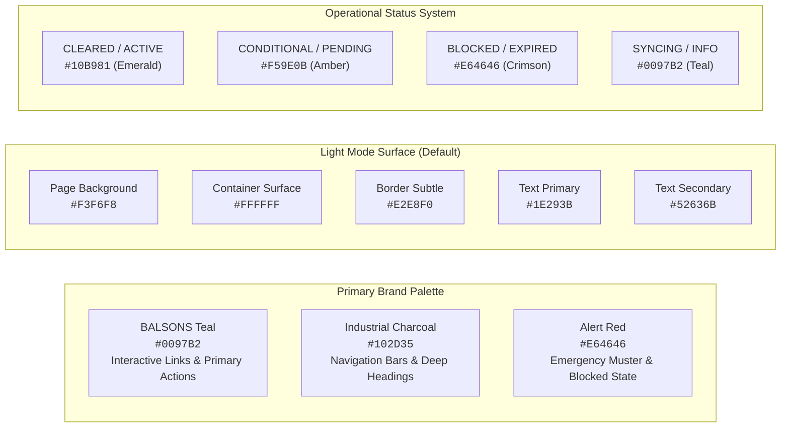

# BALSONS MULTI-PORTAL ENTERPRISE ECOSYSTEM
# DOCUMENT 04 — ENTERPRISE UI-UX, DESIGN SYSTEM & BRANDING
## GREENFIELD ENTERPRISE DESIGN SPECIFICATION, BEDS DESIGN TOKENS, RESPONSIVE ERGONOMICS & VISUAL IDENTITY

**Document Identifier:** `BAL-ENG-SPEC-04-GREENFIELD-V1.0`  
**Governing Standard:** BFast Enterprise Design System (`BEDS V2.0`) & WCAG 2.1 AA Accessibility Standards  
**Target Components:** All 6 Operational Portals (Safety, Store, HR, Gate Entry, Purchase, Operations) + Central Enterprise Launcher  
**Enterprise Entity:** BALSONS Heavy Lift & Shift  
**Anchor Project:** Jupiter Tatravagonka Railwheel Factory (JTRWF), Khordha, Odisha  
**Engineering Mandate:** **100% GREENFIELD DESIGN SYSTEM** — Fresh, unified design tokens, typography scale, responsive layout patterns, and authentic industrial split-screen visual experiences without legacy styling conflicts.

---

## 1. ENTERPRISE BRAND IDENTITY & VISUAL GOVERNANCE

### 1.1 Brand Identity Standards
The visual language of the BALSONS Enterprise Ecosystem projects precision, engineering strength, and statutory rigor:
* **Company Title:** `BALSONS HEAVY LIFT & SHIFT`
* **Enterprise Slogan:** *"Difficult we do easily, impossible takes little time."*
* **Anchor Project Sub-Brand:** `JTRWF Khordha Railwheel Factory Project`
* **Official Brand Marks:**
  - Standard Corporate Mark: `assets/images/balsons-logo.png`
  - Monogram Icon: Standardized `BS` industrial monogram for mobile headers and favicons.

### 1.2 The Master Color Palette (`BEDS V2.0`)



### 1.3 CSS Design Tokens (`beds.css`)

```css
:root {
  /* Brand Tokens */
  --beds-teal-primary: #0097B2;
  --beds-teal-hover: #008199;
  --beds-teal-surface: rgba(0, 151, 178, 0.08);
  --beds-charcoal-heading: #102D35;
  --beds-charcoal-dark: #0B191E;
  --beds-alert-red: #E64646;
  --beds-alert-surface: #FEF2F2;

  /* Surface & Background (Light Mode Default) */
  --beds-bg-canvas: #F3F6F8;
  --beds-bg-surface: #FFFFFF;
  --beds-bg-surface-alt: #F8FAFC;
  --beds-border-subtle: #E2E8F0;
  --beds-border-medium: #CBD5E1;

  /* Typography Colors */
  --beds-text-primary: #1E293B;
  --beds-text-secondary: #52636B;
  --beds-text-muted: #64748B;
  --beds-text-inverse: #FFFFFF;

  /* Status Colors */
  --beds-status-cleared: #10B981;
  --beds-status-cleared-bg: #ECFDF5;
  --beds-status-conditional: #F59E0B;
  --beds-status-conditional-bg: #FFFBEB;
  --beds-status-blocked: #E64646;
  --beds-status-blocked-bg: #FEF2F2;
  --beds-status-info: #0097B2;
  --beds-status-info-bg: #EFF6FF;

  /* Shadows & Elevations */
  --beds-shadow-sm: 0 1px 2px 0 rgba(16, 45, 53, 0.05);
  --beds-shadow-md: 0 4px 6px -1px rgba(16, 45, 53, 0.08), 0 2px 4px -1px rgba(16, 45, 53, 0.04);
  --beds-shadow-lg: 0 10px 15px -3px rgba(16, 45, 53, 0.1), 0 4px 6px -2px rgba(16, 45, 53, 0.05);
  --beds-shadow-modal: 0 20px 25px -5px rgba(16, 45, 53, 0.25), 0 10px 10px -5px rgba(16, 45, 53, 0.1);

  /* Radii & Metrics */
  --beds-radius-sm: 4px;
  --beds-radius-md: 8px;
  --beds-radius-lg: 12px;
  --beds-topbar-height: 48px;
}
```

### 1.4 Typography Standards
* **Primary Family:** `Inter`, with fallbacks `-apple-system, BlinkMacSystemFont, "Segoe UI", Roboto, sans-serif`.
* **Monospace Family (Codes, IDs, Hashes):** `ui-monospace, SFMono-Regular, Menlo, Monaco, Consolas, monospace`.
* **Hierarchy:**
  - Heading 1 (Portal Title): `22px` (Mobile: `18px`), Weight: `800`, Tracking: `-0.02em`.
  - Heading 2 (Module Section): `16px`, Weight: `700`.
  - Heading 3 (Card Title): `14px`, Weight: `600`.
  - Body Text: `13px`, Line Height: `1.5`, Color: `var(--beds-text-primary)`.
  - Meta & Labels: `11px`, Weight: `600`, Uppercase, Tracking: `0.05em`.
  - Numeric Chips & Badges: `10px`, Weight: `700`, Monospace.

---

## 2. ENTERPRISE NAVIGATION & GLOBAL WORKSPACE TOPBAR

### 2.1 Unified Workspace Topbar (`beds-workspace.js`)
Every portal injects a standardized, sticky 48px enterprise topbar at the very top of `document.body`:

```
┌────────────────────────────────────────────────────────────────────────────────────────────────────────────────────────┐
│ 🏢 BALSONS ENTERPRISE WORKSPACE | JTRWF Khordha | ⚡ Switch Dept ▾ │ 👑 Super Admin │ 👤 Switch Role │ 🔒 Sign Out │ 🟢 Gate DB Sync: LIVE 1yAuZOXc... Auto: 28s │ ⚡ Sync DB Now │
└────────────────────────────────────────────────────────────────────────────────────────────────────────────────────────┘
```

* **Left Section:**
  - Corporate Monogram: `🏢 BALSONS ENTERPRISE WORKSPACE`
  - Vertical Divider: `|`
  - Anchor Project: `JTRWF Khordha Project`
  - Department Dropdown (`#bedsDeptDropdown`): Instant routing to any of the 6 operational portals or Central Launcher.
* **Center Section:**
  - Dynamic Authority Display (`#bedsTopbarAuthority`): Renders current user tier badge (`👑 Master Super Admin`, `🛡️ Safety Manager`, `👥 HR Head`, etc.).
* **Right Section:**
  - Switch Role Button: Opens the 6-Tier Authority Simulator modal.
  - Sign Out Button: Locks the portal, purges session tokens, and presents the split-screen login modal.
  - Live Database Sync Pill (`#bedsSheetSyncPill`): Renders live database connection status, abbreviated spreadsheet ID, pulse indicator, and the 30-second countdown chip (`Auto: 30s`). Clicking opens the live Google Sheet in a new browser tab.
  - Manual Sync Button: Triggers immediate bi-directional Dual Sync.

### 2.2 Mobile Navigation & Off-Canvas Drawer
On mobile viewports ($\le 767\text{ px}$):
* A mobile hamburger button (`#btn-mobile-hamburger`, `☰ Menu`) is prepended to the portal header.
* Clicking opens an off-canvas navigation drawer (`#beds-mobile-nav-drawer`) with a darkened backdrop (`#beds-drawer-backdrop`).
* **Drawer Navigation Groups:**
  1. *Authority & Governance:* Super Admin console and Role Switcher buttons.
  2. *Quick Access:* Force Dual-Sync Now and 360° Workforce Dossier modal.
  3. *Portal Modules:* Dynamic list of active portal view buttons.
  4. *Department Switcher:* Quick links across all 6 departments.
  5. *Database Direct Link:* External link opening the dedicated operational spreadsheet.

---

## 3. DOMAIN-SPECIFIC SPLIT-SCREEN LOGIN EXPERIENCE

### 3.1 Photography & Cover Assets Alignment
Every operational portal presents a full-screen, high-contrast split-screen login modal (`beds-portal-login.js`). The left column ($50\%$ width on desktop) renders an authentic high-definition operational photograph specific to that department:

| Portal | Assigned Photography Asset | Dimensions | Visual Subject |
| :--- | :--- | :---: | :--- |
| **Gate Entry Manager** | `assets/images/login-gate.jpg` | $2400 \times 1600$ | Industrial security gate, turnstile, heavy vehicle access lane. |
| **HR & Payroll Manager**| `assets/images/login-hr.jpg` | $2400 \times 1600$ | Personnel management, technical team briefing, engineering workforce. |
| **Safety & PTW Manager**| `assets/images/login-safety.jpg`| $2400 \times 1600$ | Heavy rigging safety inspection, safety officer with PTW checklist. |
| **Store Manager** | `assets/images/login-store.jpg` | $2400 \times 1600$ | Rigging tackle warehouse, hydraulic jacks, calibrated slings, shackles. |
| **Operations Manager** | `assets/images/login-operations.jpg`| $2400 \times 1600$ | Schuler wheel press line erection, crawler crane heavy lift. |
| **Purchase Manager** | `assets/images/login-purchase.jpg`| $2400 \times 1600$ | Commercial procurement, engineering equipment contracts. |
| **Enterprise Launcher** | `assets/images/login-reports.jpg` | $2400 \times 1600$ | Master executive operations center, multi-portal telemetry. |

### 3.2 Full-Bleed CSS Styling Rules
To guarantee zero white borders, gaps, or aspect distortion, cover images strictly apply:
```css
.login-split-left {
  width: 50%;
  height: 100%;
  position: relative;
  overflow: hidden;
  background-color: var(--beds-charcoal-dark);
}

.login-split-left img.login-cover {
  width: 100%;
  height: 100%;
  object-fit: cover;
  object-position: center;
  display: block;
}
```

---

## 4. COMPONENT LIBRARY & STANDARD SCREEN PATTERNS

### 4.1 Industrial KPI Summary Cards
```html
<div class="beds-kpi-card">
  <div class="beds-kpi-icon" style="background: rgba(0, 151, 178, 0.1); color: var(--beds-teal-primary);">👥</div>
  <div class="beds-kpi-content">
    <span class="beds-kpi-label">Active Workforce</span>
    <div class="beds-kpi-value">148</div>
    <span class="beds-kpi-trend positive">↑ 12 Joined this month</span>
  </div>
</div>
```

### 4.2 Standard Data Tables
High-density, responsive tables engineered for large industrial datasets:
* **Frozen Headers:** Header row sticks at `top: 0` during vertical scrolling.
* **Zebra Striping:** Alternating `#FFFFFF` and `#F8FAFC` row backgrounds.
* **Row Hover:** Highlighted with subtle teal surface (`rgba(0, 151, 178, 0.04)`).
* **Column Alignment:** Text left-aligned; codes/dates center-aligned; monetary values right-aligned.
* **Status Badges:** Inline pills with rounded borders (`border-radius: 12px; font-size: 10.5px; font-weight: 700;`).

### 4.3 Form Controls & Validation States
* **Input Fields:** Minimum height `38px`, border `1px solid var(--beds-border-medium)`, focus outline `2px solid var(--beds-teal-primary)`.
* **Error State:** Border `1.5px solid var(--beds-alert-red)`, background `var(--beds-alert-surface)`, micro-copy error text in red below input.
* **Success State:** Border `1.5px solid var(--beds-status-cleared)`.

### 4.4 Non-Blocking Toast Notification System
* Dynamic container (`#beds-toast-container`) positioned fixed at top-right (`top: 58px; right: 20px; z-index: 10000;`).
* Auto-dismisses after 4,200 ms with smooth upward slide-and-fade animation.

---

## 5. RESPONSIVE LAYOUT SPECIFICATIONS & ACCESSIBILITY

### 5.1 Viewport Breakpoints & Ergonomic Behavior

| Viewport Category | Screen Width | Navigation Standard | Table Behavior | Modal Behavior |
| :--- | :---: | :--- | :--- | :--- |
| **Desktop High-Res** | $\ge 1200\text{ px}$ | Full topbar + horizontal sub-nav | Full multi-column view with action bars | 50/50 split-screen photography modals |
| **Laptop / Tablet Landscape**| $768\text{ px} - 1199\text{ px}$| Responsive topbar + compact tabs | Horizontal overflow scrolling (`overflow-x: auto`) | 40/60 split modal |
| **Mobile Portrait** | $\le 767\text{ px}$ | Mobile hamburger + off-canvas drawer | Card-view or horizontal scroll with sticky ID column | Single-column stacked modal |

### 5.2 Mandatory Viewport Zoom Standard
In strict accordance with WCAG 2.1 Guideline 1.4.4 (Resize Text), all HTML documents enforce standard pinch-to-zoom accessibility:
```html
<meta name="viewport" content="width=device-width, initial-scale=1.0">
```
No `maximum-scale=1.0` or `user-scalable=no` restrictions are permitted. Technicians and site engineers are fully enabled to pinch-to-zoom on intricate technical tables and drawings.

### 5.3 Color Contrast & Readability (WCAG 2.1 AA)
* Primary text (`#1E293B`) on page canvas (`#F3F6F8`): Contrast ratio **12.8:1** (Exceeds 4.5:1 requirement).
* BALSONS Teal (`#0097B2`) on white surface: Contrast ratio **4.62:1** (Compliant).
* Alert Red (`#E64646`) on white surface: Contrast ratio **4.75:1** (Compliant).
* Focus Rings: Standard 2px high-visibility outline on all interactive inputs and buttons.
