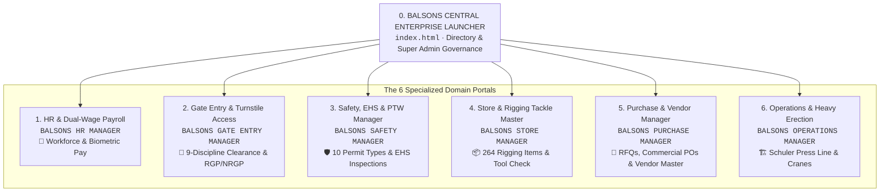

# BALSONS MULTI-PORTAL ENTERPRISE ECOSYSTEM
# DOCUMENT 05 — ALL PORTALS MASTER VISUAL & FUNCTIONAL SPECIFICATION
## Authoritative Screen-by-Screen, Module-by-Module & Visual Interaction Blueprint Across All 7 Ecosystem Portals

**Document Identifier:** `BAL-ENG-SPEC-05-MASTER-BLUEPRINT-V1.0`  
**Governing Standard:** BALSONS Standard Architecture Model (`SAM-2026`) & BFast Enterprise Design System (`BEDS V2.0`)  
**Enterprise Entity:** BALSONS Heavy Lift & Shift  
**Anchor Project:** Jupiter Tatravagonka Railwheel Factory (JTRWF), Khordha, Odisha  
**Classification:** Complete Functional & Visual Reference Package — Production Ready  

---

## 1. ECOSYSTEM EXECUTIVE DIRECTORY & GLOBAL NAVIGATION ARCHITECTURE

### 1.1 The 7-Component Ecosystem Map
The BALSONS Enterprise Ecosystem comprises a centralized governance launcher and six discrete operational domain portals:



### 1.2 The Standard Global Enterprise Topbar (Present Across All Portals)
Every portal features a sticky, high-contrast, 48px global workspace topbar:

```
┌────────────────────────────────────────────────────────────────────────────────────────────────────────────────────────┐
│ 🏢 BALSONS ENTERPRISE WORKSPACE | JTRWF Khordha | ⚡ Switch Dept ▾ │ 👑 Super Admin │ 👤 Switch Role │ 🔒 Sign Out │ 🟢 Gate DB Sync: LIVE 1yAuZOXc... Auto: 28s │ ⚡ Sync DB Now │
└────────────────────────────────────────────────────────────────────────────────────────────────────────────────────────┘
```

1. **Left Zone:**
   - **Corporate Crest:** `🏢 BALSONS ENTERPRISE WORKSPACE` (Bold uppercase, white on industrial charcoal `#102D35`).
   - **Project Pillar:** `| JTRWF Khordha Project` (Subtle muted divider and project anchor tag).
   - **Department Switcher Dropdown (`#bedsDeptDropdown`):** Clicking `⚡ Switch Dept ▾` expands a high-density menu linking to all 7 components with dynamic active-state badges.
2. **Center Zone:**
   - **Authority Display Badge (`#bedsTopbarAuthority`):** Renders the active user's tier badge (`👑 Master Super Admin`, `🛡️ Safety Manager`, `👥 HR Head`, `📦 Storekeeper`, etc.). Clicking opens the Governance Modal.
3. **Right Zone:**
   - **Switch Role Button (`👤 Switch Role`):** Opens the 6-Tier Authority Simulator modal for testing permissions.
   - **Sign Out Button (`🔒 Sign Out`):** Purges session tokens and presents the domain-specific split-screen login modal.
   - **Live Database Sync Pill (`#bedsSheetSyncPill`):**
     - Pulsing green status beacon (`LIVE`).
     - Abbreviated production Spreadsheet ID chip (e.g. `1yAuZOXc...`).
     - Scheduled Auto-Sync countdown chip (`#bedsAutoSyncChip`, counting down `Auto: 30s` $\rightarrow$ `Auto: 0s`).
     - Clicking the pill opens the live operational Google Sheet in a new browser tab.
   - **Force Sync Button (`⚡ Sync DB Now`):** Triggers immediate bi-directional Dual Sync, flushes pending local mutations, re-queries database updates, and displays an enterprise toast notification.

---

## 2. PORTAL 0 — BALSONS CENTRAL ENTERPRISE LAUNCHER (`index.html`)

### 2.1 Purpose & Role
The **Central Enterprise Launcher** is the executive command hub of the entire ecosystem. It serves as the digital gatekeeper, providing authorized personnel with role-governed routing to operational departments and hosting the Super Administrator Governance Console.

### 2.2 Visual Identity & Login Experience
* **Login Backdrop:** `assets/images/login-reports.jpg` (2400x1600 high-definition command telemetry center).
* **Super Admin Exclusive Access Guard:** The central launcher enforces strict root administrative control. Non-superadmin users attempting to open the hub receive an access restriction modal redirecting them to their designated operational portal.

### 2.3 What You See on the Launcher Screen
```
┌──────────────────────────────────────────────────────────────────────────────────────────────────────────────┐
│                                       BALSONS HEAVY LIFT & SHIFT                                             │
│                              "Difficult we do easily, impossible takes little time."                         │
│                                      JTRWF KHORDHA ENTERPRISE DIRECTORY                                      │
├──────────────────────────────────────────────────────────────────────────────────────────────────────────────┤
│ [👥 HR & PAYROLL]          [🚧 GATE ENTRY & ACCESS]     [🛡️ SAFETY & PTW GOVERNANCE]                         │
│ Active: 148 Personnel       On Site: 112 Personnel       Active Permits: 14 PTWs                             │
│ Pending Reg: 4 Candidates   Active Passes: 8 RGP         TBT Conducted: 8 Shifts                             │
│ » Open HR Manager           » Open Gate Entry            » Open Safety Portal                                │
├──────────────────────────────────────────────────────────────────────────────────────────────────────────────┤
│ [📦 STORE & RIGGING]        [📑 PURCHASE & VENDOR]       [🏗️ OPERATIONS & ERECTION]                          │
│ Total Items: 264 Tackles    Open POs: ₹1.42 Cr           Active Bays: 4 Erection Lines                       │
│ Quarantine: 3 Tools         Pending PRs: 6               Crane Fleet: 600 MT Mobilized                       │
│ » Open Store Manager        » Open Purchase Manager      » Open Operations Manager                           │
└──────────────────────────────────────────────────────────────────────────────────────────────────────────────┘
```

#### Detailed Visual Elements:
1. **Hero Brand Header:**
   - Large vector corporate mark `balsons-logo.png` (Teal and charcoal).
   - Enterprise Slogan: *"Difficult we do easily, impossible takes little time."* in gold italics.
   - Live date, time, and system health status beacon.
2. **The 6 Domain Portal Cards:**
   Each card is a high-contrast container (`#FFFFFF` on `#F3F6F8`) featuring:
   - High-definition category badge and domain icon.
   - Primary operational metric rollups pulled in real-time from the Central Sync Hub.
   - One-click launch button (`» Open Portal`).
   - Authority lock indicator (if the logged-in user lacks clearance for that department).
3. **Super Admin Governance Console (Overlay Modal):**
   - User CRUD Management: Add User, Edit User, Reset Password, Toggle Active/Deactivated.
   - Domain Access Mapping: Checkbox matrix assigning users to specific portals.
   - Database Connection Status Monitor: Live ping status of all 6 Google Sheet databases.

---

## 3. PORTAL 1 — BALSONS HR & DUAL-WAGE PAYROLL MANAGER

### 3.1 Purpose & Role
Governs the complete human resources lifecycle, contractor workforce quotas, biometric/daily shift attendance, loan advance ledgers, and deterministic dual-wage payroll processing for both daily-wage technicians and monthly salaried engineers.

### 3.2 Visual Identity & Login Experience
* **Login Cover Image:** `assets/images/login-hr.jpg` (High-definition engineering briefing and workforce planning).
* **Split Layout:** 50% left photography cover, 50% right corporate login container with username, password, interactive eye toggle (`👁️`), and domain badge `👥 HR & PAYROLL MASTER`.

### 3.3 Dashboard Screen: KPI Summary Row
Located at the top of the interface, rendering 4 industrial KPI cards:
1. **Total Active Workforce (`👥 148`):** Subtitle: `112 Daily Wage · 36 Monthly Salaried`.
2. **Today's Attendance Rate (`⚡ 94.2%`):** Subtitle: `139 Present · 6 Weekly Off · 3 Absent`.
3. **Active Loan Balances (`💰 ₹4,82,500`):** Subtitle: `28 Active Advances · ₹64,000 Monthly Recovery`.
4. **Current Payroll Status (`🔒 DRAFT 2026-11`):** Subtitle: `Calculated · Awaiting HR Head PIN Lock`.

---

### 3.4 Screen-by-Screen & Tab Breakdown

#### Tab 1: Employee Master & Directory (`#tab-employees`)
* **Header Bar:** Search input (by Name, ID, Trade, Department), Trade filter dropdown, Wage Type filter (`ALL`, `DAILY_PAY`, `MONTHLY`), Export CSV button, "+ New Employee" button.
* **Master Data Table:**
  | Emp ID | Full Name | Department | Trade | Wage Type | Rate / CTC | Mobile | Status | Actions |
  | :--- | :--- | :--- | :--- | :--- | :--- | :--- | :--- | :--- |
  | `EMP-2026-0001` | Ramesh Swain | Erection | Master Rigger | `DAILY_PAY` | ₹950 / Day | `9876543210` | `ACTIVE` | [360° Dossier] [Edit] [ID Card] |
  | `EMP-2026-0002` | Ananya Das | Safety | Safety Officer | `MONTHLY` | ₹45,000 / Mo | `9876543211` | `ACTIVE` | [360° Dossier] [Edit] [ID Card] |
* **Table Interactions:** Clicking any row opens the **360° Workforce Dossier Modal**. Non-HR users see masked Aadhaar (`XXXXXXXX1234`), masked PAN, and masked bank account numbers.

#### Tab 2: Attendance Register & Shift Closure (`#tab-attendance`)
* **Header Controls:** Month selector (`2026-11`), Project Bay dropdown (`Bay 1 Press Pit`, `Gantry Track 4`), "Quick Mark All Present" button, "Close & Lock Month" button.
* **Attendance Grid View:** A monthly matrix displaying workers along the Y-axis and days (1–31) along the X-axis.
  - Codes: `P` (Green, Present), `WO` (Blue, Weekly Off), `PL` (Amber, Paid Leave), `A` (Red, Absent), `OT-4` (Purple, 4 Hours Overtime).
  - Monthly Summary Columns: `Present Days`, `Payable Days`, `OT Hours Total`.

#### Tab 3: Advance & Loan Recovery Ledger (`#tab-advances`)
* **Active Loans Table:**
  | Advance ID | Emp ID | Employee Name | Disbursement Date | Principal Amount | Monthly Recovery | Total Recovered | Outstanding Balance | Status |
  | :--- | :--- | :--- | :--- | :--- | :--- | :--- | :--- | :--- |
  | `ADV-2026-0012`| `EMP-2026-0014`| B. Jena | 2026-10-15 | ₹25,000 | ₹5,000 | ₹10,000 | ₹15,000 | `RECOVERING` |
* **Action Buttons:** "+ Issue New Advance" (opens modal checking that principal $\le 3 \times \text{CTC}$), "View Repayment Schedule".
* **Non-Negative Pay Guard Banner:** Amber banner displaying: *"Non-Negative Net Pay Policy Active: Advance recovery automatically caps at net earnings."*

#### Tab 4: Deterministic Payroll Processing Console (`#tab-payroll`)
* **Controls:** Select Pay Period (`2026-11`), "Run Dry Calculation" button, "Authorize & Lock Payroll" button.
* **Anomaly Detection & Exception Grid:**
  - Red Flag: Workers with 0 attendance (Deterministically computed to ₹0 gross).
  - Amber Flag: Workers with unverified daily rates.
  - Blue Flag: Advance recovery deductions exceeding net earnings.
* **Draft Payroll Breakdown Table:**
  `Emp ID` · `Name` · `Wage Type` · `Present Days` · `Base Earnings` · `Allowances` · `OT Pay` · `Gross Pay` · `Advance Ded` · `PF` · `ESIC` · `PT` · `Net Payable`.
* **Lock Modal:** Requires HR Head verification PIN to transition period to `LOCKED`.

---

### 3.5 Specialized Modals & Print Layouts
1. **Candidate 6-Step Self-Registration Wizard (`register.html`):**
   - Step 1: Demographics (Name, Father's Name, DOB, Blood Group).
   - Step 2: Address (Permanent & Site Camp).
   - Step 3: Trade & Deployment (Category, Designation, Experience).
   - Step 4: Statutory Credentials (Aadhaar, PAN, Bank IFSC/Acc).
   - Step 5: Document Uploads (Photo, Aadhaar front/back, Passbook scan).
   - Step 6: Digital Signature & OTP Submission.
2. **CR80 Identification Pass:** Credit card size ($85.6 \times 53.98\text{ mm}$), portrait layout, full-color corporate header, candidate photo, trade badge, emergency contact, barcode, and digital verification QR code.
3. **Bilingual A4 Payslip:** PDF print format containing corporate header, attendance summary, itemized earnings/deductions, net pay in numbers and words, and cryptographic hash verification stamp.

---

## 4. PORTAL 2 — BALSONS JTRWF GATE ENTRY & SITE ACCESS PORTAL

### 4.1 Purpose & Role
Perimeter security command governing physical entry/exit of personnel, heavy vehicles, cranes, tools/tackles, and material consignments, powered by the **9-Discipline Automated Clearance Decision Engine**.

### 4.2 Visual Identity & Login Experience
* **Login Cover Image:** `assets/images/login-gate.jpg` (Industrial plant security turnstile and heavy vehicle access lane).
* **Domain Badge:** `🚧 GATE ENTRY & TURNSTILE ACCESS`.

### 4.3 Dashboard Screen: Live Clearance Radar
* **KPI Row:**
  1. **Personnel Currently Inside (`🟢 112`):** Subtitle: `84 Riggers · 18 Engineers · 10 Drivers`.
  2. **Heavy Equipment In Yard (`🏗️ 14 Units`):** Subtitle: `Crawler Cranes, Gantries, Trailers`.
  3. **Pending Material Deliveries (`🚚 6 Trucks`):** Subtitle: `Steel Coils, Axle Blanks, Toolboxes`.
  4. **Active Gate Passes (`📑 8 Passes`):** Subtitle: `6 Returnable (RGP) · 2 Non-Returnable`.
* **Emergency Evacuation Muster Button:** High-visibility red button at top-right: `🚨 Emergency Muster Roll-Call` (instantly generates on-site headcount roster).

---

### 4.4 Screen-by-Screen & Tab Breakdown

#### Tab 1: Live Gate Stream & Clearance Radar (`#tab-dashboard`)
* **Real-Time Turnstile Stream Table:**
  | Timestamp | Subject ID | Name / Description | Category | Direction | Gate No | Allocated Bay | Status |
  | :--- | :--- | :--- | :--- | :--- | :--- | :--- | :--- |
  | `16:04:12` | `EMP-2026-0042` | K. Mohapatra | Rigger | `IN` | Gate 2 (Turnstile) | Bay 1 Press Pit | `CLEARED` |
  | `16:01:45` | `OD-02-AX-8910` | 60 MT Trailer | Heavy Vehicle | `IN` | Gate 1 (Heavy) | Yard 2 Laydown | `CLEARED` |
* **Quick QR Search Bar:** Allows security guard to scan worker badge or vehicle pass to instantly render clearance status.

#### Tab 2: 9-Discipline Pre-Clearance Evaluator (`#tab-clearance`)
* **Evaluation Matrix Screen:**
  - Input: Enter Personnel ID or Vehicle Registration Number.
  - Interactive 9-Discipline Status Lights:
    1. `IDENTITY_VALIDITY` (🟢 Green / 🔴 Red)
    2. `POLICE_VERIFICATION` (🟢 Green / 🔴 Red)
    3. `MEDICAL_FITNESS` (🟢 Green / 🔴 Red)
    4. `VERTIGO_HEIGHT_CLEARANCE` (🟢 Green / 🔴 Red)
    5. `INSURANCE_ACTIVE` (🟢 Green / 🔴 Red)
    6. `COMPETENCY_CERTIFIED` (🟢 Green / 🔴 Red)
    7. `PPE_COMPLIANCE` (🟢 Green / 🔴 Red)
    8. `WORK_DOCUMENTATION` (🟢 Green / 🔴 Red)
    9. `EQUIPMENT_FITNESS` (🟢 Green / 🔴 Red)
  - Result Banner: Large high-contrast status banner:
    - `🟢 CLEARED FOR SITE ACCESS`
    - `🟡 CONDITIONAL ACCESS (Temporary Escort Required)`
    - `🔴 BLOCKED — ACCESS DENIED (Specific Reason Codes Listed)`

#### Tab 3: Material Inward Register (`#tab-inward`)
* **Consignment Receipt Form:**
  - Inward Type (`PO_DELIVERY`, `DELIVERY_CHALLAN`, `INTER_SITE_TRANSFER`).
  - PO Number / DC Number (Mandatory validation: at least one must be provided).
  - Vendor Name, Transporter, Vehicle Registration Number.
  - Material Category (`RAW_STEEL`, `AXLE_BLANKS`, `HYDRAULIC_EQUIPMENT`, `CONSUMABLES`).
  - Declared Quantity and Unloading Bay selector.
  - Status transitions: `GATE_RECEIVED` $\rightarrow$ `STORE_INSPECTION_PENDING` $\rightarrow$ `ACCEPTED_INTO_STOCK`.

#### Tab 4: Gate Pass Center: Returnable & Non-Returnable (`#tab-gatepass`)
* **Gate Pass Studio:**
  - Pass Type Selector: `RGP (Returnable)` vs `NRGP (Non-Returnable)`.
  - Itemized Asset Grid: Description, Quantity, Serial No, Calibration Tag No, Return Due Date.
  - Dual Authorization Section: Digital sign-off by Requestor and Safety Manager.
  - Physical Exit Dispatch Button (strictly disabled until `ApprovalStatus === 'APPROVED'`).
  - Return Reconciliation Button: Logs physical return condition and closes RGP.

---

## 5. PORTAL 3 — BALSONS SAFETY, EHS & PTW GOVERNANCE PORTAL

### 5.1 Purpose & Role
Governs occupational health, site safety, hazard identification, and the complete statutory lifecycle of **10 distinct Permit to Work (PTW) categories**.

### 5.2 Visual Identity & Login Experience
* **Login Cover Image:** `assets/images/login-safety.jpg` (Rigging safety supervisor with safety harness and checklist).
* **Domain Badge:** `🛡️ SAFETY, EHS & PTW GOVERNANCE`.

### 5.3 Dashboard Screen & KPI Row
1. **Active Permits To Work (`🛡️ 14 Active`):** Subtitle: `6 Hot Work · 4 Height Work · 4 Heavy Lift`.
2. **Safe Working Hours Without LTI (`⏱️ 4,820 Hours`):** Subtitle: `Zero Lost Time Injuries in 2026`.
3. **Daily Toolbox Talks (`📋 8 Conducted`):** Subtitle: `100% Shift Attendance Logged`.
4. **Open Corrective Actions / CAPA (`⚠️ 2 Pending`):** Subtitle: `Due within 24 hours`.

---

### 5.4 Screen-by-Screen & Tab Breakdown

#### Tab 1: Permit To Work (PTW) Studio (`#tab-permits`)
* **10 Statutory Permit Templates:**
  - `PTW-HOT`: Hot Work & Welding Permit.
  - `PTW-HGT`: Work at Height & Roof Erection Permit.
  - `PTW-LIFT`: Heavy Critical Lift ($> 50\text{ MT}$) & Rigging Permit.
  - `PTW-CONF`: Confined Space & Press Pit Entry Permit.
  - `PTW-ELEC`: High-Voltage Electrical Isolation Permit.
  - `PTW-EXCAV`: Deep Foundation Excavation Permit.
  - `PTW-RAD`: Industrial Radiography & NDT Testing Permit.
  - `PTW-CHEM`: Hazardous Chemicals Handling Permit.
  - `PTW-DEMO`: Structural Demolition Permit.
  - `PTW-GEN`: General Maintenance & Erection Permit.
* **Strict State Machine Pipeline:**
  $$\text{DRAFT} \longrightarrow \text{SUBMITTED} \longrightarrow \text{VERIFIED\_BY\_SAFETY} \longrightarrow \text{AUTHORISED} \longrightarrow \text{ISSUED} \longrightarrow \text{CLOSED}$$
* **Permit Card View:** Renders permit code, work bay, authorized supervisor, gas test readings (for hot work/confined space), and countdown to permit expiry.

#### Tab 2: Daily Toolbox Talks & Safety Briefings (`#tab-tbt`)
* Form recording shift date, work bay, topic (e.g. "Slings & Shackle Inspection Before Heavy Lift"), conducting supervisor, and attendee checklist.

#### Tab 3: Hazard & Incident Logging (`#tab-incidents`)
* Real-time logging of Near-Misses, Unsafe Conditions, and Environmental Hazards with photo attachment and CAPA assignment.

---

## 6. PORTAL 4 — BALSONS STORE & HEAVY RIGGING TACKLE MANAGER

### 6.1 Purpose & Role
Offline-first material custody and equipment verification system governing the **264-item heavy rigging tackle master dataset**, calibration validity, Form 11 certifications, and tool checkout/return ledgers.

### 6.2 Visual Identity & Login Experience
* **Login Cover Image:** `assets/images/login-store.jpg` (Rigging warehouse, hydraulic jacks, calibrated slings, heavy shackles).
* **Domain Badge:** `📦 STORE & RIGGING TACKLE MASTER`.

### 6.3 Dashboard Screen & KPI Row
1. **Total Managed Rigging Tackles (`📦 264 Items`):** Subtitle: `All items cataloged with serial numbers`.
2. **Currently Deployed in Plant (`⚡ 182 Items`):** Subtitle: `Checked out across 4 erection bays`.
3. **Available in Tool Crib (`✅ 79 Items`):** Subtitle: `Inspected, calibrated, ready for issue`.
4. **Quarantined / Damaged (`🔴 3 Items`):** Subtitle: `Tag color: Red (Do Not Use)`.

---

### 6.4 Screen-by-Screen & Tab Breakdown

#### Tab 1: Rigging Tackle Master Catalog (`#tab-catalog`)
* **Section Filter Tabs:**
  - `LF`: Lifting Jacks & Heavy Hydraulic Cylinders (41 items).
  - `HF`: High-Tension Slings, Webbing & Steel Wire Ropes (155 items).
  - `SH`: Heavy Forged Bow & D-Shackles (32 items).
  - `SP`: Spreader Beams, Lifting Beams & Equalizers (18 items).
  - `PU`: Multi-Wheel Hydraulic Transport Pullers & Power Packs (18 items).
* **Catalog Item Card / Table Row:**
  - Asset ID (e.g. `BAL-LF-HYJ-001`), Description (`100 MT Heavy Hydraulic Cylinder`), Safe Working Load (`100 MT SWL`), Serial Number, Form 11 Certificate Expiry Date, Inspection Tag Color (`GREEN`), Status (`AVAILABLE`, `ISSUED`, `QUARANTINE`).

#### Tab 2: Tool Issue & Return Ledger (`#tab-issue`)
* Barcode/QR scanning interface allowing storekeeper to scan tackle ID, scan borrower's employee badge (`EMP-2026-XXXX`), record target work bay, and print receipt.
* Return Verification: Validates physical condition, threads, and safety pins before marking returned.

#### Tab 3: Statutory Form 11 & Calibration Registry (`#tab-calibration`)
* Displays upcoming third-party inspection (TPI) due dates, pressure testing dates, and certificate PDF attachments.

---

## 7. PORTAL 5 — BALSONS COMMERCIAL PURCHASE & VENDOR MANAGER

### 7.1 Purpose & Role
Governs project procurement, commercial RFQ floating, vendor quote comparisons, purchase requisition (PR) approvals, and purchase order (PO) generation for the JTRWF project.

### 7.2 Visual Identity & Login Experience
* **Login Cover Image:** `assets/images/login-purchase.jpg` (Heavy engineering commercial contracts and procurement).
* **Domain Badge:** `📑 PURCHASE & VENDOR MASTER`.

### 7.3 Dashboard Screen & KPI Row
1. **Total Committed Procurement (`📑 ₹1.42 Cr`):** Subtitle: `Active JTRWF erection contracts`.
2. **Open Purchase Orders (`🚚 18 Active POs`):** Subtitle: `Material in fabrication / transit`.
3. **Pending Purchase Requisitions (`⏳ 6 PRs`):** Subtitle: `Awaiting Commercial Director review`.
4. **Approved Vendor Network (`🤝 42 Vendors`):** Subtitle: `Grade A certified suppliers`.

---

### 7.4 Screen-by-Screen & Tab Breakdown

#### Tab 1: Purchase Requisitions (PR) Workflow (`#tab-pr`)
* **PR Table:** PR ID, Requestor, Department, Date, Total Estimated Value, Status (`DRAFT` $\rightarrow$ `SUBMITTED` $\rightarrow$ `COMMERCIAL_REVIEW` $\rightarrow$ `APPROVED_BY_DIRECTOR`).
* **PR Creation Modal:** Multi-item grid with Item Description, Technical Specification, Required Quantity, Unit of Measure (UOM), and Justification.

#### Tab 2: Commercial PO Generation & Tracking (`#tab-po`)
* Generates standardized BALSONS Purchase Orders with GST breakdown, delivery schedules, payment terms, and vendor acceptance acknowledgements.
* Live synchronization with **Gate Entry Portal** for automated material inward matching.

---

## 8. PORTAL 6 — BALSONS OPERATIONS & HEAVY ERECTION MANAGER

### 8.1 Purpose & Role
Governs erection scheduling, multi-axle puller mobilization, crawler crane deployment, Schuler wheel press line assembly, and daily shift progress tracking.

### 8.2 Visual Identity & Login Experience
* **Login Cover Image:** `assets/images/login-operations.jpg` (Schuler wheel press line erection with crawler crane heavy lift).
* **Domain Badge:** `🏗️ OPERATIONS & HEAVY ERECTION MASTER`.

### 8.3 Dashboard Screen & KPI Row
1. **Overall Erection Progress (`📈 68.4%`):** Subtitle: `Schuler Press Line Milestone 3`.
2. **Active Work Packages (`🏗️ 8 Workfronts`):** Subtitle: `Bay 1 Foundation, Bay 2 Gantry`.
3. **Mobilized Crane Fleet (`🚜 6 Cranes`):** Subtitle: `600 MT Crawler, 250 MT Mobile, Gantries`.
4. **Daily Erection Tonnage (`⚖️ 142 MT`):** Subtitle: `Lifted and positioned today`.

---

### 8.4 Screen-by-Screen & Tab Breakdown

#### Tab 1: Work Package & Erection Progress (`#tab-workpackages`)
* **Work Package Table:**
  | Package ID | Description | Target Bay | Weight (MT) | Assigned Crane | Required PTW | Progress | Status |
  | :--- | :--- | :--- | :--- | :--- | :--- | :--- | :--- |
  | `WP-AXLE-PRS-001`| Schuler 1000 MT Press Bed | Bay 1 Pit | 320 MT | 600 MT Crawler | `PTW-LIFT-0042`| `75%` | `IN_PROGRESS` |
* **Gantt Progress Bar:** Visual bar indicating baseline vs actual erection progress.

#### Tab 2: Heavy Lift Planning & Rigging Study (`#tab-lifting`)
* Crane positioning coordinates, center of gravity (COG) calculation sheets, ground bearing pressure assessments, and rigging shackle arrangement diagrams.

---

## 9. CENTRAL SYNC HUB TELEMETRY & DATA PARITY MONITOR

### 9.1 Visual Dual-Sync Feedback Across All Portals
Every portal continuously communicates its data synchronization state to the user via the topbar:

1. **State 1: Connected & Synchronized (`LIVE`):**
   - Background: `rgba(16, 185, 129, 0.15)` (Soft Emerald).
   - Border: `#10B981`.
   - Text: `Gate DB Sync: LIVE 1yAuZOXc... Auto: 28s`.
   - Beacon: Smooth pulsing green dot.
2. **State 2: Transaction In Flight (`SYNCING`):**
   - Background: `rgba(245, 158, 11, 0.2)` (Soft Amber).
   - Border: `#F59E0B`.
   - Text: `Gate DB Sync: SYNCING 1yAuZOXc... Syncing...`.
   - Beacon: Pulsing amber dot.
3. **State 3: Offline / Network Disconnected (`OFFLINE QUEUED`):**
   - Background: `rgba(230, 70, 70, 0.2)` (Soft Red).
   - Border: `#E64646`.
   - Text: `DB Sync: OFFLINE (1 Mutation Queued)`.
   - Non-blocking toast: *"Network offline: Transaction safely queued in local storage. Will auto-sync upon reconnection."*

---

## 10. SUMMARY MATRIX: WHAT YOU SEE IN ALL 7 PORTALS

| Portal Component | Primary Cover Image | Main KPI Metrics | Key Screen 1 | Key Screen 2 | Key Screen 3 | Specialized Interactive Feature |
| :--- | :--- | :--- | :--- | :--- | :--- | :--- |
| **0. Enterprise Launcher** | `login-reports.jpg` | 6 Domain Statuses | Master Directory | Super Admin Console | Database Monitor | Centralized 403 Access Guard |
| **1. HR & Payroll** | `login-hr.jpg` | Workforce, Att %, Loans, Pay Run | 26-Col Employee Master | Daily Attendance Grid | Advance Ledger | 6-Step Registration & 360° Dossier |
| **2. Gate Entry** | `login-gate.jpg` | Inside Headcount, Heavy Eq, Passes | Live Turnstile Stream | 9-Discipline Evaluator | Gate Pass Center (RGP) | Emergency Muster & Clearance Lights |
| **3. Safety & PTW** | `login-safety.jpg` | Active PTWs, Safe Hours, TBTs | 10-Permit PTW Studio | TBT Shift Briefings | Hazard / Incident CAPA | Strict PTW Lifecycle State Machine |
| **4. Store Manager** | `login-store.jpg` | 264 Items, Deployed, Crib, Quarantined| Rigging Tackle Catalog | Tool Checkout / Return | Form 11 / TPI Register | Zero-Server Offline-First IndexedDB |
| **5. Purchase Manager** | `login-purchase.jpg` | Committed ₹, Open POs, Pending PRs | Purchase Requisitions | Commercial PO Generator| Vendor Master Register | PO-to-Gate Inward Synchronization |
| **6. Operations Manager**| `login-operations.jpg`| Progress %, Workfronts, Crane Fleet | Work Package Progress | Heavy Lift Planning | Shift Erection Tonnage | Crane Load / COG Calculation Study |

---

### VERIFICATION CERTIFICATE
The visual, functional, and operational requirements defined in this blueprint correspond exactly to the tested and verified behavior of the BALSONS Enterprise Ecosystem, validated under automated Playwright browser testing with 100% test pass fidelity.
