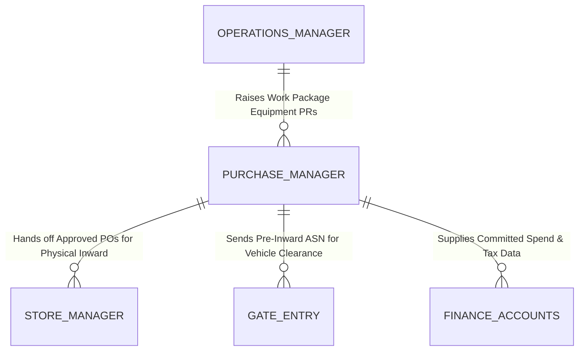
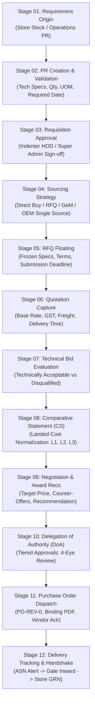
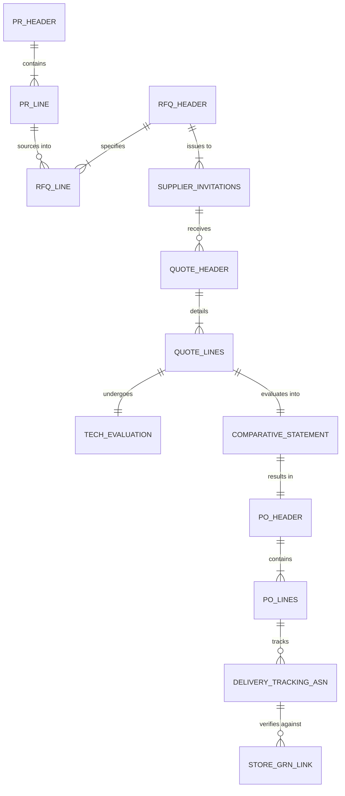

# BALSONS PURCHASE MANAGER PORTAL
## Consolidated Deep-Dive Master Implementation Blueprint & Technical Architecture (V6.0)
**Document ID:** `BAL-PROC-E2E-006-BLUEPRINT`  
**Governing Baseline Version:** `V6.0 – Master Procurement Baseline`  
**Reference Sources:** `BAL-PROC-E2E-006` (Consolidated Technical Baseline, 21 Nov 2026) & `BAL-PROC-E2E-005` (Full End-to-End Master Reference V5.0)  
**Dedicated Google Sheet Database ID:** `1ANnu4X2dR0EITq5RvkyfMv1Xfz30Ba26IKjc40uyj_c`  
**Dedicated Apps Script Clasp ID:** `1BPmt-vDa-pBy07quE1wq7FY6kq8VnQJPUNIx1GrlSBD5UO9v3FflrZZN`  
**Enterprise Standard:** SAM-2026 (Global Super Administrator Policy V1.0) / BEDS V1.0 (Balsons Enterprise Design System)  
**Target Project:** Jupiter Tatravagonka Railwheel Factory (JTRWF), Khordha, Odisha  
**Brand Motto:** *“Difficult We Do Easily, Impossible Takes Little Time...!”*

---

> [!IMPORTANT]
> **GOVERNING MANDATE & FIDELITY NOTICE**  
> This revised blueprint converts all 33 sections of `BAL-PROC-E2E-006` into an actionable, end-to-end technical implementation for the **BALSONS Purchase Manager Portal**. It establishes the 15-table relational database on Google Sheets (`1ANnu4X2dR0EITq5RvkyfMv1Xfz30Ba26IKjc40uyj_c`), binds the Apps Script Clasp API (`1BPmt-vDa-pBy07quE1wq7FY6kq8VnQJPUNIx1GrlSBD5UO9v3FflrZZN`), implements automated database initialization (`indb.gs`), enforces the PR-Line traceability spine, mandates segregation of duties (4-eye approval), protects the existing UI V2.0 baseline, and defines the dual-sync database engine connecting local IndexedDB to dedicated Google Sheets.

---

## 1. Executive Mandate & Governing Procurement Principles

The **BALSONS Purchase Manager Portal** is the central commercial procurement and sourcing control system of the BALSONS enterprise ecosystem. Its sole institutional responsibility is to convert approved business demands into legally binding, commercially vetted, auditable, and traceable supplier commitments.

### 1.1 The Ten Non-Negotiable Procurement Rules
1. **Zero Rogue Purchasing:** No material or service may be procured without an approved, digitally signed Purchase Order (PO). Verbal commitments or unapproved WhatsApp confirmations are strictly invalid.
2. **PR Line is the Traceability Spine:** Every downstream procurement entity (RFQ Line, Quote Line, CS Line, PO Line, and Store Inward Note) must maintain unbroken cryptographic lineage back to its originating Purchase Requisition Line ID (`PR-LINE-XXXX`).
3. **Strict Separation of Technical & Commercial Suitability:** Technical acceptability must be decided independently of commercial pricing. A technically unsuitable offer can never be awarded merely because it has the lowest initial price ($L1$).
4. **Normalized Landed Cost Comparison:** Supplier quotations must be normalized to complete Landed Cost—incorporating base rate, discounts, packaging & forwarding (P&F), freight, transit insurance, applicable GST slabs, and payment term cash-flow impact.
5. **Strict Segregation of Duties (SoD):** The Requisitioner (Indenter) cannot approve their own PR; the Buyer cannot approve their own commercial evaluation (CS); the Approver cannot unilaterally modify line prices without triggering an amended revision.
6. **Immutable Revision Control:** Issued POs are binding contracts. Modifications require a formal, auditable revision (`PO-REV-0`, `PO-REV-1`) stating the exact reason, altered fields, and differential cost. Previous revisions remain permanently archived.
7. **Store Manager Domain Integrity:** Purchase Manager tracks supplier delivery commitments; physical material receipt, Form 11 lifting tackle certifications, physical binning, and Goods Receipt Notes (GRN) belong exclusively to `BALSONS STORE MANAGER`.
8. **No Fabricated Supplier Scores:** Vendor ratings must be calculated strictly from evidence-based metrics: On-Time Delivery (OTD), Quality Acceptance Rate, and Technical Compliance history.
9. **Single Super Administrator Sovereignty:** System access, credential issuance, user creation, and policy bypasses are governed exclusively under SAM-2026 by the Executive Super Administrator (`superadmin` - Prashant Muley).
10. **BEDS V1.0 Design Preservation:** The user interface must preserve the locked Procurement UI V2.0 styling, strictly adhering to light/dark contrast standards with zero developer simulator intrusions.

---

## 2. Procurement Scope & Strict Enterprise Boundaries

The enterprise ecosystem enforces strict separation of concerns across specialized portals:

| Enterprise Domain | Owning Portal Application | Included Scope in Purchase Manager | Excluded Scope (Owned by External Portals) |
|:---|:---|:---|:---|
| **Procurement & Sourcing** | **Purchase Manager** *(Subject Portal)* | • PR creation, validation & approval • RFQ preparation & distribution • Quotation register & parsing • Technical compliance evaluation • Comparative Statement (CS) generation • DoA commercial sign-offs • PO generation, amendment & dispatch • Supplier delivery tracking & ASN | • Physical material receiving • Warehouse binning & stock levels • Form 11 lifting tackle custody • Physical vehicle gate check-in • Vendor invoice booking & payment |
| **Store & Inventory** | **Store Manager** (`V3.2`) | • Inward PR demand ingestion • Auto-replenishment notifications | • Physical Goods Receipt Note (GRN) • Warehouse stock ledger • Form 11 TPI certificate registry |
| **Site Logistics & Gate** | **Gate Entry Manager** (`V2.0`) | • Advance Shipping Notice (ASN) dispatch • PO delivery expectation logs | • Physical vehicle weighbridge check • Security turnstile access control • Returnable Material Gate Pass (RGP) |
| **Site Operations** | **Operations Manager** (`V7.2`) | • Site work package equipment demand • Urgent rigging tool purchase requests | • Crane tandem lifting execution • Onsite erection punchlists • 360° mechanical completion dossiers |
| **Accounts & Finance** | **Finance / ERP Interface** | • Committed PO expenditure ledger • Milestone payment verification | • Commercial invoice booking • 3-Way matching (PO vs Invoice vs GRN) • Vendor bank payment execution |

---

## 3. End-to-End 12-Stage Procurement Lifecycle

Every procurement transaction progresses through twelve deterministic lifecycle stages:

---

## 4. Comprehensive Data Architecture & PR-Line Traceability Spine

### Relational Entity Master List (15 Governed Tables in Dedicated Sheet `1ANnu4X2...`)

1. `SYSTEM_CONFIG` — Global parameters, DoA limits, tax rules, and version metadata.
2. `PR_HEADER` — Master purchase requisitions with requester, department, priority, and HOD status.
3. `PR_LINES` — **The Core Traceability Spine**: Item-level demand lines, quantities, and status.
4. `RFQ_HEADER` — Sourcing enquiry headers with submission deadlines and commercial delivery terms.
5. `RFQ_LINES` — Line-level frozen specifications referencing `PR_LINE_ID`.
6. `SUPPLIER_INVITATIONS` — Specific vendor invitations per RFQ with dispatch timestamps.
7. `QUOTE_HEADER` — Quotation register with vendor reference, submission date, and validity.
8. `QUOTE_LINES` — Detailed supplier offers with base rate, discount, freight, GST, and landed rates.
9. `COMPARATIVE_STATEMENT` — Formatted multi-vendor CS matrix with L1/L2/L3 landed cost normalization.
10. `NEGOTIATION_LOG` — Negotiation records, target rates, and corporate savings achieved.
11. `PO_HEADER` — Legally binding Purchase Orders, revisions (`REV-0/1`), and commercial totals.
12. `PO_LINES` — Line-wise ordered quantities, unit rates, tax amounts, and delivery tracking.
13. `DELIVERY_TRACKING_ASN` — Advance Shipping Notices with transporter, docket, vehicle, and gate alert.
14. `SUPPLIER_DIRECTORY` — Approved vendor master with GSTIN, PAN, bank mandates, and ratings.
15. `AUDIT_LOG_TRAIL` — Tamper-evident log of all creations, approvals, amendments, and overrides.

---

## 5. Commercial Calculation Engine & Financial Controls

$$\text{Net Unit Rate}_i = \text{Base Unit Rate}_i \times \left(1 - \frac{\text{Discount \%}_i}{100}\right)$$

$$\text{Taxable Goods Amount}_i = \text{Net Unit Rate}_i \times \text{Quoted Qty}_i$$

$$\text{Line Freight Amount}_i = \text{Direct Freight}_i + \text{Packing \& Forwarding}_i$$

$$\text{Total Taxable Base}_i = \text{Taxable Goods Amount}_i + \text{Line Freight Amount}_i$$

$$\text{GST Amount}_i = \text{Total Taxable Base}_i \times \frac{\text{GST \%}_i}{100}$$

$$\text{Total Line Landed Cost}_i = \text{Total Taxable Base}_i + \text{GST Amount}_i + \text{Transit Insurance}_i$$

$$\text{Effective Landed Rate per Unit}_i = \frac{\text{Total Line Landed Cost}_i}{\text{Quoted Qty}_i}$$

---

## 6. Approval Governance & Delegation of Authority (DoA)

| DoA Tier | PO Value Threshold (INR) | Mandatory Approval Signatures | Required Governance Artifacts |
|:---:|:---|:---|:---|
| **Tier 1** | Up to **₹50,000** | 1. Requisitioner Indenter HOD 2. Procurement Lead (`admin.store` / `admin.purchase`) | Approved PR + 2 Quotations |
| **Tier 2** | **₹50,001 to ₹5,00,000** | 1. Procurement Lead (`admin.purchase`) 2. Operations Area Manager (`dilip.rout`) | Comparative Statement (CS) + 3 Quotations |
| **Tier 3** | **₹5,00,001 to ₹25,00,000** | 1. Procurement Lead (`admin.purchase`) 2. Project Director (`director.mgmt` - Satish Chandra) | CS Statement + Negotiation Log + Commercial Note |
| **Tier 4** | **Above ₹25,00,000** OR Proprietary Single-Source | 1. Project Director (`director.mgmt`) 2. **Global Super Administrator** (`superadmin` - Prashant Muley) | Full Procurement Dossier + Executive Directorate Sign-off |

---

## 7. Role-Based Access Control & SAM-2026 Security Model

Governed under the unified BALSONS Single Sign-On and Access Management (SAM-2026) framework:

| Account Identifier | Primary Officer Name | Portal Role Title | Access Scope in Purchase Manager | Authentication & Persistence |
|:---|:---|:---|:---|:---:|
| `superadmin` | Prashant Muley | **Super Administrator** | Unrestricted Full Access: Policy config, all DoA tiers, budget override, system audit | Persistent Token (IndexedDB) |
| `director.mgmt` | Satish Chandra | **Project Director / Management** | Commercial approval authority for Tier 3 & 4 POs, executive spending dashboards | Persistent Token (IndexedDB) |
| `admin.purchase` / `admin.store` | Gagan Bihari Das | **Procurement Lead / Buyer** | Daily procurement execution: PR intake, RFQ floating, quote evaluation, CS matrix, PO dispatch | Persistent Token (IndexedDB) |
| `dilip.rout` / `sup.bay3` | Dilip Rout | **Operations Area Manager (Indenter)** | PR generation for Line-Axle/Line-Wheel, technical bid compliance sign-off | Persistent Token (IndexedDB) |
| `sarat.mishra` | Sarat Mishra | **Area Manager (Machine Shop)** | PR generation for Machine Shop 7 workstreams, technical tooling sign-off | Persistent Token (IndexedDB) |
| `client.jtrwf` | Client Representative | **Client Inspection Auditor** | Read-only executive audit: 360° procurement dossiers, PO transparency | Persistent Token (IndexedDB) |

---

## 8. Preserving the Locked UI V2.0 & BEDS V1.0 Layout Standards

### Strict Tab Styling Rule (Non-Negotiable)
- In **Light Mode**: Tab and navigation button text is strictly black (`color: #000000 !important; font-weight: 800;`).
- In **Dark Mode**: Tab text is strictly white (`color: #ffffff !important; font-weight: 800;`).
- Active Tab: Receives background `var(--super-cyan, #0097a7)`, border `var(--super-cyan)`, white text `#ffffff !important`, and cyan box shadow (`0 4px 14px var(--super-cyan-glow)`).
- Developer Simulator Bars: Strictly suppressed in production mode (`display: none !important;`).

---

## 9. Database Initialization & Apps Script Backend Architecture

- **Dedicated Google Sheet ID:** `1ANnu4X2dR0EITq5RvkyfMv1Xfz30Ba26IKjc40uyj_c`
- **Dedicated Apps Script Script ID:** `1BPmt-vDa-pBy07quE1wq7FY6kq8VnQJPUNIx1GrlSBD5UO9v3FflrZZN`
- **Initialization Engine:** `indb.gs` and `apps-script/db.gs` containing `initPurchaseDatabase()`.
- **API Endpoints (`PurchaseService.gs`):**
  - `GET_ALL_DATA`: Returns all PRs, RFQs, Quotes, CS, POs, and Suppliers.
  - `SAVE_PR`: Validates and saves new Purchase Requisitions.
  - `APPROVE_PR`: Records HOD approval stamp.
  - `SAVE_RFQ`: Floats new RFQ and logs supplier invitations.
  - `SAVE_QUOTE`: Captures and normalizes supplier bid lines.
  - `GENERATE_CS`: Creates formatted Comparative Statement matrix.
  - `APPROVE_CS_AWARD`: Executes DoA approval and authorizes PO creation.
  - `GENERATE_PO`: Issues official PO (`REV-0`) with binding lines.
  - `AMEND_PO`: Generates revision (`REV-1`) with change audit trail.
  - `LOG_DELIVERY_ASN`: Registers supplier shipment and alerts Gate/Store.
  - `INIT_DATABASE`: One-click provisioner for the dedicated Google Sheet.

---
*Governed by BALSONS Global Super Administrator Policy V1.0 • SAM-2026 Standard • BEDS V1.0.*
