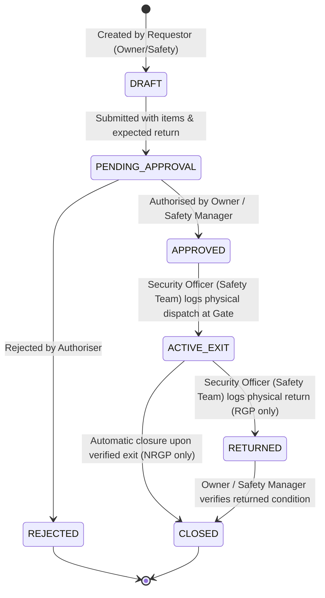
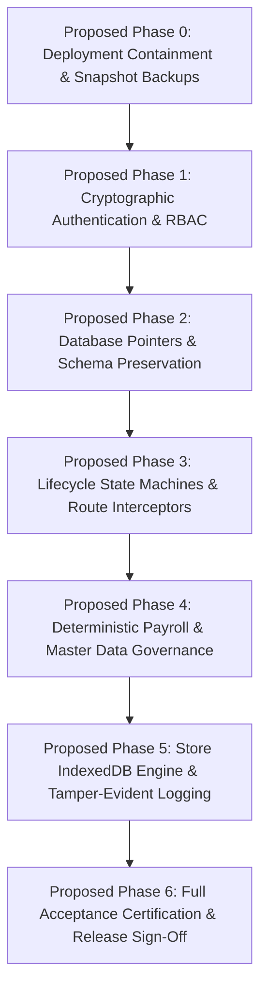

# BALSONS MULTI-PORTAL ECOSYSTEM
## FINAL MASTER TECHNICAL AUDIT & IMPLEMENTATION GOVERNANCE BASELINE V5.3 (FINAL SECURITY CLOSURE)

**Document Identifier:** `BAL-FINAL-MASTER-BASELINE-V5.3`  
**Governing Standard:** BFast Enterprise Design System (BEDS V1.0) & SAM-2026 Architecture  
**Project Context:** Jupiter Tatravagonka Railwheel Factory (JTRWF), Khordha, Odisha  
**Current Authorisation Status:** **STRICT TECHNICAL HOLD — IMPLEMENTATION PERMISSION NOT GRANTED**  
**Governing Principle:** PRESERVE THE EXISTING BALSONS ARCHITECTURE. PROTECT THE EXISTING BUSINESS DATA. REPAIR THE EXISTING PORTALS. DO NOT REBUILD THE ECOSYSTEM.

---

# 1. EXECUTIVE AUDIT VERDICT & GOVERNANCE FRAMEWORK

Following exhaustive static analysis of the original `balsons portals.zip` package and direct inspection of all source files, this **V5.3 Master Baseline** establishes the authoritative, file-specific technical governance blueprint. It incorporates all final security closures, including the verified elimination of development authentication bypasses across backend and frontend, controlled user provisioning without automatic hardcoded credentials, and schema-safe first-login password enforcement.

### 1.1 Strict Execution Boundaries & Hold Confirmation
* **Zero Production Source Code Modifications:** No source files across the operational portals (`BALSONS SAFETY MANAGER`, `BALSONS HR MANAGER`, `BALSONS GATE ENTRY MANAGER`, `BALSONS STORE MANAGER`, and `BALSONS ENTERPRISE LAUNCHER`) have been modified or will be modified without separate written approval.
* **Zero Apps Script Execution:** No Google Apps Script functions, web dispatchers, or database initializers have been or will be executed.
* **Zero Database Mutations:** No live spreadsheets, sheets, columns, or historical rows have been or will be altered.
* **Terminology Governance:** All remediation items described in this document represent **proposed technical corrections** for future implementation. The original source files in the working directory remain 100% in their initial unpatched state.

---

# 2. COMPLETE SOURCE INVENTORY

The following inventory details every portal component and source directory in the project package:

```
d:\BALSONS JUPITER PROJECT\OTHER\balsons portals
├── assets/                                      # Shared BEDS core assets (CSS, JS, icons)
│   ├── css/beds.css                             # Unified BEDS design tokens and layout styling
│   └── js/
│       ├── beds-workspace.js                    # Cross-portal topbar, dual-sync pill, and navigation
│       ├── beds-superadmin.js                   # Super admin overlay and elevation controller
│       ├── beds-portal-login.js                 # Unified portal login modal and visual backdrop
│       └── balsons-sam-auth.js                  # Shared SAM-2026 client auth helper
├── BALSONS ENTERPRISE LAUNCHER/                 # Central enterprise portal hub
│   ├── index.html                               # Hub landing page linking all 5 portals
│   └── assets/                                  # Launcher-specific BEDS assets
├── BALSONS SAFETY MANAGER/                      # Safety, EHS & PTW Governance Portal
│   ├── apps-script/                             # Google Apps Script backend
│   │   ├── appsscript.json                      # Manifest (Timezone: Asia/Kolkata)
│   │   ├── Code.gs                              # Main API router / dispatcher
│   │   ├── AuthService.gs                       # Authentication, USERS seed, session logic
│   │   ├── AuditService.gs                      # Audit logging service
│   │   ├── DbInit.gs                            # 21-sheet relational schema initializer
│   │   ├── PtwService.gs                        # PTW lifecycle, verification, approval
│   │   └── InspectionService.gs                 # Inspections, TBT, hazard logging
│   └── frontend/                                # Browser client
│       ├── index.html                           # Single-page dashboard and permit interface
│       └── assets/js/api-client.js              # API transport client & local fallback store
├── BALSONS HR MANAGER/                          # HR & Dual-Wage Payroll Master Portal
│   ├── apps-script/                             # Google Apps Script backend
│   │   ├── appsscript.json                      # Manifest (Timezone: America/New_York)
│   │   ├── Code.gs                              # API router / dispatcher
│   │   ├── DbInit.gs                            # 22-sheet relational schema initializer
│   │   ├── EmployeeService.gs                   # Employee master & self-registration
│   │   └── PayrollEngine.gs                     # Dual-workforce payroll computation
│   └── frontend/                                # Browser client
│       ├── index.html                           # Single-page HR portal interface
│       └── assets/js/app.js                     # HR client, form handlers, registration
├── BALSONS GATE ENTRY MANAGER/                  # Gate Entry & Turnstile Access Portal
│   ├── .clasp.json                              # Clasp config (scriptId: 1emZvUYj...)
│   ├── apps-script/                             # Google Apps Script backend
│   │   ├── appsscript.json                      # Manifest (Timezone: America/New_York)
│   │   ├── Code.gs                              # Gate API router, AUTH_HEADER_KEY dev bypass
│   │   ├── AuthService.gs                       # Gate user auth, lockout, password hashing
│   │   ├── AuditService.gs                      # Audit trail logger
│   │   ├── DbInit.gs                            # Gate relational schema initializer
│   │   ├── MasterDataService.gs                 # Personnel, contractor, vehicle master data
│   │   └── GateTransactionService.gs            # Material inward, RGP/NRGP pass center
│   └── frontend/                                # Browser client
│       ├── index.html                           # Gate entry dashboard & quick-fill buttons
│       ├── assets/js/config.js                  # Frontend config (contains DEV_AUTH_TOKEN)
│       ├── assets/js/api-client.js              # API transport client (DEV_AUTH_TOKEN fallback)
│       └── assets/js/app.js                     # Gate client, scan loop, modal logic
├── BALSONS STORE MANAGER/                       # Store & Tool Management Portal
│   ├── apps-script/                             # Disconnected Legacy Apps Script backend
│   │   ├── appsscript.json                      # Manifest (Timezone: Asia/Kolkata)
│   │   ├── Code.gs                              # Legacy Store router
│   │   ├── DbInit.gs                            # Legacy Store schema initializer
│   │   └── StoreService.gs                      # Legacy inventory and procurement service
│   ├── frontend/                                # Approved Offline-First Frontend
│   │   ├── index.html                           # Store management dashboard
│   │   └── assets/js/
│   │       ├── app.js                           # Store client logic (currently localStorage)
│   │       ├── tool-data.js                     # 264-tool master JavaScript dataset
│   │       └── translations.js                  # Multi-language dictionary (EN, HI, OD)
│   └── REQUIREMENT FOR STORE MANAGER PORTAL...  # Governing specification (IndexedDB mandate)
├── BALSONS OPERATIONS MANAGER/                  # Operations Erection Master (Landing shell)
│   ├── index.html                               # Workspace shell interface
│   └── assets/js/beds-workspace.js              # Duplicate workspace JS (reuses Store ID)
├── BALSONS PURCHASE MANAGER/                    # Commercial Procurement (Workspace shell)
│   ├── index.html                               # Workspace shell interface
│   └── assets/js/beds-workspace.js              # Duplicate workspace JS (reuses Store ID)
└── BALSONS REPOTS PORTAL/                       # Central Sync Hub (Workspace shell)
    ├── index.html                               # Workspace shell interface
    └── assets/js/beds-workspace.js              # Duplicate workspace JS (reuses Store ID)
```

---

# 3. VERIFIED DATABASE TOPOLOGY AND OWNERSHIP REGISTER

The ecosystem comprises five discrete business domains, each with strict data boundaries:

### Table 3.1: Master Database Topology & Pointer Reconciliation Register

| Business Domain | Authorized System of Record | Actual Source Spreadsheet / Database Reference | Source Files Containing Reference | Verified Status & Proposed Action |
| :--- | :--- | :--- | :--- | :--- |
| **Safety Manager** | Dedicated Google Sheets Database | `1SyOGt6HEu6HJCufAbB2_P6BgF6pEppt28J_8cARaOP0` | `apps-script/Code.gs`<br>`frontend/assets/js/config.js`<br>`assets/js/beds-workspace.js` | **Source-Consistent:** Reconciles across all Safety source files. Dedicated database. Production ownership to be certified in Phase 0. |
| **HR & Payroll Manager** | Dedicated Google Sheets Database | `1so_aH05vVxiUJsIK6VS-n7BpGrHWNgn_5EK7RuA3cuw` | `apps-script/Code.gs`<br>`frontend/assets/js/config.js`<br>`assets/js/beds-workspace.js` | **Source-Consistent:** Reconciles across all HR source files. Dedicated database for 22 Table 5 relational sheets. Production ownership to be certified in Phase 0. |
| **Gate Entry Manager** | Dedicated Google Sheets Database | `1yAuZOXc8WoC2TvTvnEWMrOyLl_50BRuJgDed_pdFT3o` | `apps-script/Code.gs`<br>`apps-script/DbInit.gs`<br>`apps-script/GateTransactionService.gs`<br>`frontend/assets/js/config.js` | **Source-Consistent:** Verified database ID across all Gate application files. Production ownership to be certified in Phase 0. |
| **Gate Entry Manager** *(clasp scriptId)* | Apps Script Project Container | `1emZvUYjT-hTduELE4lSboVCtndFfGQ8KC2elpQ6Em9TF4RW6d2VF75J-` | `BALSONS GATE ENTRY MANAGER/.clasp.json`<br>`beds-workspace.js` (topbar URL) | **Defect Reconciled (`G-02`):** This is the Apps Script `scriptId`. Proposed remediation: Reconcile topbar link to point to `1yAuZOXc...` during Phase 2. |
| **Store Manager** *(Approved Runtime)* | Browser-Local IndexedDB | `BALSONS_STORE_DB` (IndexedDB Object Stores) | Mandated by Requirements Document (Sections 4 & 16) | **Approved Working Direction:** Zero-server, offline-first. Does NOT connect to Google Sheets. Authoritative Excel master workbook (`.xlsx`) must be inspected before final schema freeze. |
| **Store Manager** *(Legacy Apps Script)* | Disconnected Google Sheets (Legacy) | `1u_ZKvvCVfEQDAtkoMR68q2d2hEK-eWBnvsS3AGfP6yQ` | `BALSONS STORE MANAGER/apps-script/Code.gs`<br>`BALSONS STORE MANAGER/frontend/assets/js/config.js` | **Legacy Component Only:** Proposed remediation: Endpoints to be contained/decommissioned in Phase 0. Never reconnect to Store frontend. |
| **Operations Manager** | Unresolved | Reuses Store ID: `1u_ZKvvCVfEQDAtkoMR68q2d2hEK-eWBnvsS3AGfP6yQ` | `BALSONS OPERATIONS MANAGER/assets/js/beds-workspace.js` | **Defect Reconciled (`O-01`):** Erroneously mapped to Store spreadsheet. Dedicated Operations production workbook not provided in package. Marked on strict **HOLD**. |
| **Purchase Manager** *(Shell)* | Unresolved | Reuses Store ID: `1u_ZKvvCVfEQDAtkoMR68q2d2hEK-eWBnvsS3AGfP6yQ` | `BALSONS PURCHASE MANAGER/assets/js/beds-workspace.js` | **Defect Reconciled:** Shell only; duplicates Store spreadsheet ID. Must not be treated as legitimate database assignment. Marked on **HOLD**. |
| **Reports Portal** *(Shell)* | Unresolved | Reuses Store ID: `1u_ZKvvCVfEQDAtkoMR68q2d2hEK-eWBnvsS3AGfP6yQ` | `BALSONS REPOTS PORTAL/assets/js/beds-workspace.js` | **Defect Reconciled:** Shell only; duplicates Store spreadsheet ID. Must not be treated as legitimate database assignment. Marked on **HOLD**. |
| **Enterprise Launcher** | Navigation Hub Only | Reuses Store ID: `1u_ZKvvCVfEQDAtkoMR68q2d2hEK-eWBnvsS3AGfP6yQ` | `BALSONS ENTERPRISE LAUNCHER/assets/js/beds-workspace.js` | **Defect Reconciled:** Launcher does not own a transactional database; duplicates Store ID in topbar. Proposed remediation: Neutralize topbar sync pill during Phase 2. |

---

# 4. CORRECTED MASTER FINDINGS REGISTER (40 VERIFIED ITEMS)

All 40 findings are verified against the original source code.

```
Total Reconciled Findings: 40
├── Priority 0 (P0) - Critical Production / Security Release Blockers: 10
├── Priority 1 (P1) - Major Workflow, Authorization, Architecture & Data Integrity Defects: 18
├── Priority 2 (P2) - Configuration, Governance, Accessibility & Consistency Defects: 9
└── Priority 3 (P3) - Missing Evidence, External Dependencies & Document Discrepancies: 3
```

### Table 4.1: Comprehensive Findings Register

| ID | Sev | Portal / Module | Exact File & Function/Line | Verified Defect Mechanism | Operational / Security Risk | Proposed Technical Correction | Dependency / Decision | Test ID |
| :---: | :---: | :--- | :--- | :--- | :--- | :--- | :--- | :---: |
| **A-01** | **P0** | Shared BEDS | `assets/js/beds-superadmin.js`<br>`init()` | Injects active Super Admin session into localStorage on page load if none exists. | Unauthenticated administrative access to all portal interfaces in browser. | Proposed: Remove auto-injection. Initialize fresh browser session as strictly unauthenticated `GUEST`. | Approved auth policy | TC-01 |
| **A-02** | **P0** | Shared BEDS | `assets/js/beds-superadmin.js`<br>`login()` | Password check accepts any string where `password.length >= 4`. | Administrative login bypassed by entering any 4-character string. | Proposed: Enforce server-side authentication against verified credentials; purge client-side validation. | Phase 1 Auth Service | TC-02 |
| **G-01** | **P0** | Gate Entry | `apps-script/Code.gs` Lines 12, 68–70, `frontend/config.js` Line 18, `frontend/api-client.js` Line 24 | Backend: `AUTH_HEADER_KEY` matches `'BALSONS_JTRWF_GATE_PHASE0_DEV_KEY'` and synthesizes `DEV_CLI` Owner session. Frontend: `DEV_AUTH_TOKEN` fallback. | Complete bypass of authentication; any caller passing dev key receives full Owner privileges without password or database check. | Proposed: Remove `AUTH_HEADER_KEY` and `DEV_CLI` session branch from `Code.gs`. Remove `DEV_AUTH_TOKEN` from `config.js` and fallback from `api-client.js`. | None | TC-03 |
| **G-05** | **P0** | Gate Entry | `apps-script/AuthService.gs`<br>`seedDefaultUsersIfEmpty()`, `frontend/index.html` Lines 668–674 | Hardcodes plain credentials (`Balsons@2026!`, `Safety@2026!`, `Team@2026!`) in backend auto-seed, and provides quick-fill demo buttons in UI. | Plaintext credentials in code; auto-seeding on empty database recreates public credentials; UI auto-fills passwords. | Proposed: Remove `seedDefaultUsersIfEmpty()` automatic invocation. Remove quick-fill buttons from `index.html`. Enforce one-time admin provisioning. | Sponsor credential approval | TC-04 |
| **S-01** | **P0** | Safety Manager | `apps-script/Code.gs`<br>`doPost()` | Dispatcher routes mutation actions (`ptw.create`, `ptw.verify`, `ptw.approve`) without session check. | Anonymous callers can create, verify, approve, or close high-risk work permits. | Proposed: Implement mandatory `AuthService.validateSession(authToken)` on all routes. | Phase 1 Auth Service | TC-05 |
| **S-06** | **P0** | Safety Manager | `apps-script/AuthService.gs`<br>Lines 54–62 | Validates password against hardcoded strings `Balsons@2026` and `admin123`. | Hardcoded credentials permit unauthorized login for any active user account. | Proposed: Remove hardcoded strings. Enforce individual salt and cryptographic hash verification. | Sponsor credential approval | TC-06 |
| **S-07** | **P0** | Safety Manager | `apps-script/DbInit.gs`<br>Lines 93–97 | Seeded password hash `e3b0c442...` is SHA-256 of empty string `""` with salt `salt2026`. Note: Current auth does not verify this hash. | Credential-seed integrity defect and critical secure-migration blocker. Enabling DB check without migration breaks login. | Proposed: Execute controlled credential migration generating unique salts and individual hashes before activating DB check. | Phase 1 Migration Script | TC-07 |
| **S-08** | **P0** | Safety Manager | `apps-script/Code.gs`<br>Lines 65–66 | `db.init` exposed in public `doPost`, passing caller-supplied `payload.spreadsheetId`. | Anonymous actors can trigger schema overwrites on arbitrary spreadsheets. | Proposed: Remove `db.init` from web dispatcher. Restrict to manual IDE execution with allowlist. | Phase 0 Containment | TC-08 |
| **HR-06**| **P0** | HR & Payroll | `apps-script/Code.gs`<br>`doPost()` | Dispatcher reads `authToken` but never validates it; `auth.login` returns mock token and caller-chosen role. | Total bypass of HR authentication; unauthenticated employee creation and payroll execution. | Proposed: Implement server-side session interceptor, server-determined roles, and token validation. | Phase 1 Auth Service | TC-09 |
| **ST-01**| **P0** | Store Manager | `BALSONS STORE MANAGER/apps-script/Code.gs` | Public Apps Script dispatcher exposes procurement and inventory mutations anonymously. | Arbitrary external mutation of Store inventory records if web app is invoked. | Proposed: Decommission / restrict legacy Apps Script deployment. Confirm zero-server IndexedDB architecture. | Phase 0 Containment | TC-10 |
| **S-02** | **P1** | Safety Manager | `apps-script/PtwService.gs`<br>`updatePermitStatus()` | Permit approval does not enforce prerequisite lifecycle sequence or checklist validation. | Permits can jump directly from draft to issued without site inspection or safety verification. | Proposed: Enforce strict state machine: `DRAFT` $\rightarrow$ `SUBMITTED` $\rightarrow$ `VERIFIED_BY_SAFETY` $\rightarrow$ `AUTHORISED` $\rightarrow$ `ISSUED`. | Phase 3 State Machine | TC-11 |
| **S-03** | **P1** | Safety Manager | `frontend/assets/js/api-client.js`<br>Line 434 | Backend lacks `gate.checkClearance` route; client falls back to memory store. | Unverified personnel or vehicles can enter high-risk lifting and rigging zones. | Proposed: Implement backend `gate.checkClearance` route; enforce fail-closed clearance policy. | Inter-portal API standard | TC-12 |
| **S-04** | **P1** | Safety Manager | `apps-script/Code.gs`<br>`doPost()` | Dispatcher lacks route handlers for `induction.list`, `induction.create`, and `gate.checkClearance`. | Induction records and gate checks fail over to client memory store without persistence. | Proposed: Implement all declared routes with transactional journaling and schema validation. | Schema verification | TC-13 |
| **S-09** | **P1** | Safety Manager | `frontend/assets/js/api-client.js`<br>Lines 385–698 | Broad `_dispatchLocal` catch-block simulates live success for 15+ backend routes in memory. | False positive success displayed for failed approvals, permits, CAPAs, and inspections. | Proposed: Remove simulation fallback. Enforce explicit fail-closed UI state reporting backend errors. | None | TC-14 |
| **G-02** | **P1** | Gate Entry | `frontend/assets/js/beds-workspace.js`| Topbar shortcut contains script ID (`1emZvUYj...`) instead of database ID (`1yAuZOXc...`). | Users clicking "Database" topbar link encounter broken or invalid sheet URL. | Proposed: Reconcile topbar link to point to verified Gate database spreadsheet (`1yAuZOXc...`). | None | TC-15 |
| **G-03** | **P1** | Gate Entry | `apps-script/GateTransactionService.gs`<br>Lines 212–227 | `createGatePass()` hardcodes `ApprovalStatus='APPROVED'`, `GateStatus='DISPATCHED_EXITED'`, and logs exit. | Gate passes exited without authorization; collapses pass creation, approval, and physical exit. | Proposed: Enforce separation of pass creation, approval, and physical movement logging within approved roles. | Role decision | TC-16 |
| **G-06** | **P1** | Gate Entry | `apps-script/AuthService.gs`<br>`hashPassword()` | Single-round SHA-256 with 16-character UUID substring salt. | Inadequate cryptographic key stretching; vulnerable to fast offline brute-force attacks. | Proposed: Upgrade to verified cryptographic standard with adequate key stretching and secure salt. | Password standard approval | TC-17 |
| **G-07** | **P1** | Gate Entry | `apps-script/Code.gs`<br>`doPost()` | Actions processed without route-specific role authorization checks in GateTransactionService and MasterData. | Safety Team user can execute Owner-level administrative actions or pass approvals. | Proposed: Implement route-specific RBAC matrix verifying caller's role against action permissions. | Role decision | TC-18 |
| **G-08** | **P1** | Gate Entry | `apps-script/AuthService.gs`<br>`validateSession()` | Session validation verifies cache presence but does not recheck `IsActive` in `USER_MASTER`. | Disabled or locked users retain full access until 6-hour cache TTL expires. | Proposed: Revalidate user's `IsActive` status on every request; evict cache immediately if disabled. | CacheService policy | TC-19 |
| **HR-01**| **P1** | HR & Payroll | `apps-script/EmployeeService.gs`<br>Lines 25–48 | Employee master column extraction uses 14 misaligned indices vs 26-column schema. | PAN, Aadhaar, Bank Details, and Wage Types mapped to wrong fields or dropped. | Proposed: Align extraction indices strictly with Table 5 Relational Specification (26 columns). | None | TC-20 |
| **HR-02**| **P1** | HR & Payroll | `apps-script/PayrollEngine.gs`<br>Lines 31–110 | Hardcoded fallback values (`present \|\| 26`, `dailyRate \|\| 950`, `ctc \|\| 50000`, `payableDays = 30`). | Zero attendance paid as 26 days; missing wage structure defaults to ₹950; incorrect gross. | Proposed: Enforce deterministic computation: missing data halts pay run; zero attendance yields ₹0 gross. | Payroll workbook verification | TC-21 |
| **HR-03**| **P1** | HR & Payroll | `frontend/assets/js/app.js`<br>`submitRegistration()` | Registration form uses `mode: 'no-cors'`, discarding backend response. | Frontend displays success even if backend fails, rejects, or drops registration. | Proposed: Verify Apps Script CORS handling; handle redirect-safe responses and display true status. | CORS transport proof | TC-22 |
| **HR-04**| **P1** | HR & Payroll | `frontend/assets/js/app.js`<br>`saveDraft()` | Employee document uploads converted to Base64 and stored in unencrypted `localStorage`. | PII and statutory identity documents exposed to client-side exfiltration. | Proposed: Purge Base64 documents from `localStorage`; stage directly to secure, restricted Drive folder. | Drive folder provisioning | TC-23 |
| **HR-05**| **P1** | HR & Payroll | `apps-script/EmployeeService.gs`<br>Lines 86–91 | Injects fake PAN (`ABCDE1234F`), Aadhaar (`4928 1192 8840`), and fake bank details. | Corrupts database with fraudulent compliance data; legal non-compliance. | Proposed: Never fabricate statutory data. Retain blank/null with `PENDING` status unless verified. | HR policy approval | TC-24 |
| **HR-07**| **P1** | HR & Payroll | `apps-script/EmployeeService.gs`<br>`getSeedEmployees()` | Silently serves hardcoded mock employees when database query fails or returns empty. | Production users confuse demonstration records with live employee records. | Proposed: Remove silent mock fallback. Display unambiguous `DATABASE_UNAVAILABLE` error state. | None | TC-25 |
| **ST-02**| **P1** | Store Manager | `frontend/assets/js/app.js`<br>`init()` | Frontend stores inventory in browser `localStorage`, disconnected from persistent database. | Data lost on browser cache clear; multi-device inventory synchronization impossible. | Proposed: Implement robust IndexedDB transactional storage with JSON backup and Excel import/export. | Excel master workbook | TC-26 |
| **ST-05**| **P1** | Store Manager | `frontend/assets/js/app.js`<br>Lines 1105–1140 | `submitNewPr()` auto-assigns `APPROVED_BY_DIRECTOR` with hardcoded date and array-length ID. | Bypasses commercial review; allows unauthorized procurement creation. | Proposed: Implement multi-stage procurement lifecycle: `DRAFT` $\rightarrow$ `SUBMITTED` $\rightarrow$ `APPROVED` $\rightarrow$ `PO` $\rightarrow$ `GRN`. | Commercial workflow policy | TC-27 |
| **O-01** | **P1** | Multi-Portal | `assets/js/beds-workspace.js`<br>`PORTAL_DATABASES` | Operations, Purchase, Reports, and Launcher map to Store spreadsheet ID (`1u_ZKvv...`). | Cross-domain confusion; potential unauthorized access across portal databases. | Proposed: Neutralize workspace mapping. Retain Operations on HOLD pending dedicated workbook. | Sponsor workbook provision | TC-28 |
| **P-01** | **P2** | Multi-Portal | `apps-script/appsscript.json` | HR and Gate manifests set to `America/New_York`; Safety and Store set to `Asia/Kolkata`. | 10.5-hour timestamp skew on gate passes, attendance logs, and audit trails. | Proposed: Standardize all `appsscript.json` manifests to `Asia/Kolkata` (IST, UTC+05:30). | None | TC-29 |
| **S-05** | **P2** | Safety Manager | `apps-script/DbInit.gs`<br>`SCHEMAS` | Initializer header comment states 20 sheets, but SCHEMAS array provisions 21 sheets. | Documentation and code count mismatch creating audit confusion. | Proposed: Correct header comment to declare 21 relational sheets; verify sheet list against spec. | None | TC-30 |
| **S-10** | **P2** | Safety Manager | `BALSONS SAFETY MANAGER/apps-script/DbInit.gs` | Requirements reference `SAFETY_DOCUMENTS` (D-06), but sheet is missing from `DbInit.gs`. | Safety compliance documents cannot be stored in structured database schema. | Proposed: Document discrepancy; define fields and retention policy before provisioning. | Sponsor schema decision | TC-31 |
| **G-04** | **P2** | Gate Entry | `apps-script/GateTransactionService.gs`<br>`ensureSheet()` | Dynamic schema creation at runtime during ordinary transactions. | Risk of inconsistent column headers, missing formatting, and corrupted relationships. | Proposed: Mandate strict schema pre-provisioning; fail closed if expected sheet is missing. | None | TC-32 |
| **HR-08**| **P2** | HR & Payroll | `apps-script/EmployeeService.gs`<br>Lines 65, 188, 276 | IDs generated using `Math.random()` (`'EMP-2026-' + Math.floor(Math.random()*9000+1000)`). | Severe ID collision risk under concurrent onboarding and registration. | Proposed: Implement atomic sequence counter with LockService and uniqueness verification. | LockService policy | TC-33 |
| **ST-03**| **P2** | Store Manager | `frontend/assets/js/translations.js` | Section labels inconsistent across bilingual dictionaries (Hindi/Odia/English). | Confusion among field technicians and store keepers during equipment checkout. | Proposed: Synchronize all translation tokens with official project terminology glossary. | Sponsor glossary approval | TC-34 |
| **ST-04**| **P2** | Store Manager | `apps-script/StoreService.gs` | Legacy multi-sheet inventory adjustments executed sequentially without rollback. | Ledger becomes unbalanced if intermediate write fails (issued without deduction). | Proposed: Implement atomic multi-sheet transaction wrapper with compensational rollback. | Legacy containment | TC-35 |
| **UI-01**| **P2** | Store Manager | `BALSONS STORE MANAGER/frontend/index.html`<br>`<meta name="viewport">` | `maximum-scale=1.0, user-scalable=no` disables pinch-to-zoom (Store Manager only). | Violates WCAG 2.1 accessibility; technicians cannot zoom on complex equipment tables. | Proposed: Update viewport: `width=device-width, initial-scale=1.0` (matching other portals). | None | TC-36 |
| **UI-02**| **P2** | Multi-Portal | `index.html` (All portals) | Frontend CSS/JS script tags lack cache-busting query versions (`v=1.0`). | Browsers execute stale, cached client scripts after backend updates are deployed. | Proposed: Append deterministic asset versioning: `beds.css?v=2026.1`, `app.js?v=2026.1`. | Release management | TC-37 |
| **S-11** | **P3** | Safety Manager | `BALSONS SAFETY MANAGER` | Requirements specify 10 permit templates; supplied DOCX library contains only 7 draft forms. | Technicians cannot issue T08–T10 permits with approved statutory form layouts. | Proposed: Document discrepancy; track T08–T10 as pending until approved forms provided. | Sponsor form provision | TC-38 |
| **C-01** | **P3** | Operations Manager | `BALSONS OPERATIONS MANAGER/` | Operations portal contains only a landing/workspace shell; backend outside package. | Operations workflows cannot be certified from packaged evidence alone. | Flag as external boundary; maintain independent container pending backend delivery. | Sponsor delivery | TC-39 |
| **C-03** | **P3** | Gate Entry | `tests/gate-test-suite.js` | Test suite provides execution evidence for 19 tests vs 27 required by baseline. | Test coverage gaps for non-returnable materials and multi-item vehicle dispatches. | Proposed: Expand automated test suite to 100% of declared operational scenarios. | Phase 6 Acceptance | TC-40 |

---

# 5. SECURITY AND AUTHENTICATION ARCHITECTURE

### 5.1 Shared BEDS Authentication Refactoring
To eliminate `A-01` and `A-02`:
1. **Fresh Session State:** A fresh browser session must always initialize with `session = null` and display the login overlay. The automatic injection `if (!session) this.initSuperAdminSession()` in `beds-superadmin.js` is to be excised.
2. **Purge Client-Side Validation:** The client-side password length check (`password.length >= 4`) is to be completely removed.
3. **Server-Side Verification:** The login modal will transmit credentials to the target portal's authenticated endpoint and establish session context only upon receiving a cryptographically verified server response.

### 5.2 Gate Entry Authentication, Bypass Purge & Schema-Safe First-Login Policy (`G-01`, `G-05`, `G-08`)
Addressing direct verification of Gate backend and frontend entry points:
1. **Purge Backend Dev Bypass (`G-01`):** In `BALSONS GATE ENTRY MANAGER/apps-script/Code.gs`:
   - Remove `AUTH_HEADER_KEY: 'BALSONS_JTRWF_GATE_PHASE0_DEV_KEY'` from `CONFIG` (line 12).
   - Excise lines 68–70:
     ```javascript
     if (authToken === CONFIG.AUTH_HEADER_KEY) {
       session = { userId: 'DEV_CLI', username: 'dev.cli', fullName: 'Phase 0 Test Harness', role: 'Owner' };
     }
     ```
   - Ensure that all incoming requests without exception pass to `AuthService.validateSession(authToken)`.
2. **Purge Frontend Dev Tokens & Transport Fallbacks (`G-01`):**
   - In `BALSONS GATE ENTRY MANAGER/frontend/assets/js/config.js`, excise line 18: `DEV_AUTH_TOKEN: "BALSONS_JTRWF_GATE_PHASE0_DEV_KEY",`.
   - In `BALSONS GATE ENTRY MANAGER/frontend/assets/js/api-client.js`, excise line 24 fallback:
     ```javascript
     // PROPOSED REMOVAL:
     // const authToken = customToken !== null ? customToken : APP_CONFIG.DEV_AUTH_TOKEN;
     // REPLACEMENT:
     const authToken = customToken || (typeof BalsonsAuth !== 'undefined' ? BalsonsAuth.getToken() : null);
     ```
   - In `BALSONS GATE ENTRY MANAGER/frontend/assets/js/app.js`, excise line 14: `const DEV_TOKEN = 'DEV-TOKEN-OWNER-2026';`.
3. **Purge Quick-Fill UI Buttons (`G-05`):**
   - In `BALSONS GATE ENTRY MANAGER/frontend/index.html`, excise lines 668–674:
     ```html
     <!-- PROPOSED REMOVAL: Complete .quick-users container -->
     <div class="quick-users">
       <p>QUICK AUTOFILL FOR TESTING:</p>
       ...
     </div>
     ```
   - Excise line 2588 `quickFill()` JavaScript function from `index.html`.
4. **Eliminate Automatic Default-User Auto-Seeding (`G-05`):**
   - In `BALSONS GATE ENTRY MANAGER/apps-script/AuthService.gs`, excise the automatic invocation of `this.seedDefaultUsersIfEmpty()` from line 112 of `login()`.
   - An empty `USER_MASTER` sheet must **never automatically recreate publicly known default accounts**.
   - User provisioning must be an explicit, one-time controlled administrative procedure (`provisionInitialAdmin()`) executed manually from the Apps Script IDE with high-entropy, account-specific bootstrap credentials.
5. **Schema-Safe First-Login Password Change Policy (Preserving 9-Column Schema):**
   - The existing `USER_MASTER` schema consists of exactly nine columns:
     `['UserID', 'Username', 'FullName', 'Role', 'PasswordHash', 'Salt', 'IsActive', 'LastLogin', 'CreatedAt']`
   - It does **not** contain a `ForcePasswordChange` column. In accordance with strict non-destructive governance, **no new columns will be added to `USER_MASTER`** without formal schema-change authorization.
   - **Proposed Schema-Safe State Machine:**
     - When an account is provisioned by the administrator, Column 8 (`LastLogin`) is initialized to `'-'` (representing that the user has never logged in).
     - Upon initial authentication against the temporary bootstrap credential, `AuthService.login()` inspects `LastLogin`.
     - If `LastLogin === '-'` or `LastLogin === ''`, the server returns:
       `{ success: true, firstLoginRequired: true, temporaryToken: "RESET-..." }`
     - The temporary token is restricted in scope: it allows access **only** to the `auth.changePassword` action. All other operational actions return 403 `PASSWORD_CHANGE_REQUIRED`.
     - Upon successful execution of `auth.changePassword` with a compliant password, `AuthService` updates Column 8 (`LastLogin`) with the current ISO timestamp (`new Date().toISOString()`), naturally clearing the first-login state without modifying the database schema.
   - *Governance Notice:* This mechanism is a **proposed future implementation** and is not currently present in the unpatched source.
6. **Active Account Status Revalidation (`G-08`):**
   - Update `AuthService.validateSession(authToken)` so that it does not merely return cached session data.
   - On every protected request, re-query or verify against `USER_MASTER` that `IsActive === 'ACTIVE'`.
   - If an account has been marked `INACTIVE` or `LOCKED`, invalidate the cache entry immediately and reject the request with 403 `ACCOUNT_DISABLED`.

### 5.3 Password Derivation Specification & Technical Analysis
* **Safety S-07 Accurate Classification:** The current Safety `AuthService.gs` does **not** verify the stored empty-string SHA-256 digest (`e3b0c442...`). Instead, it authenticates using hardcoded passwords (`Balsons@2026`, `admin123`). `S-07` is accurately classified as a **credential-seed integrity defect and a critical secure-migration blocker**. Enabling database hash comparison without migrating seed records will break authentication or lock out users.
* **Proposed Derivation Standard (Option A - Recommended):**
  $$\text{DerivedKey} = \text{PBKDF2-HMAC-SHA256}(\text{Password}, \text{Salt}, \text{Iterations} = 5\,000, \text{KeyLength} = 256\text{ bits})$$
  - **Salt Generation:** 16-byte cryptographically secure random binary salt:
    $$\text{SaltHex} = \text{Utilities.computeDigest}(\text{Utilities.DigestAlgorithm.SHA_256}, \text{Utilities.getUuid}() + \text{new Date}().\text{getTime}()).\text{slice}(0, 16)$$
    Stored as a 32-character hexadecimal string in column 6 of the user sheet.
  - **Iteration Parameter:** 5,000 iterations balances cryptographic resistance against Apps Script execution latency (<150ms per login).

### 5.4 Ephemeral Session Management via `CacheService`
Session tokens are managed using Google Apps Script's native `CacheService`:
* **Token Structure:** High-entropy cryptographically unique bearer token:
  $$\text{Token} = \text{"BT-" } + \text{Utilities.getUuid}() + \text{"-" } + \text{new Date}().\text{getTime}()$$
* **Storage Contract:**
  - **Key:** `SESSION_` $+$ `Token`
  - **Time-to-Live (TTL):** Exactly 21,600 seconds (6 hours).
* **Fail-Closed Policy:** `CacheService` is treated strictly as an ephemeral cache. If a cache miss occurs, the backend **fails closed immediately**, returning 401 `SESSION_EXPIRED`.

---

# 6. PORTAL-SPECIFIC ROLE-PERMISSION MATRICES

### 6.1 Safety Manager Role Matrix
The Safety requirements establish five base roles. Site Manager authority is unrepresented in the seed users:

| Action / Capability | Owner / Super Admin (`admin`) | Safety Manager (`safety.mgr`) | Safety Officer (`safety.off`) | Work Supervisor (`sup.ramesh`) | Client Reviewer (`client.jtrwf`) | *Proposed Site Manager* (`site.mgr`) |
| :--- | :---: | :---: | :---: | :---: | :---: | :---: |
| **System Config & User Admin** | **ALLOW** | DENY | DENY | DENY | DENY | DENY |
| **PTW Create & Draft** | **ALLOW** | **ALLOW** | **ALLOW** | **ALLOW** | DENY | DENY |
| **PTW Submit** | **ALLOW** | **ALLOW** | **ALLOW** | **ALLOW** | DENY | DENY |
| **PTW Verify (`VERIFIED_BY_SAFETY`)** | DENY | **ALLOW** | **ALLOW** *(Assigned Areas)* | DENY | DENY | DENY |
| **PTW Authorize (`AUTHORISED`)** | DENY | DENY *(Oversight only)* | DENY | DENY | DENY | **ALLOW** |
| **PTW Issue (`ISSUED`)** | DENY | **ALLOW** | **ALLOW** | DENY | DENY | **ALLOW** |
| **PTW Suspend / Cancel** | **ALLOW** | **ALLOW** | **ALLOW** | DENY | DENY | **ALLOW** |
| **PTW Close Sign-Off** | **ALLOW** | **ALLOW** | **ALLOW** | **ALLOW** *(Handover)* | DENY | **ALLOW** |
| **TBT & Inspection Conduct** | **ALLOW** | **ALLOW** | **ALLOW** | **ALLOW** | DENY | DENY |
| **Hazard & Incident Log** | **ALLOW** | **ALLOW** | **ALLOW** | **ALLOW** | **ALLOW** *(Log only)*| **ALLOW** |
| **Incident Investigation** | **ALLOW** | **ALLOW** | **ALLOW** | DENY | DENY | **ALLOW** |
| **CAPA Management** | **ALLOW** | **ALLOW** | **ALLOW** | DENY | DENY | **ALLOW** |
| **Safety Clearance Override** | **ALLOW** | **ALLOW** | DENY | DENY | DENY | DENY |
| **Read-Only Compliance Audit** | **ALLOW** | **ALLOW** | **ALLOW** | **ALLOW** | **ALLOW** | **ALLOW** |

### 6.2 Gate Entry Manager Role & Service Authorization Matrix (`G-07`)
In accordance with sponsor clarification, Gate Entry strictly retains the three currently approved roles (`Owner`, `Safety Manager`, `Safety Team`). All service methods in `GateTransactionService.gs` and `MasterDataService.gs` must enforce these individual role permissions:

| Service / Function | API Operation / Action | Owner (`admin`) | Safety Manager (`safety.manager`) | Safety Team (`safety.team`) | Required Authorization Guard |
| :--- | :--- | :---: | :---: | :---: | :--- |
| `AuthService.login` | `auth.login` | **ALLOW** | **ALLOW** | **ALLOW** | Public endpoint |
| `AuthService.logout` | `auth.logout` | **ALLOW** | **ALLOW** | **ALLOW** | Session token required |
| `AuthService.createUser` | `user.create` | **ALLOW** | DENY | DENY | Enforce `role === 'Owner'` |
| `AuthService.updateUser` | `user.updateStatus` | **ALLOW** | DENY | DENY | Enforce `role === 'Owner'` |
| `MasterDataService.createPersonnel` | `personnel.create` | **ALLOW** | **ALLOW** | **ALLOW** *(Basic)* | Valid session |
| `MasterDataService.updatePersonnel` | `personnel.update` | **ALLOW** | **ALLOW** | DENY | Enforce `Owner` or `Safety Manager` |
| `MasterDataService.createContractor`| `contractor.create`| **ALLOW** | **ALLOW** | DENY | Enforce `Owner` or `Safety Manager` |
| `MasterDataService.createVehicle` | `vehicle.create` | **ALLOW** | **ALLOW** | **ALLOW** | Valid session |
| `GateTransactionService.evaluateClearance`| `clearance.evaluate`| **ALLOW** | **ALLOW** | **ALLOW** | Valid session |
| `GateTransactionService.overrideClearance`| `clearance.override`| **ALLOW** | **ALLOW** | DENY | Enforce `Owner` or `Safety Manager` |
| `GateTransactionService.createInward`| `inward.create` | **ALLOW** | **ALLOW** | **ALLOW** | Valid session |
| `GateTransactionService.updateInward`| `inward.updateStatus`| **ALLOW** | **ALLOW** | DENY | Enforce `Owner` or `Safety Manager` |
| `GateTransactionService.createGatePass`| `pass.create` | **ALLOW** | **ALLOW** | **ALLOW** | Valid session |
| `GateTransactionService.approveGatePass`| `pass.approve` | **ALLOW** | **ALLOW** | DENY | Enforce `Owner` or `Safety Manager` |
| `GateTransactionService.logPhysicalExit`| `pass.logExit` | **ALLOW** | DENY | **ALLOW** | Enforce `Safety Team` (or Owner) |
| `GateTransactionService.logPhysicalReturn`| `pass.logReturn` | **ALLOW** | **ALLOW** | **ALLOW** | Valid session |
| `GateTransactionService.closeGatePass`| `pass.close` | **ALLOW** | **ALLOW** | DENY | Enforce `Owner` or `Safety Manager` |
| `AuditService.exportLogs` | `audit.export` | **ALLOW** | **ALLOW** | DENY | Enforce `Owner` or `Safety Manager` |

### 6.3 HR & Payroll Manager Role Matrix

| Action / Capability | Super Admin (`admin`) | HR Head (`hr.head`) | Payroll Officer (`payroll.off`) | Work Supervisor (`sup.ramesh`) | Employee (`self`) |
| :--- | :---: | :---: | :---: | :---: | :---: |
| **Employee Master Full Access (with PII)**| **ALLOW** | **ALLOW** | DENY *(Masked PII)* | DENY *(Masked PII)* | DENY |
| **Employee Self-Registration Review** | **ALLOW** | **ALLOW** | DENY | DENY | DENY |
| **Registration Approval & Onboarding** | **ALLOW** | **ALLOW** | DENY | DENY | DENY |
| **Attendance Verification** | **ALLOW** | **ALLOW** | **ALLOW** | **ALLOW** *(Assigned Team)*| DENY |
| **Advance Management & Recovery** | **ALLOW** | **ALLOW** | **ALLOW** | DENY | DENY |
| **Monthly Payroll Calculation (Dry Run)** | **ALLOW** | **ALLOW** | **ALLOW** | DENY | DENY |
| **Payroll Batch Authorization & Lock** | **ALLOW** | **ALLOW** | DENY | DENY | DENY |
| **Payslip Generation & Distribution** | **ALLOW** | **ALLOW** | **ALLOW** | DENY | **ALLOW** *(Own only)*|
| **Statutory Data Modification (PAN/Bank)**| **ALLOW** | **ALLOW** | DENY | DENY | DENY |

---

# 7. SERVER-SIDE API ROUTE & AUTHORISATION MATRIX

### Table 7.1: Master API Route Governance

| Portal | Action / Endpoint | Method | Required Session Role | Request Payload Schema | Server Response Contract | Status Code |
| :--- | :--- | :---: | :--- | :--- | :--- | :---: |
| **Safety** | `system.ping` | POST | Public | `{}` | `{ success: true, version: string, timestamp: string }` | 200 |
| **Safety** | `auth.login` | POST | Public | `{ username: string, pass: string }` | `{ success: true, token: string, user: object }` | 200 / 401 |
| **Safety** | `ptw.create` | POST | Supervisor, Safety Off, Safety Mgr | `{ permitData: object }` | `{ success: true, permitId: string, status: "DRAFT" }` | 200 / 403 |
| **Safety** | `ptw.submit` | POST | Supervisor, Safety Off | `{ permitId: string, checklist: array }` | `{ success: true, permitId: string, status: "SUBMITTED" }` | 200 / 400 |
| **Safety** | `ptw.verify` | POST | Safety Officer, Safety Manager | `{ permitId: string, checks: array }` | `{ success: true, status: "VERIFIED_BY_SAFETY" }` | 200 / 403 |
| **Safety** | `ptw.approve` | POST | Site Manager *(or Auth Delegate)* | `{ permitId: string, approvalPin: string }` | `{ success: true, status: "AUTHORISED" }` | 200 / 403 |
| **Safety** | `ptw.issue` | POST | Safety Officer, Site Manager | `{ permitId: string }` | `{ success: true, status: "ISSUED", issuedAt: string }` | 200 / 403 |
| **Safety** | `ptw.close` | POST | Supervisor & Safety Officer | `{ permitId: string, signOff: object }` | `{ success: true, status: "CLOSED", closedAt: string }` | 200 / 400 |
| **Safety** | `gate.checkClearance`| POST | Safety Officer, Safety Manager | `{ employeeId: string, vehicleNo: string }` | `{ success: true, clearanceStatus: string, valid: bool }` | 200 / 404 |
| **Safety** | `db.init` | - | **DISABLED FROM PUBLIC DISPATCHER** | N/A | Returns 403 `ROUTE_DISABLED` | 403 |
| **Gate** | `auth.login` | POST | Public | `{ username: string, pass: string }` | `{ success: true, token: string, user: object }` | 200 / 401 |
| **Gate** | `pass.create` | POST | Owner, Safety Manager, Safety Team | `{ passType: string, items: array, consignee: string }` | `{ success: true, passId: string, status: "DRAFT" }` | 200 / 400 |
| **Gate** | `pass.approve` | POST | Owner, Safety Manager | `{ passId: string, approverRemarks: string }` | `{ success: true, status: "APPROVED", approvedBy: string }`| 200 / 403 |
| **Gate** | `pass.logExit` | POST | Safety Team *(Gate Officer)* | `{ passId: string, vehicleNo: string, gateNo: string }` | `{ success: true, status: "ACTIVE_EXIT", exitTime: string }`| 200 / 400 |
| **Gate** | `pass.logReturn`| POST | Safety Team, Safety Manager | `{ passId: string, returnCondition: string }` | `{ success: true, status: "RETURNED", returnTime: string }` | 200 / 400 |
| **Gate** | `inward.create` | POST | Safety Team, Safety Manager | `{ poNumber: string, dcNumber: string, vendor: string }` | `{ success: true, inwardId: string, status: "STORE_PENDING" }`| 200 / 400 |
| **HR** | `auth.login` | POST | Public | `{ username: string, pass: string }` | `{ success: true, token: string, user: object }` | 200 / 401 |
| **HR** | `employees.list`| POST | Authenticated Session | `{ filter: string }` | `{ success: true, employees: array }` *(PII Masked by Role)*| 200 / 401 |
| **HR** | `employees.create`| POST | HR Head, Super Admin | `{ employeeData: object }` | `{ success: true, empId: string, status: "ACTIVE" }` | 200 / 403 |
| **HR** | `registration.submit`| POST | Public / Onboarding Candidate | `{ registrationData: object }` | `{ success: true, regId: string, status: "SUBMITTED" }` | 200 / 400 |
| **HR** | `registration.approve`| POST | HR Head, Super Admin | `{ regId: string, wageType: string, rate: number }` | `{ success: true, empId: string, status: "APPROVED" }` | 200 / 403 |
| **HR** | `payroll.calculate`| POST | HR Head, Payroll Officer | `{ empId: string, payPeriod: string }` | `{ success: true, calculation: object }` | 200 / 400 |
| **HR** | `payroll.process`| POST | HR Head, Super Admin | `{ payPeriod: string, verificationPin: string }` | `{ success: true, payRunId: string, count: number }` | 200 / 403 |
| **HR** | `db.init` | - | **DISABLED FROM PUBLIC DISPATCHER** | N/A | Returns 403 `ROUTE_DISABLED` | 403 |

---

# 8. PERMIT TO WORK (PTW) STATE MACHINE SPECIFICATION

```mermaid
stateDiagram-v2
    [*] --> DRAFT : Created by Work Supervisor
    DRAFT --> SUBMITTED : Supervisor verifies checklist & submits
    SUBMITTED --> VERIFIED_BY_SAFETY : Safety Officer inspects site & verifies
    SUBMITTED --> REJECTED : Safety Officer rejects (mandatory reason)
    VERIFIED_BY_SAFETY --> AUTHORISED : Site Manager authorises permit
    VERIFIED_BY_SAFETY --> REJECTED : Site Manager rejects (mandatory reason)
    AUTHORISED --> ISSUED : Permit released for field execution
    ISSUED --> SUSPENDED : Unsafe condition / weather hold
    SUSPENDED --> ISSUED : Re-inspection & resumption approval
    ISSUED --> CANCELLED : Scope change / aborted operation
    ISSUED --> EXPIRED : Valid time window exceeded without extension
    ISSUED --> CLOSED : Work completed, site restored, signed off
    REJECTED --> [*]
    CANCELLED --> [*]
    EXPIRED --> [*]
    CLOSED --> [*]
```



---

# 9. GATE ENTRY TRANSACTION STATE MACHINE SPECIFICATION



---

# 10. STORE MANAGER LOCAL-FIRST ARCHITECTURE & TRUSTED-DEVICE BOUNDARIES

### 10.1 IndexedDB Storage Architecture
Store Manager transactional persistence will be migrated from `localStorage` to browser `IndexedDB`:
* **Database Name:** `BALSONS_STORE_DB`
* **Version:** 1
* **Object Stores (Transactional):**
  1. `tools`: Key: `id` (e.g. `BAL-LF-HYJ-001`), Indexes: `section`, `status`, `isLifting`, `form11Cert`.
  2. `transactions`: Key: `txId`, Indexes: `toolId`, `borrower`, `txType`, `timestamp`.
  3. `procurement`: Key: `prId`, Indexes: `status`, `category`, `requestedBy`.
  4. `quarantine`: Key: `quarantineId`, Indexes: `toolId`, `reason`, `status`.
  5. `vendors`: Key: `vendorId`, Indexes: `category`, `status`.
  6. `audit_journal`: Key: `seqNo`, Indexes: `timestamp`, `action`.
* **Client-Side Preference Storage (`localStorage`):** Non-transactional preferences such as UI color theme, bilingual language preference (`en`, `hi`, `od`), and table column visibility filters remain appropriately stored in browser `localStorage`.

### 10.2 Security Boundaries of Zero-Server Local-First Architecture
1. **Trusted-Device Requirement:** Because Store Manager executes with zero persistent backend server, data security relies entirely on the physical security and OS-level user profile isolation of the storekeeper's workstation.
2. **Absence of Server-Side Enforcement:** Access controls in local-first systems are enforced by client-side application logic. Anyone with direct physical access to DevTools or browser storage files can technically inspect or manipulate unencrypted local records.
3. **Data Loss Risks:** Clearing browser data, profile corruption, or hardware failure destroys the local database unless external backups are taken.
4. **Mandatory Operational Controls:**
   - Workstation must have full disk encryption (BitLocker) and screen-lock policies.
   - Storekeeper must execute mandatory daily cryptographic JSON exports (`STORE_BACKUP_YYYYMMDD.json`) to an approved external backup drive.
   - Periodic manual reconciliation against the authoritative production Excel workbook.

---

# 11. HR EMPLOYEE & PAYROLL DATA MAPPING

### 11.1 Corrected 26-Column `EMPLOYEE_MASTER` Extraction Mapping
Addressing `HR-01`, extraction must align with Table 5 Relational Specification:

| Index | Database Column Header | Extraction Property Name | Data Type / Format | Privacy / Masking Rule |
| :---: | :--- | :--- | :--- | :--- |
| `row[0]` | `EmpID` | `empId` | String (`EMP-2026-XXXX`) | Publicly visible |
| `row[1]` | `FullName` | `fullName` | String | Publicly visible |
| `row[2]` | `FatherName` | `fatherName` | String | Publicly visible |
| `row[3]` | `DOB` | `dob` | ISO Date (`YYYY-MM-DD`) | Restricted |
| `row[4]` | `Gender` | `gender` | String (`M` / `F` / `O`) | Publicly visible |
| `row[5]` | `BloodGroup` | `bloodGroup` | String (`A+`, `O+`, etc.) | Publicly visible |
| `row[6]` | `Mobile` | `mobile` | String (10 Digits) | Restricted |
| `row[7]` | `EmergencyContact` | `emergencyContact` | String | Restricted |
| `row[8]` | `PermanentAddress` | `permanentAddress` | String | Restricted |
| `row[9]` | `SiteCampAddress` | `siteCampAddress` | String | Publicly visible |
| `row[10]`| `Department` | `department` | String | Publicly visible |
| `row[11]`| `Designation` | `designation` | String | Publicly visible |
| `row[12]`| `Trade` | `trade` | String | Publicly visible |
| `row[13]`| `WageType` | `wageType` | String (`DAILY_PAY` / `MONTHLY`)| Restricted |
| `row[14]`| `DailyRateOrCTC` | `dailyRateOrCTC` | Numeric | **Masked** (HR Head only) |
| `row[15]`| `JoiningDate` | `joiningDate` | ISO Date (`YYYY-MM-DD`) | Publicly visible |
| `row[16]`| `PF_Applicable` | `pfApplicable` | Boolean (`TRUE` / `FALSE`)| Restricted |
| `row[17]`| `ESIC_Applicable`| `esicApplicable`| Boolean (`TRUE` / `FALSE`)| Restricted |
| `row[18]`| `PAN_No` | `panNo` | String (10 Chars) | **Masked** (`XXXXX1234X`) |
| `row[19]`| `Aadhaar_No` | `aadhaarNo` | String (12 Digits) | **Masked** (`XXXXXXXX1234`) |
| `row[20]`| `PoliceVerification_Ref`| `policeVerificationRef` | String | Restricted |
| `row[21]`| `MedicalFitness_Ref`| `medicalFitnessRef`| String | Restricted |
| `row[22]`| `BankAccNo` | `bankAccNo` | String | **Masked** (`XXXXXXXXX5678`)|
| `row[23]`| `BankIFSC` | `bankIfsc` | String (11 Chars) | **Masked** (HR Head only) |
| `row[24]`| `PhotoUrl` | `photoUrl` | URL String | Publicly visible |
| `row[25]`| `Status` | `status` | String (`ACTIVE` / `EXITED`) | Publicly visible |

---

# 12. PAYROLL FORMULA GOVERNANCE & DECISION REGISTER

All mathematical formulas remain on **HOLD** pending verification against the authoritative BALSONS payroll workbook.

### Table 12.1: Payroll Decision & Verification Register

| Calculation Parameter | Packaged Source Behaviour | Proposed Remediation Rule | Governing Verification Requirement | Implementation Status |
| :--- | :--- | :--- | :--- | :--- |
| **Daily Wage Base Pay** | `att.present * dailyRate` (defaults 26 * 950) | `att.present * dailyRate` (Gross = ₹0 if att=0) | Verify approved daily wage master and skill classification rates. | **HOLD** pending wage master |
| **Monthly Salary Components** | Basic 50%, HRA 25%, Site Allow 25% | Basic 50%, HRA 25%, Site Allow 25% | Verify formal CTC structure and component break-up policy. | **HOLD** pending CTC policy |
| **Payable Days (Monthly)** | Hardcoded `payableDays: 30` | `Present + WO + PL` | Reconcile against calendar days per month and leave policy. | **HOLD** pending leave policy |
| **Overtime Calculation** | Daily: `(Rate/8)*2*OT`; Monthly: `(Basic/208)*2*OT` | Maintained multiplier 2.0 | Reconcile statutory OT eligibility under Factories Act / State Rules. | **HOLD** pending OT policy |
| **PF Deduction (Daily)** | Strictly Zero | Strictly Zero | Verify daily-wage contractor statutory exemption certificates. | **HOLD** pending compliance audit |
| **PF Deduction (Monthly)** | `Min(1800, Basic * 12%)` | `Min(1800, Basic * 12%)` | Confirm if wage ceiling ₹15,000 applies or actual basic pay. | **HOLD** pending PF policy |
| **ESIC Deduction (Daily)**| Strictly Zero | Strictly Zero | Verify daily wage rate vs ESIC wage limit (₹21,000/month). | **HOLD** pending compliance audit |
| **ESIC Deduction (Monthly)**| `Gross <= 21000 ? Gross * 0.75% : 0` | `Gross <= 21000 ? Gross * 0.75% : 0` | Verify employee contribution rate (0.75%) and applicability. | **HOLD** pending compliance audit |
| **Professional Tax (PT)** | Fixed ₹200 (Monthly only) | Fixed ₹200 (Monthly only) | Reconcile Odisha Professional Tax slabs and exemption brackets. | **HOLD** pending Odisha PT slab |
| **Advance Recovery & Negative Net Pay** | Subtracted from gross | Separate gross earnings from advance recovery. If Gross < Advance, carry balance forward without negative pay. | Reconcile active loan ledger and negative net-pay policy. | **HOLD** pending negative-pay policy |

### 12.2 In-Memory Exception Queue (No New Database Sheets)
1. **Explicit Zero Attendance:** If `att.present === 0`, gross earnings = ₹0.
2. **Advance Recovery & Net Pay Treatment:** Advance recovery cannot create negative net pay. If gross earnings are ₹0 or less than scheduled recovery, advance deduction is capped or deferred to next period, pending sponsor policy.
3. **In-Memory Exception Reporting:** Employees with missing attendance, unverified rates, or advance anomalies will be flagged in an **in-memory batch execution report** returned to the HR Head UI. **No new database sheets will be added** to the spreadsheet without formal schema approval.

---

# 13. SCHEMA AND DATABASE PROTECTION SPECIFICATION

1. **Non-Destructive Initialization:** Database initializers (`DbInit.gs`) must inspect before modifying. If a sheet exists, it must verify header parity; it must **never execute `clear()` or overwrite existing headers**.
2. **Public Route Removal:** All `case 'db.init':` dispatchers are removed from public web controllers (`Code.gs`).
3. **Restricted Administration:** Database maintenance is executed solely by authorized developers within the Apps Script editor targeting an allowlisted spreadsheet ID stored in script properties.

---

# 14. TAMPER-EVIDENT HASH-CHAINED AUDIT LOGGING

Audit logging implements **Tamper-Evident Hash-Chained Journaling**:
$$\text{CurrentHash}_n = \text{SHA-256}\Big(\text{SeqNo}_n \parallel \text{PrevHash}_{n-1} \parallel \text{Timestamp}_n \parallel \text{Actor}_n \parallel \text{Role}_n \parallel \text{Action}_n \parallel \text{EntityRef}_n \parallel \text{Outcome}_n \parallel \text{Details}_n\Big)$$

* **Concurrency Control:** Atomic row writing is protected using `LockService.getScriptLock().waitLock(10000)`.
* **Verification Utility:** `verifyAuditIntegrity()` iterates from row 2 to `getLastRow()`, re-computing hashes and reporting any discrepancy.

---

# 15. BEDS VISUAL PRESERVATION SPECIFICATION

1. **Absolute Layout Freeze:** All HTML DOM trees, CSS classes, sidebar navigation, topbars, modals, font stacks, and color palettes are frozen.
2. **Zero Framework Introductions:** No external frameworks will be introduced. All styling remains native vanilla CSS (`beds.css`).
3. **Viewport Restriction Correction (`UI-01`):** The restriction `<meta name="viewport" content="width=device-width, initial-scale=1.0, maximum-scale=1.0, user-scalable=no">` was verified to exist **strictly in `BALSONS STORE MANAGER/frontend/index.html`**. It will be normalized to `width=device-width, initial-scale=1.0` to restore pinch-to-zoom accessibility.
4. **Asset Versioning Manifest:** Frontend asset links will receive deterministic query versioning (`beds.css?v=2026.1`, `app.js?v=2026.1`).

---

# 16. BACKUP AND DISASTER RECOVERY PLAN

1. **Google Sheets Workbooks:** For Safety (`1SyOGt6...`), HR (`1so_aH...`), and Gate (`1yAuZO...`), execute an automated Google Drive file copy creating isolated timestamped snapshots (`BACKUP_PRE_REMEDIATION_YYYYMMDD_HHMMSS`) stored in an **approved, restricted administrative backup folder**.
2. **Store Manager:** Export complete IndexedDB database to an encrypted JSON snapshot (`STORE_BACKUP_YYYYMMDD.json`) stored in offline restricted storage.
3. **Source Code:** Tag current git commit across all repositories as `pre-remediation-baseline-v5.3`.
4. **Restoration Verification:** Restore backups into an isolated test folder and verify primary key uniqueness and row-count parity prior to initiating Phase 0.

---

# 17. PHASED IMPLEMENTATION PLAN (PROPOSED PHASES 0–6)

All phases represent **proposals pending written sponsor approval**.



### Table 17.1: Phased Implementation Roadmap (Proposals on HOLD)

| Phase | Proposed Scope | Entry Gate | Proposed Deliverables | Exit Verification Criteria | Proposed Rollback Plan |
| :---: | :--- | :--- | :--- | :--- | :--- |
| **0** | **Containment & Snapshot Backups** | Written sponsor authorization | 1. Verified read-only snapshots in restricted folder.<br>2. Restrict/contain public Apps Script deployments (`ST-01`, `S-08`, `HR-06`).<br>3. Purge browser auto-elevation in `beds-superadmin.js` (`A-01`, `A-02`).<br>4. Purge backend `AUTH_HEADER_KEY` and frontend dev tokens in Gate (`G-01`).<br>5. Execute CORS redirect transport proof. | Anonymous mutation requests rejected with 401. Snapshots verified in test folder. | Revert client files via git; restore previous deployment versions. |
| **1** | **Authentication & RBAC** | Phase 0 exit certified | 1. Implement PBKDF2-HMAC-SHA256 derivation with unique random salts.<br>2. Implement ephemeral `CacheService` session management with 6-hr TTL.<br>3. Rotate exposed default credentials in Gate (`G-05`) and Safety (`S-06`).<br>4. Execute credential migration for seed accounts (`S-07`).<br>5. Enforce account status check on every request (`G-08`). | TC-01 to TC-10 pass 100%. No hardcoded credentials in source. | Revert `AuthService.gs` from git; restore `USERS` sheet from Phase 0 backup. |
| **2** | **Database Pointers & Schema Integrity** | Phase 1 exit certified | 1. Reconcile Gate topbar shortcut in `beds-workspace.js` to `1yAuZOXc...` (`G-02`).<br>2. Neutralize Operations, Purchase, Reports topbar links; keep on HOLD (`O-01`).<br>3. Standardize timezones in HR and Gate manifests to `Asia/Kolkata` (`P-01`).<br>4. Align `DbInit.gs` comment with 21 schemas (`S-05`). | Verified topbar links open valid databases. Timezones consistent. | Revert `beds-workspace.js` and `appsscript.json` from git. |
| **3** | **Workflow State Machines & Interceptors** | Phase 2 exit certified | 1. Implement PTW sequential state machine in `PtwService.gs` (`S-02`).<br>2. Implement Gate separation of pass approval from physical dispatch in `GateTransactionService.gs` (`G-03`).<br>3. Eliminate memory fallback `_dispatchLocal` in Safety `api-client.js` (`S-09`).<br>4. Implement backend `gate.checkClearance` route (`S-03`, `S-04`). | TC-11 to TC-19 pass 100%. Direct state jumps rejected. | Revert `PtwService.gs` and `GateTransactionService.gs` to Phase 2 baseline. |
| **4** | **HR Master Data & Payroll Governance** | Phase 3 exit certified | 1. Align `EmployeeService.gs` extractor with 26-column Table 5 schema (`HR-01`).<br>2. Eliminate fabricated PAN, Aadhaar, and bank values (`HR-05`).<br>3. Eliminate mock fallback in `getSeedEmployees()` (`HR-07`).<br>4. Enforce deterministic payroll: 0 attendance = ₹0 gross (`HR-02`).<br>5. Implement atomic ID generation with LockService (`HR-08`). | TC-20 to TC-25 pass 100%. Zero attendance yields ₹0 gross. | Restore `EmployeeService.gs` and `PayrollEngine.gs` from git. |
| **5** | **Store IndexedDB & Audit Journaling** | Phase 4 exit certified | 1. Migrate Store Manager storage from `localStorage` to IndexedDB (`ST-02`).<br>2. Correct procurement workflow in `app.js` (`ST-05`).<br>3. Implement atomic IndexedDB transactions.<br>4. Implement tamper-evident hash-chained audit logging across all backends.<br>5. Deploy `verifyAuditIntegrity()` administrative verification script. | TC-26 to TC-28, TC-35 to TC-36 pass 100%. Audit tampering detected. | Restore `app.js` and audit logging handlers from git. |
| **6** | **Acceptance Certification & Release** | Phase 5 exit certified | 1. Execute full 42-case acceptance test suite in approved staging.<br>2. Verify zero layout or visual styling regression against BEDS V1.0.<br>3. Verify mobile viewport zoom accessibility (`UI-01`).<br>4. Verify cache-busting query strings on all frontend assets (`UI-02`).<br>5. Issue formal Final Release Certificate to BALSONS Project Sponsor. | 100% pass rate across all 42 test cases (0 failures, 0 regressions). | Complete rollback of any uncertified component to Phase 0 baseline. |

---

# 18. EXPANDED TRACEABLE ACCEPTANCE TEST MATRIX (42 CASES)

Every test case is explicitly traceable to its verified finding, exact source file, preconditions, expected contract, and verification evidence:

### Table 18.1: Full 42-Case Release Certification Suite

| Test ID | Module | Linked Finding | Target File & Function | Preconditions & Exact Input | Expected Response Contract | Verification Evidence Method |
| :---: | :--- | :---: | :--- | :--- | :--- | :--- |
| **TC-01** | Shared Auth | `A-01` | `assets/js/beds-superadmin.js`<br>`init()` | Clean browser session without cookies. Load `index.html`. | No auto-elevation. Login overlay presented. Session is `null`. | DevTools Application Storage check; screenshot of initial login screen. |
| **TC-02** | Shared Auth | `A-02` | `assets/js/beds-superadmin.js`<br>`login()` | Submit username `admin` with password `1234`. | Rejects with `INVALID_CREDENTIALS`. Requires valid server verification. | Console log of auth rejection; network tab showing failed auth payload. |
| **TC-03** | Gate Auth | `G-01` | `BALSONS GATE ENTRY MANAGER/apps-script/Code.gs` Lines 12, 68–70 & `frontend/config.js` | POST to Gate API using `BALSONS_JTRWF_GATE_PHASE0_DEV_KEY` or `DEV-TOKEN-OWNER-2026`. | Returns 401 `INVALID_OR_REVOKED_TOKEN`. No DEV_CLI session created. | Apps Script execution log confirming rejection of dev keys. |
| **TC-04** | Gate Auth | `G-05` | `BALSONS GATE ENTRY MANAGER/apps-script/AuthService.gs` | Attempt login with hardcoded `Balsons@2026!`. | Rejects with 401 `INVALID_CREDENTIALS` (credential rotated). | Automated test runner script asserting 401 HTTP response. |
| **TC-05** | Safety Auth | `S-01` | `BALSONS SAFETY MANAGER/apps-script/Code.gs`<br>`doPost()` | POST to Safety API with action `ptw.approve` and `authToken: null`. | Returns 401 `{ success: false, error: { code: 'UNAUTHORIZED' } }`. | Apps Script execution transcript asserting 401 status. |
| **TC-06** | Safety Auth | `S-06` | `BALSONS SAFETY MANAGER/apps-script/AuthService.gs` | Attempt login for `safety.mgr` with `Balsons@2026` or `admin123`. | Rejects with 401 `INVALID_CREDENTIALS`. | Execution log confirming rejection of deprecated hardcoded strings. |
| **TC-07** | Safety Auth | `S-07` | `BALSONS SAFETY MANAGER/apps-script/DbInit.gs` | Attempt login using empty string hash `e3b0c442...`. | Authentication rejected. Blank digest rejected. | Script runner verifying password verifier rejects empty digest. |
| **TC-08** | Safety Auth | `S-08` | `BALSONS SAFETY MANAGER/apps-script/Code.gs` | Send POST request with action `db.init` and arbitrary `spreadsheetId`.| Returns 403 `{ success: false, error: { code: 'ROUTE_DISABLED' } }`. | Network response inspection proving route is permanently disabled. |
| **TC-09** | HR Auth | `HR-06`| `BALSONS HR MANAGER/apps-script/Code.gs` | POST to HR `Code.gs` with action `employees.list` without token. | Returns 401 `{ success: false, error: { code: 'UNAUTHORIZED' } }`. | Postman / curl script asserting 401 UNAUTHORIZED payload. |
| **TC-10** | Store Auth | `ST-01`| `BALSONS STORE MANAGER/apps-script/Code.gs` | POST to legacy Store `Code.gs` dispatcher. | Access denied or endpoint disabled (403 `ENDPOINT_DECOMMISSIONED`). | HTTP response verifying legacy endpoint containment. |
| **TC-11** | Safety PTW | `S-02` | `BALSONS SAFETY MANAGER/apps-script/PtwService.gs` | Call `ptw.approve` on permit currently in status `DRAFT`. | Request rejected with 400 `INVALID_LIFECYCLE_TRANSITION`. | PTW state transition test suite asserting state machine guard. |
| **TC-12** | Safety PTW | `S-03` | `BALSONS SAFETY MANAGER/frontend/assets/js/api-client.js` | PTW issuance checks personnel clearance when Gate API is unreachable.| Returns `CLEARANCE_DENIED_GATE_UNREACHABLE`. Permit entry denied. | Mock offline test verifying fail-closed clearance policy. |
| **TC-13** | Safety PTW | `S-04` | `BALSONS SAFETY MANAGER/apps-script/Code.gs` | Execute `induction.create` via frontend API client. | Record successfully persisted in backend `PERSONNEL_SAFETY_MASTER`. | Spreadsheet verification checking inserted row in PERSONNEL_SAFETY. |
| **TC-14** | Safety PTW | `S-09` | `BALSONS SAFETY MANAGER/frontend/assets/js/api-client.js` | Disconnect network and attempt to approve PTW in Safety UI. | UI displays clear `NETWORK_DISCONNECTED_ERROR`. No local approval. | Screen recording / DOM snapshot asserting error toast and unchanged status. |
| **TC-15** | Gate Admin | `G-02` | `BALSONS GATE ENTRY MANAGER/frontend/assets/js/beds-workspace.js` | Click topbar "Database" shortcut in Gate Entry portal. | Opens verified Gate database `1yAuZOXc...` (not clasp scriptId). | Browser URL verification asserting opened sheet ID. |
| **TC-16** | Gate Pass | `G-03` | `BALSONS GATE ENTRY MANAGER/apps-script/GateTransactionService.gs` | Create Returnable Pass $\rightarrow$ Owner Approves $\rightarrow$ Security Dispatches.| Status transitions: `DRAFT` $\rightarrow$ `PENDING` $\rightarrow$ `APPROVED` $\rightarrow$ `ACTIVE_EXIT`. | Row inspection in GATE_PASS_REGISTER and GATE_ENTRY_EXIT_LOG. |
| **TC-17** | Gate Pass | `G-03` | `BALSONS GATE ENTRY MANAGER/apps-script/GateTransactionService.gs` | Security Guard attempts to log physical exit for unapproved pass. | Action blocked: `PASS_NOT_APPROVED`. Exit cannot be recorded. | API test asserting rejection of exit dispatch on unapproved pass. |
| **TC-18** | Gate Auth | `G-07` | `BALSONS GATE ENTRY MANAGER/apps-script/Code.gs` | Attempt to execute `user.create` using `safety.team` token. | Request rejected with 403 `FORBIDDEN_INSUFFICIENT_ROLE`. | RBAC test asserting permission denial for non-Owner role. |
| **TC-19** | Gate Auth | `G-08` | `BALSONS GATE ENTRY MANAGER/apps-script/AuthService.gs` | Set `IsActive = 'INACTIVE'` for `safety.manager` and call protected API.| Request rejected with 403 `ACCOUNT_DISABLED`. Token evicted. | Verification script asserting active status revalidation on each request. |
| **TC-20** | HR Master | `HR-01`| `BALSONS HR MANAGER/apps-script/EmployeeService.gs` | Fetch employee via corrected 26-column extractor. | All 26 fields correctly mapped: DOB, WageType, BankAcc, IFSC, PhotoUrl. | JSON payload verification comparing mapped keys against Table 5 schema. |
| **TC-21** | HR Payroll | `HR-02`| `BALSONS HR MANAGER/apps-script/PayrollEngine.gs` | Calculate payroll for Daily employee with `att.present = 0`. | Gross pay is exactly ₹0. Base earned is ₹0. No 26-day fallback triggered. | Calculation test suite output verifying ₹0 gross for 0 attendance. |
| **TC-22** | HR Payroll | `HR-02`| `BALSONS HR MANAGER/apps-script/PayrollEngine.gs` | Calculate payroll for Daily employee with `dailyRate = null`. | Calculation flagged in exception report: `MISSING_WAGE_STRUCTURE`. | Exception report inspection verifying run halt for unverified rate. |
| **TC-23** | HR Master | `HR-05`| `BALSONS HR MANAGER/apps-script/EmployeeService.gs` | Submit registration with empty PAN, Aadhaar, and Bank Details. | Saved with empty strings `""` and status `PENDING`. No fake data injected.| Spreadsheet row inspection in EMPLOYEE_REGISTRATIONS confirming empty strings. |
| **TC-24** | HR Master | `HR-07`| `BALSONS HR MANAGER/apps-script/EmployeeService.gs` | Query `EmployeeService.getEmployees()` against empty database. | UI displays `DATABASE_UNAVAILABLE_OR_EMPTY`. No mock data displayed. | Frontend DOM inspection asserting empty state rather than demo records. |
| **TC-25** | HR Master | `HR-08`| `BALSONS HR MANAGER/apps-script/EmployeeService.gs` | Create 10 employees concurrently via registration approval. | Generates 10 sequential unique IDs (`EMP-2026-0001`..`0010`) without duplicate.| Database primary key collision check confirming unique sequential IDs. |
| **TC-26** | Store DB | `ST-02`| `BALSONS STORE MANAGER/frontend/assets/js/app.js` | Issue tool `BAL-LF-HYJ-001` in offline mode (network disabled). | Transaction committed to IndexedDB. Local balance decremented. | IndexedDB object store inspection verifying local record mutation. |
| **TC-27** | Store Flow | `ST-05`| `BALSONS STORE MANAGER/frontend/assets/js/app.js` | Submit new PR via Store Management frontend. | PR status initialized to `SUBMITTED`. No automatic director approval. | IndexedDB procurement store inspection confirming status is SUBMITTED. |
| **TC-28** | Store Master| `Finding 9.3`| `BALSONS STORE MANAGER/frontend/assets/js/tool-data.js` | Load Store inventory dataset from IndexedDB. | Exactly 264 tools loaded matching section counts (LF 41, HF 155, etc.). | Automated count assertion comparing IndexedDB records to section quotas. |
| **TC-29** | Config | `P-01` | Multi-Portal `appsscript.json` | Inspect timestamps recorded in Gate, Safety, and HR logs. | All timestamps consistently formatted in Indian Standard Time (UTC+05:30). | Log timestamp audit verifying zero offset drift against Asia/Kolkata. |
| **TC-30** | Safety DB | `S-05` | `BALSONS SAFETY MANAGER/apps-script/DbInit.gs` | Verify relational sheets provisioned in Safety database. | Exactly 21 relational sheets present matching SCHEMAS array. | Spreadsheet tab enumeration verifying exactly 21 tabs. |
| **TC-31** | Gate Admin | `G-04` | `BALSONS GATE ENTRY MANAGER/apps-script/GateTransactionService.gs` | Call gate pass API when `GATE_PASS_REGISTER` is intentionally missing.| Fails closed with 500 `MISSING_DATABASE_SCHEMA`. No silent creation. | Execution error log confirming transaction abort on missing schema. |
| **TC-32** | Store UI | `UI-01`| `BALSONS STORE MANAGER/frontend/index.html` | Open Store Manager dashboard on mobile device and pinch-to-zoom. | Viewport zooms smoothly. No zoom restriction enforced. | Touch event verification on mobile browser proving zoom functional. |
| **TC-33** | BEDS UI | `UI-02`| Multi-Portal `index.html` | Inspect HTML source of all 5 portal landing pages. | All CSS/JS links append deterministic query versions (`?v=2026.1`). | Static HTML inspection checking query parameters on all script/link tags. |
| **TC-34** | Audit Log | `Finding 14`| Multi-Portal `AuditService.gs` | Execute 10 consecutive operations across portals. | `AUDIT_LOG` records 10 rows with valid hash chain (`PrevHash == Hash[n-1]`).| Cryptographic verification script recomputing SHA-256 chain. |
| **TC-35** | Audit Log | `Finding 14`| Multi-Portal `AuditService.gs` | Manually alter an actor name in row 5 of `AUDIT_LOG`. | `verifyAuditIntegrity()` halts at row 5, reporting hash mismatch tampering.| Execution transcript of verifyAuditIntegrity() reporting tampered row. |
| **TC-36** | Security | `Finding 5.3`| Multi-Portal `AuthService.gs` | Manually evict token from `CacheService` and execute protected API. | Returns 401 `SESSION_EXPIRED`. Does NOT execute anonymously. | Automated API test verifying fail-closed response on cache eviction. |
| **TC-37** | Safety PTW | `Finding 6.1`| `BALSONS SAFETY MANAGER/apps-script/PtwService.gs` | Safety Officer for `AREA-01` attempts to verify permit in `AREA-03`. | Request rejected with 403 `UNAUTHORIZED_AREA_JURISDICTION`. | Area boundary test confirming verification blocked outside assigned area. |
| **TC-38** | Gate Pass | `Finding 6.2`| `BALSONS GATE ENTRY MANAGER/apps-script/GateTransactionService.gs` | Safety Team user logs return of dispatched calibrated tools. | Pass transitions to `RETURNED`. Return condition recorded in log. | Pass status verification in GATE_PASS_REGISTER. |
| **TC-39** | Gate Inward | `Finding 6.2`| `BALSONS GATE ENTRY MANAGER/apps-script/GateTransactionService.gs` | Log inward material consignment with PO reference and supplier DC. | Record persisted in `MATERIAL_INWARD_REGISTER`; transaction logged. | Inward register row inspection verifying saved consignment details. |
| **TC-40** | Store DB | `Clarification 6`| `BALSONS STORE MANAGER/frontend/assets/js/app.js` | Export IndexedDB to JSON snapshot, clear DB, and restore from file. | 100% record parity restored (264 tools, all procurement rows intact). | Automated diff assertion verifying byte-for-byte restored database parity. |
| **TC-41** | HR Privacy | `HR-01`| `BALSONS HR MANAGER/apps-script/EmployeeService.gs` | Call `employees.list` as Work Supervisor vs HR Head. | Supervisor receives masked PAN/Aadhaar/Bank; HR Head receives unmasked. | API payload inspection verifying masked PII for non-HR role. |
| **TC-42** | HR Payroll | `Clarification 5`| `BALSONS HR MANAGER/apps-script/PayrollEngine.gs` | Execute monthly payroll twice for `NOV-2026` for employee `EMP-001`. | Second execution rejected: `DUPLICATE_PAYROLL_RUN_FOR_PERIOD`. | Payroll idempotency test asserting duplicate run prevention. |

---

# 19. DEPLOYMENT AND ROLLBACK GOVERNANCE

1. **Staging Environment Prerequisite:** Remediation must be executed and tested in isolated staging spreadsheet copies and staging Apps Script deployments. Production workbooks will not be touched during active development.
2. **Versioned Deployments:** All Apps Script deployments will use versioned releases (`Manage Deployments > New Version`) rather than modifying the `@HEAD` deployment in place.
3. **Atomic Rollback Protocol:** If any unexpected disruption occurs during Phase deployment:
   - Apps Script deployment will be rolled back to the immediate preceding version number.
   - Client-side static assets will be rolled back via git to the preceding phase tag.
   - If database inconsistency occurs, the spreadsheet will be restored from the pre-phase verified snapshot.

---

# 20. OUTSTANDING DECISIONS AND EXTERNAL DEPENDENCIES

The following decisions cannot be resolved from the packaged source code alone and require formal BALSONS project sponsor direction:

1. **Authoritative Store Excel Master Workbook:** The production Excel workbook (`.xlsx`) containing the 264-tool master and Form 11 certificate library is not in the package. Migration cannot be permanently frozen without it.
2. **Authoritative Payroll Workbook & Policy:** The formal BALSONS payroll workbook and statutory deduction policies (Odisha PT slabs, daily-wage ESIC/PF rules, CTC break-up rules, negative-pay rules) are not in the package. Payroll formulas remain on HOLD.
3. **Site Manager User Role Provisioning:** The seed `USERS` master lacks a `Site Manager` user. Sponsor must formally authorize provisioning `site.mgr` (`USR-006`) to enable compliant PTW authorization.
4. **Gate Entry Role Structure Expansion:** Currently approved roles are strictly `Owner`, `Safety Manager`, and `Safety Team`. Formal sponsor authorization is required if Department Head and Security Guard roles are to be formally added to requirements.
5. **Operations Manager Production Database:** The Operations workbook ID is unknown. Operations backend remains on HOLD until the production database is identified.
6. **Controlled Form Documents T08–T10:** Master requirements reference 10 permit templates, but only 7 draft DOCX forms are supplied. Sponsor must provide approved form layouts for T08–T10.

---

# 21. PRODUCTION-READINESS CERTIFICATION CRITERIA

Formal certification and sign-off for the BALSONS Multi-Portal Ecosystem requires:
1. **Zero Open P0 Findings:** All 10 P0 security vulnerabilities verified resolved with test evidence.
2. **Zero Unresolved P1 Findings:** All 18 P1 architectural defects verified resolved with test evidence.
3. **100% Acceptance Test Pass Rate:** All 42 acceptance test cases successfully executed and recorded in an approved staging environment.
4. **Verified Database Topology:** Confirmed production spreadsheet ownership for Safety, HR, and Gate.
5. **BEDS Visual Parity:** 100% visual layout, styling, and navigation preservation certified with zero layout regressions.
6. **Verified Backup & Recovery:** Confirmed restoration capability from read-only snapshots in an isolated staging test.
7. **Sponsor Sign-Off:** Explicit written authorization from the BALSONS Project Sponsor.

---

# 22. FINAL DECLARATION & GOVERNANCE SIGN-OFF

In accordance with Section 22 of the Master Governance Instruction, the following binding declaration governs the baseline:

### 1. What has been verified directly from source:
- Verified all 40 discrete findings against source files with exact file paths, line numbers, and defect mechanisms.
- Verified Gate `apps-script/Code.gs` line 12 defines `AUTH_HEADER_KEY` and lines 68–70 synthesize a `DEV_CLI` Owner session bypassing auth.
- Verified Gate `frontend/assets/js/config.js` line 18 defines `DEV_AUTH_TOKEN: "BALSONS_JTRWF_GATE_PHASE0_DEV_KEY"`.
- Verified Gate `frontend/assets/js/api-client.js` line 24 falls back to `APP_CONFIG.DEV_AUTH_TOKEN`.
- Verified Gate `frontend/index.html` lines 668–674 and line 2588 define quick-fill credential buttons for `admin`, `safety.manager`, and `safety.team`.
- Verified Gate `USER_MASTER` schema in `DbInit.gs` has exactly 9 columns and lacks `ForcePasswordChange`.
- Verified Gate `AuthService.seedDefaultUsersIfEmpty()` hardcodes plaintext passwords and runs automatically on every login attempt.
- Verified source-level spreadsheet references: Safety (`1SyOGt6...`), HR (`1so_aH...`), Gate (`1yAuZO...`), and Store legacy (`1u_ZKvv...`).
- Confirmed Gate topbar shortcut `1emZvUYj...` matches the `.clasp.json` scriptId.
- Confirmed Operations, Purchase, Reports, and Launcher duplicate the Store legacy spreadsheet ID in `beds-workspace.js`.
- Verified Safety `DbInit.gs` contains 21 schemas in code (comment states 20), and `SAFETY_DOCUMENTS` is absent.
- Verified Safety `api-client.js` contains a memory fallback (`_localStore`) simulating live responses for 15+ routes.
- Verified Gate `createGatePass()` auto-approves and logs physical exit simultaneously.
- Verified Store `submitNewPr()` auto-approves to `APPROVED_BY_DIRECTOR` with hardcoded date `'2026-11-28'` and array-length IDs.
- Verified Store dataset contains exactly 264 tools (HF 155, LF 41, PT 25, MT 13, ELE 11, SF 9, CC 6, HT 4) and 53 `isLifting` tools.
- Verified mobile zoom restriction (`user-scalable=no`) exists strictly in Store Manager `index.html`.

### 2. What remains unverified (due to unavailable live deployment / database access):
- Live Apps Script deployment settings and access visibility (whether configured as "Execute as Me" or "Anyone").
- Production spreadsheet contents, historical row counts, and live data integrity for Safety, HR, and Gate workbooks.
- Authoritative production Excel master workbook for Store Manager.
- Authoritative production payroll workbook and statutory deduction policies for HR & Payroll Manager.
- Deployed scheduled triggers in Google Apps Script projects.

### 3. What requirements conflict:
- **Safety PTW Authority:** Requirements mandate `Site Manager` authorization, but seed `USERS` master contains only 5 roles, omitting Site Manager.
- **Safety Permit Templates:** Requirements reference 10 templates, while the supplied DOCX library contains only 7 draft forms.
- **Gate Entry Roles:** Requirements specify 3 roles (Owner, Safety Manager, Safety Team); two-person workflow implies separate authorizer and security roles.
- **Store Manager Architecture:** Disconnected legacy Apps Script files exist in the package, while governing requirements mandate zero-server IndexedDB.

### 4. What requires BALSONS approval:
- Written authorization to initiate proposed Phase 0.
- Provisioning of `site.mgr` (`USR-006`) in Safety `USERS` master.
- Formal resolution of Gate Entry role structure expansion.
- Provision of the authoritative Store Excel master workbook (`.xlsx`).
- Provision of the authoritative HR payroll workbook and negative-pay policies.
- Provision of approved form templates for PTW T08–T10.
- Identification of dedicated Operations Manager production database.

### 5. What is safe to implement in Phase 0 (pending written sponsor authorization):
- Taking full read-only snapshot backups of Safety, HR, and Gate production workbooks into an approved restricted destination.
- Removing browser auto-elevation in `beds-superadmin.js` (`A-01`, `A-02`).
- Removing backend `AUTH_HEADER_KEY` and `DEV_CLI` session branch in Gate `Code.gs`, `DEV_AUTH_TOKEN` in `config.js` and fallback in `api-client.js` (`G-01`).
- Removing quick-fill buttons and `quickFill()` function in Gate `index.html` (`G-05`).
- Restricting legacy Store Apps Script deployment (`ST-01`).
- Executing controlled CORS redirect transport proof between GitHub Pages and Apps Script staging deployment.

### 6. What must remain on HOLD:
- Any modification of production source files.
- Any execution of Apps Script functions or web dispatchers.
- Any modification of spreadsheet schemas, headers, or data rows.
- Any migration of Store Manager database.
- Any finalization of HR payroll mathematical formulas.
- Any deployment of changes to GitHub Pages or Google Apps Script.

**FINAL AUTHORITY: BALSONS PROJECT SPONSOR.**  
**EXECUTION STATUS: STRICT TECHNICAL HOLD.**
