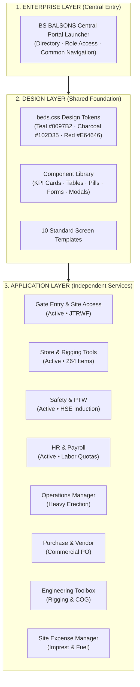

# BALSONS ENTERPRISE DESIGN SYSTEM (BEDS)
## Global Design Baseline & Implementation Plan — Locked Baseline V1.0

**Company:** BALSONS HEAVY LIFT & SHIFT  
**Document:** Global Design Baseline & Implementation Plan  
**Baseline Date:** 19 November 2026  
**Scope:** All existing and future BALSONS portals  
**Status:** **LOCKED BASELINE V1.0**

---

### Core Objective
The objective is not to rebuild every application into one monolithic system. It is to make every application look, behave, and feel like part of one professionally managed enterprise platform.

---

## 1. Locked Design Decisions

| Decision Area | Approved Baseline V1.0 | Implementation Rule |
| :--- | :--- | :--- |
| **Central Portal Launcher** | **Yes** (Single Digital Entry Point) | Core platform module hosting application directory and user access. |
| **Default Appearance** | **Premium Light Mode** | Mandatory default for all new users and sessions. |
| **Optional Appearance** | **Dark Mode** | High-contrast, follows identical brand tokens, persists per user. |
| **Implementation Scope** | **All Existing & Future Portals** | Applies across Gate Entry, Store, Safety, HR, Operations, Purchase, etc. |
| **Brand Identity** | **Common BALSONS Identity** | Standardized `BS` monogram, typography, and color harmony. |
| **Navigation Standard** | **Shared Global Navigation** | Sticky header, brand banner, tabbed horizontal routing, quick-switch launcher. |
| **Component Library** | **Central Reusable Library (`beds.css`)** | Shared tokens, KPI cards, data tables, status pills, and modals. |
| **Application Architecture** | **Independent Portal Backends** | Zero single point of failure; portals run independently if launcher is down. |
| **Responsive Support** | **Desktop, Tablet, and Mobile** | Fully fluid layouts, touch-friendly tap targets, horizontal scrolling tables. |
| **Language Foundation** | **English-Ready & Multilingual Capable** | UTF-8, clean resource string architecture for Hindi/Odia localization. |
| **User Experience** | **Role-Based & Permission-Aware** | Dynamic visibility of portals and controls based on authenticated roles. |

> **Governance Rule:** No individual portal may independently introduce a conflicting colour system, navigation pattern, typography system, or component style without formal approval under the global design standard.

---

## 2. Global Architecture & 3-Tier Layering

### Architectural Separation
1. **Enterprise Layer:** Central launcher, application directory, shared visual identity, and common navigation.
2. **Design Layer:** Shared CSS tokens (`beds.css`), reusable UI components, standard templates, and interaction rules.
3. **Application Layer:** Individual portal logic, Google Apps Script APIs, Google Sheets databases, authentication, and business workflows.

> **Fail-Safe Independence:** The central launcher is **not** a single point of failure. Individual applications operate independently when the launcher is unavailable, subject to their own authentication and connectivity requirements.

---

## 3. Global Brand Identity

### 3.1 Colour System

#### Primary Brand Colours
* **BALSONS Teal (`#0097B2`):** Primary actions, active navigation states, interactive links, focus rings.
* **Industrial Charcoal (`#102D35`):** Navigation bars, primary headings, top-level text.
* **Alert Red (`#E64646`):** Critical alerts, destructive actions, emergency muster, `BLOCKED` status.

#### Supporting Interface Colours (Light Mode Default)
* **Page Background (`#F3F6F8`):** Soft neutral foundation for fatigue-free reading.
* **Panels & Cards (`#FFFFFF`):** High-contrast white containers with subtle borders.
* **Secondary Text (`#52636B`):** Clear contrast for labels, descriptions, and metadata.

#### Semantic Status Colours
| Status | Token Colour | Hex Code | Meaning |
| :--- | :--- | :--- | :--- |
| **Success / Approved** | Green | `#10B981` (Surface: `#ECFDF5`) | Successfully completed / Cleared |
| **Warning / Pending** | Amber | `#F59E0B` (Surface: `#FFFBEB`) | Requires attention / Conditional |
| **Critical / Rejected** | Red | `#E64646` (Surface: `#FEF2F2`) | Serious issue / Blocked |
| **Information** | Blue / Teal | `#0097B2` (Surface: `#EFF6FF`) | Informational state |
| **Neutral** | Grey | `#64748B` (Surface: `#F8FAFC`) | Inactive / Draft / Archived |

### 3.2 Typography & Visual Language
* **Primary Font:** `Inter`, with `-apple-system, BlinkMacSystemFont, Segoe UI, Roboto, sans-serif` system fallbacks.
* **Headings:** Compact, medium-to-bold weights (`700`/`800`), tight tracking (`-0.02em`).
* **Body:** Highly readable, consistent `1.5` line spacing, `13px`–`14px` base font size.
* **Numbers:** **Tabular figures** (`font-variant-numeric: tabular-nums`) strictly enforced across all operational metrics, timestamps, serial numbers, and financial figures.
* **Icons:** Consistent Lucide-style line iconography.
* **Panels & Cards:** Subtle restrained borders (`#E2E8F0`), soft box shadows (`0 1px 3px rgba(16, 45, 53, 0.05)`).
* **Corner Radius:** Standardized across the ecosystem (`4px` sm, `6px` md, `8px` lg, `9999px` full pill).
* **Visual Discipline:** Zero decorative visual clutter, heavy gradients, or gratuitous animations.

### 3.3 Theme Behaviour
* **Light Mode is the Default** for all initial sessions.
* **Dark Mode is Optional** and adheres to the identical brand color tokens in an inverted `#0B1317` / `#121C22` surface space.
* **Persistence:** Theme selection persists via `localStorage.getItem('beds_theme_preference')`.
* **Accessibility:** High WCAG AA contrast ratios and prominent focus rings (`#0097B2` outline) maintained across both themes.

---

## 4. Central BALSONS Portal Launcher

The Central Launcher serves as the enterprise entry point following user sign-in:

### Layout Concept
* **Header:** `BS` Monogram + `BALSONS HEAVY LIFT & SHIFT` + Enterprise Workspace Title + Theme Toggle + User Role Pill.
* **Greeting:** Dynamic time-based greeting (*"Good morning / afternoon / evening, BALSONS Team"*).
* **Workspace Toolbar:** Live keyword search + functional domain filter tabs (*Operations & Logistics, Safety & Access, Commercial & HR*).
* **Recently Accessed:** Horizontal card reel of recent applications.
* **Portal Directory:** Grid of registered enterprise applications with real-time availability badges (`AVAILABLE`, `MAINTENANCE`, `OFFLINE`).

### Registered Applications
1. **Gate Entry & Site Access Portal** (`BALSONS GATE ENTRY MANAGER/frontend/index.html`)
2. **Store & Inventory Manager** (`BALSONS STORE MANAGER/`)
3. **Safety & PTW Manager** (`BALSONS SAFETY MANAGER/`)
4. **HR & Payroll Manager** (`BALSONS HR MANAGER/`)
5. **Operations Manager** (`BALSONS OPERATIONS MANAGER/`)
6. **Purchase & Vendor Manager** (`BALSONS PURCHASE MANAGER/`)
7. **Engineering Toolbox** (Rigging calculations & COG)
8. **Site Expense Manager** (Site imprest & diesel logs)

> **Authentication Independence:** The launcher does **not** bypass individual application security controls. Every portal verifies identity and permissions independently through its own Google Apps Script session engine.

---

## 5. Global UI Component Library & Standard Templates

### 5.1 Component Groups
1. **Navigation:** Sticky Enterprise Header, Monogram, Section Navigation bar, Breadcrumb trail.
2. **Dashboard:** KPI Radar Grid, summary metric widgets, health status pills.
3. **Data:** BEDS Data Tables, column filters, search inputs, pagination, row hover states.
4. **Forms:** Clean text inputs, dropdown selects, date pickers, floating labels, validation borders.
5. **Actions:** Primary Teal buttons, Ghost Secondary buttons, Alert Red Danger buttons, Icon buttons.
6. **Workflow:** Tri-state clearance indicators (`CLEARED`, `CONDITIONAL`, `BLOCKED`), activity feeds.
7. **Feedback:** Inline status alerts (Red/Green/Amber), dismissible banners.
8. **Reporting:** Print-optimized layout (`@media print`), export controls (CSV/PDF), muster roll formats.
9. **Security:** Modal login overlay, session expiration warnings, role badges (`Owner`, `Safety Manager`, `Safety Team`).
10. **Mobile:** Responsive hamburger/overflow menus, horizontally scrollable data grids.

### 5.2 Ten Standard Screen Templates
Every portal must employ the standardized screen templates:
1. **Login & Authentication Screen**
2. **Portal Dashboard & Command Radar**
3. **Record Listing & Search View**
4. **Record Creation & Editing Form**
5. **Record Details & Inspection History**
6. **Approval & Tri-State Rejection View**
7. **Reports & Analytics Dashboard**
8. **Administration & Master Configuration**
9. **User Profile & Preference Management**
10. **Error, Loading, Empty, and Access-Denied Screens**

---

## 6. Implementation Deliverables in Workspace

1. **Shared Master Stylesheet:** [beds.css](file:///d:/BALSONS%20JUPITER%20PROJECT/OTHER/balsons%20portals/beds.css)
2. **Central Portal Launcher:** [index.html](file:///d:/BALSONS%20JUPITER%20PROJECT/OTHER/balsons%20portals/index.html) and [BALSONS ENTERPRISE LAUNCHER/index.html](file:///d:/BALSONS%20JUPITER%20PROJECT/OTHER/balsons%20portals/BALSONS%20ENTERPRISE%20LAUNCHER/index.html)
3. **Gate Entry Portal Implementation:** [BALSONS GATE ENTRY MANAGER/frontend/index.html](file:///d:/BALSONS%20JUPITER%20PROJECT/OTHER/balsons%20portals/BALSONS%20GATE%20ENTRY%20MANAGER/frontend/index.html)
4. **Shared Portal CSS Assets:** [frontend/assets/css/beds.css](file:///d:/BALSONS%20JUPITER%20PROJECT/OTHER/balsons%20portals/BALSONS%20GATE%20ENTRY%20MANAGER/frontend/assets/css/beds.css)
