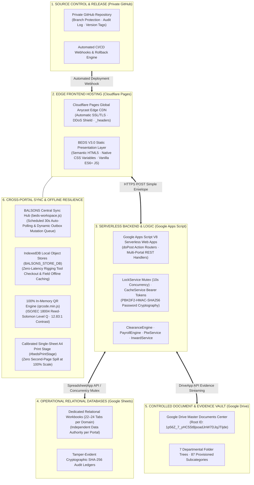

# BALSONS MULTI-PORTAL ENTERPRISE ECOSYSTEM
# SELECTED MASTER ARCHITECTURE & PLATFORM SPECIFICATION BASELINE
**Document Identifier:** `BAL-ARCH-SPEC-2026-LOCKED-V3.0`  
**Governing Standard:** BALSONS Standard Architecture Model (`SAM-2026`) & BFast Enterprise Design System (`BEDS V3.0`)  
**Enterprise Tenancy:** BALSONS Heavy Lift & Shift  
**Anchor Project:** Jupiter Tatravagonka Railwheel Factory (JTRWF), Khordha, Odisha  
**Approved Baseline Date:** 25 November 2026  
**Status:** **AUTHORITATIVE & LOCKED**

---

## 1. EXECUTIVE ARCHITECTURE STATEMENT & MANDATE

The **BALSONS Enterprise Portal Ecosystem** operates under the formally approved, multi-tier serverless master architecture tailored for zero-spill field operations, strict statutory non-repudiation, and sub-second industrial response times:

---

## 2. THE 5 CORE ARCHITECTURAL PILLARS

### 2.1 Pillar 1: Private GitHub Repository (Frontend Source & Release Control)
* **Operational Scope:** Mandatory source of truth for all frontend user interfaces, styling tokens, configuration scripts, and documentation.
* **Governance & Security:**
  - Strict branch protection on `main` branch.
  - Mandatory code review and automated regression testing before merge.
  - Zero secrets in repository: backend API execution endpoints and folder IDs configured via runtime environment constants.
  - Granular commit history providing statutory non-repudiation and instantaneous rollback capability.

### 2.2 Pillar 2: Cloudflare Pages (Edge Frontend Hosting & CDN)
* **Operational Scope:** High-availability static hosting connected directly to the private GitHub repository.
* **Engineering Advantages:**
  - Cloudflare Anycast edge network spanning 300+ global locations for sub-50ms TTFB across remote industrial workfronts.
  - Native automated SSL/TLS termination with zero maintenance overhead.
  - Immutable deployment previews and atomic zero-downtime production releases on every authorized Git commit.
  - Hardened HTTP security headers defined via `_headers` (`X-Frame-Options: SAMEORIGIN`, `X-Content-Type-Options: nosniff`, `Strict-Transport-Security`).

### 2.3 Pillar 3: Google Apps Script (Backend, APIs & Business Rules)
* **Operational Scope:** Serverless application runtime providing microservice APIs, state validation, access authorization, and enterprise integrations.
* **Key Components:**
  - **Runtime:** Google Apps Script V8 high-performance engine.
  - **API Contract:** Universal `doPost` action dispatcher receiving `application/json` payloads over simple HTTPS POST.
  - **Concurrency Serialization:** Google Apps Script `LockService.getScriptLock()` with 10-second mutex timeout preventing race conditions during concurrent turnstile swipes or inventory checkouts.
  - **Session Security:** In-memory `CacheService` ephemeral bearer tokens with strict 6-hour TTL and cryptographic PBKDF2-HMAC-SHA256 password hashing.
  - **Business Engines:** Autonomous engines including `ClearanceEngine.gs`, `PayrollEngine.gs`, `PtwService.gs`, and `AuditService.gs`.

### 2.4 Pillar 4: Google Sheets (Independent Operational Databases)
* **Operational Scope:** Multi-tab relational workbooks with strictly separated data authority per operational domain.
* **Relational Schema Allocation:**
  1. **Gate Entry Portal:** `1v_0Xo44...` (22 relational tabs: personnel, contractors, vehicles, material movements, blacklist).
  2. **HR & Payroll Portal:** `1so_aH05vVxiUJsIK6VS-n7BpGrHWNgn_5EK7RuA3cuw` (24 relational tabs: staff, daily crew, advances, dual-wage payroll, biometric logs).
  3. **Safety & Risk Portal:** `1SyOGt6HEu6HJCufAbB2_P6BgF6pEppt28J_8cARaOP0` (10 PTW registers, HIRA, TBT, mock drills, CAPA).
  4. **Store & Tackle Portal:** `1u_ZKvvCVfEQDAtkoMR68q2d2hEK-eWBnvsS3AGfP6yQ` (264 rigging items, Form 11 inspection logs, quarantine register).
  5. **Purchase & Commercial Portal:** Procurement master, PRs, RFQs, vendor comparative statements, formal PO ledger.
  6. **Operations & Rigging Portal:** `1GeqDDmBgdVm3ZUp4c9iB36__iLJ9wADQQRhEIwVxa-E` (Schuler 2500T press line erection, work packages, daily shifts).
  7. **Central Sync Hub:** Unified audit registry, cross-portal telemetry rollups, and synchronized workforce masters.
* **Compliance:** Cryptographic SHA-256 tamper-evident hash chaining on every statutory row mutation.

### 2.5 Pillar 5: Google Drive (Controlled Document & Evidence Vault)
* **Operational Scope:** Centralized statutory document, certificate, and evidence archive.
* **Master Vault Root ID:** `1p56Z_7_yHC5St8jsoadJnW7DJqJTIjde` ("BALSONS DOCUMENTS CENTER").
* **Folder Hierarchy:** 7 departmental subfolder trees across 87 provisioned functional subcategories:
  - `01_GATE_ENTRY_MANAGER` (13 folders: ID proofs, police verifications, driver licenses, vehicle fitness, RGP challans)
  - `02_HR_AND_PAYROLL_MANAGER` (16 folders: employee dossiers, signed payslips, bank mandates, statutory ESI/EPF)
  - `03_OPERATIONS_AND_RIGGING_MANAGER` (12 folders: heavy lift plans, crane load charts, Schuler erection drawings)
  - `04_PURCHASE_AND_COMMERCIAL_MANAGER` (11 folders: vendor quotations, purchase orders, technical compliance)
  - `05_SAFETY_AND_RISK_MANAGER` (14 folders: signed PTWs, HIRA sheets, TBT records, accident reports)
  - `06_STORE_AND_TACKLE_MANAGER` (12 folders: Form 11 TPI certificates, calibration test reports, delivery challans)
  - `07_EXECUTIVE_GOVERNANCE_AND_SYNC_HUB` (9 folders: UAT sign-off certificates, compliance audits, sync logs)

---

## 3. EDGE CAPABILITIES & FIELD RESILIENCE

### 3.1 BALSONS Central Sync Hub & Controlled Dual-Sync
* Embedded `beds-workspace.js` synchronization client running on all portals.
* Scheduled 30-second automated bi-directional polling ensuring real-time cross-portal data freshness.
* Outbox mutation queue (`beds_pending_mutations_queue` in localStorage) with automatic retry and collision detection.

### 3.2 High-Performance Offline Storage (IndexedDB)
* Dedicated `BALSONS_STORE_DB` client-side IndexedDB database.
* Enables zero-latency rigging tool checkout, inventory lookups, and draft form creation even during network dropouts at remote workfronts.

### 3.3 100% In-Memory QR Generation & Field Scanner Calibration
* Synchronous in-memory QR engine (`qrcode.min.js`) requiring zero network round-trips.
* Encoded with ISO/IEC 18004 Reed-Solomon Level Q error correction (25% damaged recovery).
* Strict 12.83:1 contrast ratio calibrated for instant optical decoding on industrial rugged terminals (Zebra TC52/TC57/DS3608, Honeywell EDA51/CT60).

### 3.4 Calibrated A4 Single-Sheet Print Stage (`#bedsPrintStage`)
* Zero second-page spill at exact 100% print scale on A4 portrait media (210mm × 297mm).
* Applicable across ID passes, delivery challans, PTWs, payslips, Form 11 certificates, and UAT sign-off sheets.

---

## 4. ARCHITECTURAL DECISION MATRIX

| Architectural Dimension | Approved Selection | Alternatives Considered | Deciding Factors |
| :--- | :--- | :--- | :--- |
| **Frontend Source** | **Private GitHub Repository** | Public GitHub / GitLab / Bitbucket | Mandatory enterprise confidentiality, branch controls, integrated audit history. |
| **Frontend Hosting** | **Cloudflare Pages** | GitHub Pages / AWS S3 / Netlify | Cloudflare Anycast edge speed, instant git-connected builds, custom domain routing, DDoS protection. |
| **Backend Engine** | **Google Apps Script (V8)** | Node.js Express / Python FastAPI / AWS Lambda | Zero server maintenance, zero cold starts, native Google Workspace domain security, zero hosting cost. |
| **Operational Database**| **Google Sheets (Relational)** | Supabase / PostgreSQL / MongoDB | Direct management auditability, familiar spreadsheet UI for authorized admins, native formula rollups. |
| **Evidence Vault** | **Google Drive Enterprise Vault** | AWS S3 / Local NAS / Azure Blob | Native Google Workspace permissions, secure file streaming, statutory compliance, centralized corporate backup. |
| **Cross-Portal Sync** | **BALSONS Central Sync Hub** | Kafka / RabbitMQ / Direct DB Links | Controlled decoupled event exchange without direct database coupling or single point of failure. |
| **Local Offline Cache** | **Browser IndexedDB** | WebSQL / LocalStorage Only | High-volume structured object storage for 264+ rigging items with zero main-thread UI blocking. |

---

## 5. STATUTORY COMPLIANCE & NON-REPUDIATION GUARANTEE

This architecture baseline is formally bound to **VERSION 3.0** under the executive authority of the BALSONS Enterprise Systems Directorate. Any future modifications to backend engines, storage locations, or deployment topologies must undergo formal Change Advisory Board (CAB) review and directorate approval.
